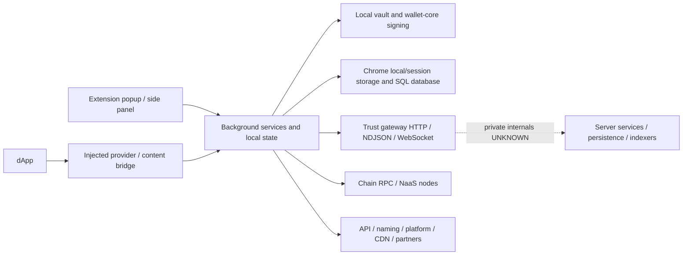

# Trust Wallet extension backend specification

Target: supplied extension **26.41.0**, inspected on **2026-10-21**. This document concerns the extension's background services, local database, and remote service contracts. It does not contain Trust Wallet's private server source.

## 1. What the evidence establishes

**The extension reveals enough to specify many client-facing backend contracts. It cannot reveal Trust Wallet's actual server framework, database vendor, deployment topology, private algorithms, or complete server-side validation rules. Those remain UNKNOWN.** A backend built from this document can target compatible observable interfaces; identical internal implementation and complete behavioral equivalence are not established.

Evidence labels throughout:

- **[certain, CODE-CONFIRMED]**: directly present in recovered target code, within the stated scope. Bundled code does not establish an enabled user feature.
- **[certain, OBSERVED-ONLY]**: recorded in a historical HAR. It establishes the recorded request/response, not its implementation, current availability, or independent attribution to this exact extension.
- **UNKNOWN**: unavailable or unresolved evidence. No original server implementation is inferred from a response format.
- **PROPOSED**: an implementation design for an equivalent backend, separate from recovered Trust Wallet facts.

The supplied `background.js` is 42,723,770 bytes, SHA-256 `a6dc88b6583df8488ba549ed7228a8a0d47db0488c0484078cef1f34b6b49d44`. The manifest declares MV3/version 26.41.0. Its public-key-derived extension ID is `egjidjbpglichdcondbcbdnbeeppgdph`. These files match the workspace's existing reference copies. **Official CRX signature/authenticity remains UNKNOWN.** Full identities are in [provenance.json](evidences/re-evidence/40-backend-api/2026-10-21/provenance.json).

### Reading order and deliverables

| Artifact | What it contains |
|---|---|
| This document | Backend boundaries, architecture, auth, database, end-to-end flows, implementation design and unresolved work |
| [API-CATALOG.md](evidences/re-evidence/40-backend-api/2026-10-21/API-CATALOG.md) | Every inventoried historical HTTP route, RPC method/host pair, and static path occurrence; source offsets and counts |
| [CLIENT-CONTRACTS.md](evidences/re-evidence/40-backend-api/2026-10-21/CLIENT-CONTRACTS.md) | All **73 recovered `ApiService` methods**, including exact parameter construction, defaults, paths and returns |
| [HAR-SCHEMAS.md](evidences/re-evidence/40-backend-api/2026-10-21/HAR-SCHEMAS.md) | Value-free request/response shapes, header names, status counts and capture ordinals for all **237** historical route groups |
| [har-contracts.json](evidences/re-evidence/40-backend-api/2026-10-21/har-contracts.json) | Machine-readable shape variants, observed lengths, MIME types, status counts, source files and every record reference |
| [local-schema-unique.sql](evidences/re-evidence/40-backend-api/2026-10-21/local-schema-unique.sql) | **56 distinct packaged DDL statements**, including alternative/migration definitions; not a server schema or a linear migration script |
| [local-schema-index.json](evidences/re-evidence/40-backend-api/2026-10-21/local-schema-index.json) | Every DDL statement mapped to its original file/hash/byte ranges |
| [chain-capabilities.json](evidences/re-evidence/40-backend-api/2026-10-21/chain-capabilities.json) | Allowlisted public capability response: 108 chain rows; 86 enabled, 49 database-lookup enabled and 49 WebSocket-supported in that capture |
| [Evidence README](evidences/re-evidence/40-backend-api/2026-10-21/README.md) | REA evidence IDs, tool identities, repeat commands, coverage, redactions, verification and limitations |

There are **802 static path-literal occurrences** across the combined passes, not 802 independent APIs. The scan parsed **238 JavaScript files** without parse errors. A separate pass found **2,264 syntactic network-call candidates**; collection `.get()` calls and unresolved receivers produce false positives. Six historical HAR files supplied **5,216 complete entries**, grouped into **237 host/method/normalized-path groups**, including unrelated browser resources. There are **86 RPC method/host pairs**. These sets are intentionally separate: neither a string nor a captured resource proves an active extension API. Dynamic paths, remote configuration, unexercised branches and minified Ktor calls prevent a defensible claim that every possible API has been identified.

## 2. Actual responsibility boundaries

**[certain, CODE-CONFIRMED]** The manifest points to `background.js` as the extension service worker, `popup.html` as the popup, `sidepanel.html` as the side panel, and `content-scripts/content.js` for page injection. The background contains wallet services, HTTP clients, the Trust SDK, and storage adapters. This is browser-side code even when it looks like a backend service class. [Source: provenance; `recovery/focus-extra-1/modules/bundle.js`, `WalletKitService` and `DeviceService`.]



The graph depicts observed client boundaries. The server box is deliberately opaque. Domain separation does not prove separate processes, microservices, databases or infrastructure providers.

| Responsibility | Established client behavior | Server detail available? |
|---|---|---|
| Custody | Local wallet/vault and Wallet Core dependency; prior crypto evidence retained under `evidences/re-evidence/04-06-vault-crypto`, `evidences/re-evidence/07-walletcore-usage` and `evidences/re-evidence/08-derivation` | No evidence supports server custody of seeds/private keys |
| Wallet registry | Registers public account addresses and numeric coin identifiers; associates additional addresses | Storage engine, ownership checks and registry internals UNKNOWN |
| Device auth | Fingerprint registration, device ID, per-device hash key, HMAC request headers | Issuance algorithm, server key protection/revocation/anti-abuse UNKNOWN |
| Asset discovery | Public addresses/coins/publicKey fields sent; incremental `from_time`; `docs` response | Indexer architecture and discovery algorithms UNKNOWN |
| Balances | NDJSON request plus local per-chain fallback | Server data sources/cache/finality policies UNKNOWN |
| Prices | Tickers, rates, charts, info, sentiment, listings | Data-provider provenance/aggregation logic UNKNOWN unless explicitly present in response |
| History | Individual and bulk transaction history with cursors | Indexing pipeline, reorg handling and storage UNKNOWN |
| Risk | Address, URL, transaction and message checks | Risk rules/model/data vendors not established by client contract alone |
| Swaps | Quote/session/route/history interfaces and chain execution orchestration | Routing engine, provider agreements, fee policies UNKNOWN |
| Realtime | Centrifuge-compatible JSON client protocol | Exact server implementation/version/infrastructure UNKNOWN |

## 3. Technology stack: proven versus unavailable

| Layer | Established from supplied artifact | Confidence and limitation |
|---|---|---|
| Extension runtime | JavaScript, Chrome MV3, service worker, popup/side-panel, extension storage | [certain, CODE-CONFIRMED], manifest and storage adapter |
| Client HTTP | Axios instance; fetch adapter; `crypto-browserify` HMAC call site | [certain, CODE-CONFIRMED], `focus-extra-1` transport initializers and `background-05` auth |
| Shared wallet SDK | Kotlin/JS-generated functions/coroutines, Trust SDK modules, serialization, Ktor-style HTTP client setup | [certain] for bundled constructs; exact compiler/Ktor versions UNKNOWN in this pass |
| Cryptographic dependency | Shipped `wallet-core.wasm`; earlier workspace evidence binds it byte-for-byte to `@trustwallet/wallet-core@4.8.2` | Current hash rechecked in provenance; original dependency investigation remains in `evidences/re-evidence/07-walletcore-usage` and `evidences/audit/verification-summary.json` |
| Local SQL | sql.js-style WASM loader, `JsSqlDriver`, generated query/schema adapters, SQLite SQL | [certain, CODE-CONFIRMED], `background-04` and `database-0`; precise sql.js/SQLite/generated-query-library versions UNKNOWN |
| Local persistence | `chrome.storage.local` for compressed exported SQL bytes; extension storage adapter for other state | [certain, CODE-CONFIRMED], detailed below; not a remote DB |
| Realtime protocol | WebSocket, `centrifuge-json`, newline-delimited JSON commands | [certain, CODE-CONFIRMED], `transport-0`; protocol compatibility does not prove the server binary is Centrifugo |
| Chain interfaces | JSON-RPC, Blockbook-style HTTP, Cosmos LCD, Tron HTTP, Cardano GraphQL and other SDK clients | Code candidates + historical observations; see API catalogue for exact scope |
| Server language/framework | **UNKNOWN** | Kotlin/JS on the client does not establish Kotlin/JVM, Go, Node, NestJS, Python or any other server stack |
| Server DB/cache/queue | **UNKNOWN** | No proof of PostgreSQL, MySQL, MongoDB, Redis, Kafka or any other server product |
| Hosting/deployment | **UNKNOWN** | No recovered container manifests, server package manifests, DB migrations or private server source |

**[certain, OBSERVED-ONLY]** Allowlisted response headers in the E2E HAR report `server: istio-envoy` on several twnodes hosts, `server: cloudflare` on CDN/platform/wallet-kit hosts, and CloudFront cache hints on some resources. Cardano GraphQL, Kusama and Polkadot node responses include `x-powered-by: Express`. These are bounded infrastructure/framework **hints** for those responses; headers can be rewritten and do not establish the main gateway's application stack, a Kubernetes deployment, origin hosting, or any database. Exact hosts and record ordinals are in [server-header-hints.json](evidences/re-evidence/40-backend-api/2026-10-21/server-header-hints.json).

## 4. Hosts and external boundaries

**[certain, CODE-CONFIRMED]** The recovered `init_api_constants` defines:

| Host | Established role / scope |
|---|---|
| `https://gateway.us.trustwallet.com` | Main extension gateway; device/wallet registry, assets/balances, market, risk, history, NFT, discovery, swap sessions |
| `https://api.trustwallet.com` | Separate API base, including wizard simulation/visualization and legacy device metrics |
| `https://assets-cdn.trustwallet.com` | Token/chain/validator images and token-list resources |
| `https://naming.trustwallet.com` | `/v1/lookup?name=...&coin=...` domain resolution |

**[certain, CODE-CONFIRMED / OBSERVED-ONLY as distinguished in catalogue]** SDK/capture boundaries also include `gateway.trustwallet.com/v2/projects/{projectId}/nodes`, `platform.trustwallet.com/v1/defi/*`, `wallet-kit.trustwallet.com`, per-chain `*.twnodes.com`, `api.bnbchain.org`, `query.thegraph.kiln.fi`, and a public Sepolia RPC host. Do not treat Google/font/Sentry/browser resources in the HAR as wallet backend endpoints.

**[certain, CODE-CONFIRMED]** The SDK bundles staging/environment strings including `amber-api-stg.twinternal.net`, `earn.twstg.net` and a `perps.trustwallet.com` base. `WalletKitService` selects staging only for the staging swap-setting branch, otherwise production. A bundled hostname is not proof it is contacted or enabled for this user's flow. [Source: `background-00` CommonModule assignments; `focus-extra-1` WalletKit boot.]

No captured host was contacted in this investigation. Captured tokens, device IDs and NaaS path credentials were not reused.

## 5. Transport and device authentication

### 5.1 Shared HTTP behavior

**[certain, CODE-CONFIRMED]** `init_fetch` creates Axios with `timeout: 5000`, `adapter: "fetch"`, `fetchOptions: {redirect: "error"}`. It registers X-Origin, traceparent and authentication request interceptors, and the unauthenticated response interceptor. Balances override the timeout to **15,000 ms**, request text and send `Accept: application/x-ndjson`. These are client deadlines, not server timeout settings. [Source: `focus-extra-1` init_fetch; `background-05` ApiService.streamBalances.]

**[certain, CODE-CONFIRMED]** X-Origin is `Trust/26.41.0 Extension`. Its host guard permits exact `trustwallet.com` / `twnodes.com` and genuine subdomains. Invalid URLs and suffix lookalikes fail. The traceparent initializer emits `00-<trace-id>-<parent-id>-01` by default. Exact entropy generation of those IDs was not recovered in this pass. The HMAC guard is narrower: exact origin equality with the gateway base. [Source: `focus-extra-1` getHeaderVersionValue, isFirstPartyRpcHost, auth and traceparent initializers.]

### 5.2 Device bootstrap sequence

**[certain, CODE-CONFIRMED]** `DeviceService` and `ApiService` establish this sequence:

1. Read existing device ID/hash key. If a device ID exists without a hash key, mark it as legacy and register under the new auth flow.
2. Obtain or create `authIdentifier`. Creation uses `crypto.randomUUID()` plus `-` plus the first four hex characters of SHA-256 of that UUID.
3. `POST /v2/devices/fingerprint` with `{identifier, bundle: BUNDLE_ID, sr: SCREEN_RESOLUTION}`. The supplied constants include bundle ID matching the extension ID and screen resolution `1920x1080`; this is a packaged value, not a claim that it reflects every actual display.
4. Consume response `hash_key` and `device_id`; store the key in app state and propagate device/auth changes to SDK `SwapService` setters.
5. Update `/v2/devices/{deviceId}` with extension type, push setting, version, wallets_version `0`, empty model name, language default `en`, selected currency, and optional legacy_device_id.
6. Device polling starts at boot, uses **60,000 ms** and stops when an ID is available. The legacy-device update branch separately uses Retry with maxAttempts `5`, wait `1000`, incrementalWait `true`.

Sources: `focus-extra-1` DeviceService; `background-05` getFingerprint/updateDevice. The fingerprint request/response shape is independently recorded in the HAR catalogue. Server issuance, proof of device authenticity, account authorization and abuse prevention remain UNKNOWN. A client-supplied UUID is not proof of ownership of an on-chain address.

### 5.3 Exact gateway HMAC construction

**[certain, CODE-CONFIRMED]** If deviceId/hashKey is absent, or URL origin is not the exact gateway origin, this interceptor leaves the request unsigned. Otherwise:

```text
query = URL.search without the leading '?' when present;
        otherwise config.params excluding undefined, rendered as key=value pairs
canonicalQuery = URLSearchParams(query), keys sorted with localeCompare,
                 duplicate values retained in their original per-key order,
                 keys and values rendered with encodeURIComponent
date = new Date().toUTCString()
nonce = crypto.randomUUID()
canonical = [METHOD.toUpperCase(), URL.pathname, canonicalQuery,
             deviceId, nonce, date].join(';')
signature = Base64(HMAC-SHA256(hashKey, canonical))
X-TW-DATE = date
X-TW-NONCE = nonce
X-TW-CREDENTIAL = deviceId
Authorization = "HMAC-SHA256 Signature=" + signature
```

This pseudocode reconstructs `background-05` sortQueryParams/authenticationInterceptor; original function ranges are in [auth-fixtures.json](evidences/re-evidence/40-backend-api/2026-10-21/auth-fixtures.json). The **request body is absent from this client's signature string**. This says nothing about additional server-side validation. URL query takes precedence over `config.params`; do not silently replace this behavior with a different signing convention. String encoding of server-issued hash_key is passed through the crypto dependency; its issuance/entropy/storage on the server is UNKNOWN.

**Controlled verification:** six checks execute the four exact target functions with synthetic device data, an all-zero public fixture key, fixed time/nonce and Node's HMAC primitive. They cover duplicate-query ordering, canonical string/signature, body exclusion, host rejection, missing credentials and first-party suffix checks. This is a controlled function fixture, **not** full-extension runtime, crypto-browserify equivalence proof, or successful authentication to a real server.

### 5.4 Authentication recovery and error semantics

**[certain, CODE-CONFIRMED]** A gateway **403** can refresh the hash key and retry the original request once. The fingerprint path is excluded. A `retriedAfterAuth` marker prevents a second retry; shared `hashKeyRefresh` coalesces concurrent refreshes and clears in finally. Refresh stores response `hash_key`; failure returns false and the original request rejects. [Source: `background-05` unauthenticatedInterceptor; `focus-extra-1` refreshHashKey.]

**[certain, CODE-CONFIRMED]** Many `ApiService` methods have `SafeMethod()` decorators. With default `propagate=false`, caught errors can produce **undefined**, after logging/suppression/reporting. A bare method body alone is therefore insufficient to reproduce caller-visible failure behavior. The exact decoration list remains in recovered `background-05`; the wrapper is in `transport-0`. Methods such as domain lookup additionally catch and return null; wizard simulation treats ResultError.error_code `"1"` as FailedSilentSimulation and other error messages as thrown Error.

Server time-skew tolerance, nonce retention, body validation, status selection, error catalog, rate limits and idempotency rules are UNKNOWN. The client retry branch is not evidence that a server-side mutation is safe to repeat.

## 6. Local database and storage — exact distinction from server DB

### 6.1 SQL initialization and persistence

**[certain, CODE-CONFIRMED]** The packaged SQL path initializes sql.js-style code, builds a database from stored bytes or an empty Uint8Array, wraps it with `JsSqlDriver` and `SaveableSqlDriver`, and uses generated query/schema adapters. `RealDatabaseManager` provides/caches its database and has schema migration/error paths. [Source: `background-04` provideDbDriver/provideDb/initChromeDb coroutines and JsSqlDriver methods; `database-0` helpers.]

**[certain, CODE-CONFIRMED]** The browser SQL persistence key is **`TrustSDK_DB` in `chrome.storage.local`**:

```text
write: database.export() -> deflate(bytes) -> Base64 -> chrome.storage.local.set
read:  chrome.storage.local.get -> Base64 decode -> inflate -> new Database(bytes)
```

The compression options object is referenced by reconstructed symbols; all compression parameters and the helper library's exact version are not established here. The shown storage path adds compression/base64, not encryption. This does not establish the sensitivity of every stored field or the protection of the separate wallet vault. Actual SQL writes/persistence were not exercised in Chrome during this pass. [Source: `database-0` setStorageKey/getStorageKey, `background-04` onSave/initChromeDb.]

**[certain, CODE-CONFIRMED]** The separate StorageService defaults to extension `storage.local`, JSON-serializes non-string values, parses on get, retains legacy key `store`, and constructs `trust:wallets:<vaultId>` keystore-list keys. Existing vault/session evidence remains separate; do not move private wallet material into a new backend database. [Source: `transport-0` StorageService; prior vault evidence.]

### 6.2 Packaged SQL tables

The DDL extraction contains 174 occurrences across duplicated bundles, **56 distinct DDL statements** and **40 distinct CREATE TABLE identifiers**, including seven `_new` migration table names. Multiple definitions of a name reflect migrations/versions; executing the concatenated statements is not a valid migration plan. **[certain, CODE-CONFIRMED for packaged schema definitions]**:

| Area | Packaged table names / data roles |
|---|---|
| Asset identity | AssetInfo: assetID/type/name/symbol/decimals/iconUrl/updatedAt |
| Asset capability | AssetStatus: buy/sell/swap/cross-chain/stake flags, default pairs, scaled UI metadata; AssetLocalStatus: walletID/assetID/manual/enabled flags |
| Asset messaging | AssetMessage, AssetLocalMessage |
| Pricing | AssetTicker, MarketInfo, MarketInfoLink, AssetHighlights |
| Address balances | AssetAccount: asset/address/wallet association and available/frozen/locked/rewards/staked/pending and other balance fields; full definition in SQL |
| Security | AssetSecurityInfo, AssetSecurityInfoItem |
| Fees | FeePriority |
| Home/earn cache | HomepageCache, EarnPortfolio |
| Launchpool | LaunchpoolCampaign, LaunchpoolReward, LaunchpoolRewardItem, LaunchpoolRewardProof |
| Stablecoin UX | StablecoinBalanceChange, StablecoinPopupStatus |
| Swap | SwapSelectedPair |
| Token locking | TokenLockerPosition |
| Allowances | Approval: primary key `(walletId,address,spenderAddress,assetId)`, chain/spender/risk/allowance and pending transaction fields |
| Price alerts | PriceAlert, PriceAlertAssets, PriceAlertSettings; sync status, attempts, last failure and next retry fields in PriceAlertAssets |
| Bundled perpetuals | PerpetualAssetIcon, PerpetualBracketRisk, PerpetualExchangeSymbol, PerpetualFavoriteSymbol, PerpetualOrderedSymbol, PerpetualUserLeverage |

Exact types, keys, foreign keys, defaults and alternative/migration definitions are in [the SQL evidence](evidences/re-evidence/40-backend-api/2026-10-21/local-schema-unique.sql). Presence of a table does not prove its corresponding feature is enabled. **None of these tables establish Trust Wallet's server schema.**

## 7. API families and client decisions

All methods and complete request construction are retained in [CLIENT-CONTRACTS.md](evidences/re-evidence/40-backend-api/2026-10-21/CLIENT-CONTRACTS.md), avoiding a lossy paraphrase. The catalogue separately lists SDK path candidates and historical traffic. **[certain, CODE-CONFIRMED]** representative interfaces:

| Family | Method and path | Request contract / important choice |
|---|---|---|
| Device | POST `/v2/devices/fingerprint` | identifier, bundle, sr; response device_id/hash_key |
| Device | GET / PUT `/v2/devices/{id}` | Metadata and settings; optional legacy migration |
| Wallet registry | POST `/v3/devices/{device}/wallets/{wallet}/register` | optional parent_wallet_id, operation_type, accounts `[{addresses:[address],coin:parseInt(coinKey,10)}]` |
| Address association | POST same wallet prefix + `/address_association` | optional parent_wallet_id, coin, address |
| Wallet meta | GET same wallet prefix + `/meta` | Response shape remains capture-limited; errors also observed |
| Discovery | POST `/v1/assets` | assets, from_time, version **30**; two client methods share requestAssets |
| Metadata | GET `/v1/assets`, `/v1/assets/{assetId}`, `/v1/assets/symbols*` | Comma-separated ID/symbol lists or a single identifier |
| Search | GET `/v1/search/assets` | networks, exactQuery, sortBy=market_cap, type, include_pricing_info=true, version=30, limit, offset; optional fromAsset |
| Listings | GET `/v1/assets/listings` | version **27**, category_id, currency, limit default 100, optional networks/sort_field/sort_direction |
| Config | GET `/v1/assets/listing-categories`, `/tabs-config`, `/trending-config` | Server-controlled category/tab/network presentation |
| Balance | POST `/v1/balances/stream` | currency, addresses `[{asset_id,address}]`; NDJSON response text |
| Balance config | GET `/v1/balances/chains` | Per-chain enabled/db_lookup_enabled/ws_supported flags |
| Market | POST `/v2/market/tickers`; GET `/v2/market/rates` | currency, assets, optional include_market_info; rates query currency |
| Market detail | GET `/v2/market/charts/{asset}`, `/info/{asset}` | currency; charts also period |
| Sentiment | GET `/v2/market/sentiment-assets`, `/sentiment/{asset}` | Supported assets and asset-specific data |
| Individual history | GET `/v1/txhub/txs` | asset, chain, address, from, to, limit, next_token |
| Bulk history | POST `/v1/txhub/bulk_history` | addresses, from, to, next_token |
| Address risk | POST `/v1/validate/address` | asset_id, address, version **7**, type default security_scanner |
| URL risk | POST `/v1/validate/url` | dapp_url |
| Transaction/message risk | POST `/v1/validate/transaction`, `/message` | Caller-supplied object; client marks unsupported-chain errors; complete payload constraints UNKNOWN |
| Allowance scan | POST `/v1/approvals/scan` | Caller object; capture shows addresses `[{chain,address}]`, currency |
| Simulation | POST API-host `/v1/wizard/simulate` or `/visualize` | Caller object; Result.ResultSuccess / Result.ResultError response handling |
| NFT collection | POST `/v3/nft/collections` | owners `[{chain,address}]`; page/pageSize/exclude_spam=true in query |
| NFT tokens | GET `/v3/nft/chains/{chain}/collections/{collection}/tokens` | address, page, pageSize, exclude_spam=true |
| NFT metadata | GET `/v3/nft/chains/{chain}/contracts/{contract}/tokens/{token}` | Metadata response not fully established by empty collection fixtures |
| Naming | GET naming-host `/v1/lookup` | name, coin; returns address/memo or null |
| Announcements | GET `/v2/announcements`; POST `/v2/announcements/seen` | strategy=prioritize_app_update, version, platform=extension, device_id; seen IDs in body |
| Push | PUT `/v2/devices/{id}` and `/push-topics` | push_enabled, conditional push_token; topics object |
| Realtime token | POST `/v1/centrifugo-hooks/token` | Empty object; response token |
| Swap streaming | POST `/amber-api/v2/session`, `/session/status`, `/session/close`, `/route/step` | Caller-supplied objects; detailed serializers/full responses still incomplete |
| Swap status | GET `/amber-api/v1/history/status` | stepId processed through bareStepId |
| Discovery UI | GET `/v1/discover/new`, `/search`, `/group/invest-staking` | wallet prefix `m_`, device/currency/content/source; search query; staking group currency USD in client |
| Homepage | GET `/v1/homepage` | wallet_id=m_..., user_type=new, coins comma-list, currency, version=0 |
| Buy/sell | `/v1/buycrypto/*`, `/v2/buycrypto/assets`, `/v3/buycrypto/*`, `/v1/sellcrypto/*` | Quote/request/config/routes; address/currency/amount/twt_amount, ts/sig where specified; exact forms in client catalogue |
| CEX transfer | GET `/v1/cex-transfer/providers/{provider}/assets`, provider link, transaction status | assetID, walletAddress, ts, sig, platform, redirectUrl; custom parameter encoder preserves pre-encoded value |
| P2P/recurring | GET `/v1/buycrypto/p2p/{config,quotes,checkout}`; POST `/v1/buycrypto/route/recurring/checkout` | Recurring body includes fiat_currency/fiat_amount/frequency and conditional charge_month_day/charge_week_day |
| VIP | GET `/v3/points/{address}/vip` | Response is public-address-associated VIP data; rules/point calculations UNKNOWN |

**[certain, CODE-CONFIRMED]** Search defaults: assets limit 20, max limit 500, max page 100; offset is bounded page multiplied by bounded limit. NFT default/max pageSize is 100, page bounded to 100. These are client choices; they do not prove server maxima or requiredness.

**[certain, CODE-CONFIRMED]** Separate Kotlin `TrustSwapClient` builders include `/v2.1/swap` with from_address/from_asset/to_asset/from_amount/to_amount/slippage/recipient_address/contract_call, and `/v2.1/swap/quote` with from_address/from_asset/to_asset/amount/amount_for/recipient_address/slippage/contract_call. Their exact builders are in recovered `focus-extra-1`, with original ranges in focus-extra-ranges.json. This pass has not established all corresponding HTTP verbs, serializer types, defaults or successful quote responses; do not infer verbs from builder names. The **decimal version `v2.1` is intentional**.

Other bundled SDK paths include gas/fee/APR services, Amber providers/routes/history/submit, Tronify, staking, stablecoin/vault services, perpetuals and prediction APIs. They are included in the static catalogue as **packaged candidates**. They are not silently promoted to active extension capabilities or completed lifecycle research.

## 8. End-to-end flows and response contracts

### 8.1 Wallet creation/import → backend registration

**[certain, CODE-CONFIRMED within recovered registration boundary]** Local account creation/import produces address data. ApiService.registerWallet serializes accounts per coin and registers the wallet under a device; registerCoin associates additional public addresses. The HTTP layer signs the gateway request and a decorated method may suppress errors. HAR records show successful register replies with accounts/coins and also error-shaped replies. Captures do not establish all caller timing, retries or server authorization. Source: CLIENT-CONTRACTS registerWallet/registerCoin; HAR-SCHEMAS corresponding route sections. **UNKNOWN:** complete registration state machine through every import/hardware/private-key path and wallet ownership proof. Existing chronological onboarding gate remains open.

### 8.2 Home balances and asset discovery

**[certain, CODE-CONFIRMED]** BalanceService resolves active wallet/account assets → BalanceStreamService builds `{asset_id,address}` entries → ApiService.streamBalances → shared auth/HTTP → gateway NDJSON → split text on newlines → parse valid balance events → map integer-unit amount strings using asset decimals → batch state updates. Missing assets or failed stream responses fall back to chain clients. A successful stream response with only some assets triggers fallback for the missing assets. Negative/non-numeric values map to `"0"` in the recovered mapper; non-balance events/malformed lines are skipped. Source: `focus-extra-1` BalanceStreamService; `focus-1` BalanceService.

**[certain, OBSERVED-ONLY]** Response line shapes include:

```text
{type: string, payload: {
  asset_id: string, address: string, currency: string, slug?: string,
  amounts: {total: string, total_in_fiat: string,
            available: string, available_in_fiat: string},
  block_timestamp?: string
}}
```

Other recorded line shapes contain asset_id/address/reason. Code expects optional `amounts.breakdown` keys including available/staked/rewards/pending/frozen/locked/blocked/reserved/claimable/transferable/inscription/dust, plus resource counts. Optional markers describe observed variants or code branches, not a complete server schema. Full variants are in har-contracts.json.

**[certain, CODE-CONFIRMED]** Discovery posts assets/from_time/version. BalanceFeedService uses a per-wallet/account cursor, calls the asset change feed, accepts response-driven interval_ms and emits targeted balance refreshes. Default interval 3000 ms, bounds 1000..60000 ms; failure backoff starts 10000 ms, doubles and caps at 60000 ms. It discards superseded scope/session results and reports repeated 429s after four consecutive rate limits. Source: `focus-extra-1` BalanceFeedService.

**[certain, OBSERVED-ONLY]** Captured discovery response was `{docs: [], meta:{interval_ms:number}}`. An empty docs array does **not** establish the schema of populated docs. Captured `/v1/balances/chains` contains 108 rows/86 enabled; those flags are configuration observations, not a future supported-chain guarantee.

### 8.3 Market data

**[certain, CODE-CONFIRMED]** TickerService posts currency/assets and optionally include_market_info; response data.tickers is mapped into pricing/market figures. Rates are requested by currency; some fallback paths retain a last known USD rate or return 1. These are client fallbacks, not server exchange-rate guarantees. Source: `focus-extra-1` TickerService.

**[certain, OBSERVED-ONLY]** Ticker reply: `{currency:string,tickers:[{id:string,price:number,change_24h:number,provider:string,slug:string,last_updated_time:string,...}]}`; optional market_info variants are in HAR-SCHEMAS. Balance amounts use strings while ticker prices in these captures use numbers. Preserve these per-endpoint distinctions.

### 8.4 History, risk and NFT

**[certain, CODE-CONFIRMED / OBSERVED-ONLY separately]** Individual history uses query filters/cursor; bulk history uses address groups and time range, with a captured `{data,meta}` shape. Some individual-history records contain only `{error:{...}}`; successful transaction-item schema is not established by those records. Risk requests have the shapes in §7 and replies include provider/risk_analysis/flagged_address; the code does not reveal the scoring algorithm. NFT owners are grouped by chain/address, with spam filtering and pagination; captured collection docs were empty, so populated collection/token structures require more evidence. Sources: CLIENT-CONTRACTS and corresponding HAR-SCHEMAS entries.

### 8.5 Realtime WebSocket protocol

**[certain, CODE-CONFIRMED]** RealtimeStreamService fetches token from POST `/v1/centrifugo-hooks/token`, opens `wss://gateway.us.trustwallet.com/stream/ws` with subprotocol array `["centrifuge-json", token]`, then sends a connect command containing the token. Commands have numeric IDs and connect/refresh/subscribe/unsubscribe bodies; multiple JSON messages are joined by newline. Empty incoming `{}` triggers an empty-object reply. Source: recovered `transport-0` RealtimeStreamService.

```text
client -> {id: <number>, connect: {token: <own-issued-token>}}
client -> {id: <number>, subscribe: {channel: <channel>}}
client -> {id: <number>, unsubscribe: {channel: <channel>}}
client -> {id: <number>, refresh: {token: <own-issued-token>}}
server -> {id: <number>, connect|subscribe|unsubscribe|refresh: <result>}
server -> {id: <number>, error: {code: <number>, message: <string>}}
server -> {push: {channel: <channel>, pub: <publication>}}
```

These are reconstructed forms from code, not copied live token frames. Inspect the recovered command/send/handlePush implementations before implementing a wire adapter. Channel-name construction, entitlement rules, complete publication schemas and server signing keys are UNKNOWN in this pass.

**[certain, CODE-CONFIRMED]** The client reference-counts leases, synchronizes subscriptions, treats 102/103/106 as rejected channels and 105 as already subscribed, retries subscriptions after 5 s, and schedules refresh at max(ttl*1000−30000, floor(ttl*1000/2)). Reconnect base/cap are 1 s/60 s with jitter; failure threshold 5; delayed retry 300 s; stable-connection threshold 30 s. The corresponding source retains detailed cleanup/reset branches. A GET upgrade entry in a HAR does not prove publication delivery or expose every frame.

### 8.6 RPC discovery and transaction boundary

**[certain, OBSERVED-ONLY]** The capture contains project-node discovery and per-chain URLs of the form `https://<chain>.twnodes.com/naas/session/{sessionToken}/...`. EVM/Solana JSON-RPC, UTXO Blockbook routes, Cosmos LCD, Tron wallet routes and Cardano GraphQL are separately inventoried. The catalogue includes recorded method names and parameter/result shapes; it never reuses a session URL.

**[certain, CODE-CONFIRMED]** WalletKitService initializes SDK auth/context/modules and WalletCoreKotlin, enables the BitcoinV2 service path, obtains configured nodes and can apply custom/override nodes. `getNode` first handles custom-chain URLs, then an enabled RPC override; otherwise it maps the coin to DefinedChain, calls BlockchainService.getNodes and selects the first node whose weight.name is `"High"`. A custom EVM RPC binding invokes host and chain-ID guards in the supplied code. Gateway HMAC auth and NaaS session credentials are distinct mechanisms. Selected NaaS initializers show recoverable statuses `{401,502,503,504}`, a 30 s refresh cooldown and a 15 s RPC timeout; the full refresh/retry functions were not recovered here, so do not infer replay behavior from these constants alone.

**[certain, OBSERVED-ONLY]** Historical traffic includes `eth_estimateGas`, `eth_sendRawTransaction` and receipt polling on a public Sepolia RPC host. This does not finish the unresolved per-chain transaction implementation gate. A compatible backend must distinguish public data lookup, transaction simulation, relay/broadcast of already-signed bytes and local signing. No backend API discovered here requires exporting the user's seed/password/private key. Server validation, dispatch idempotency, transaction indexing and reorg policies remain UNKNOWN.

## 9. A backend structure you can build from these contracts

**Everything in this section is PROPOSED, not a claim about Trust Wallet's private internals.** This design supplies the responsibilities required by the observed client surface. Language, framework, DB engine and deployment granularity are implementer choices; they cannot be recovered from this extension.

```text
backend/
  apps/gateway/                  HTTP routing, HMAC middleware, serialization, CORS
  apps/realtime/                 WebSocket protocol, tokens, channels, publication fanout
  apps/workers/                  chain indexing, refresh, reconciliation, catalog ingestion
  modules/devices/               registration, credentials, metadata, revocation
  modules/wallet-registry/       public wallets, parent relationships, account associations
  modules/assets/                asset IDs, metadata, capability flags, discovery cursor
  modules/balances/              per-chain balance providers, NDJSON events, capability config
  modules/market/                ticker/rate/chart/info/listing providers
  modules/history/               normalized transaction history, cursors, pending reconciliation
  modules/security/              URL/address/tx/message risk adapters and unsupported-chain rules
  modules/approvals/             allowance scan and pending-revocation reconciliation
  modules/nfts/                  owner/collection/token metadata, spam flags, pagination
  modules/swaps/                 provider contracts, routes/quotes/sessions/steps/settlement
  modules/earn/                  staking, validators, vault/portfolio adapters
  modules/ramps/                 fiat/CEX provider routes, checkout and transfer status
  modules/discovery/             dApps, announcements, homepage and categories
  modules/naming/                chain-aware name resolution
  modules/push/                  topic preferences and transport adapter
  modules/vip/                   independently defined points/tier rules
  chain-adapters/                RPC/LCD/Blockbook/GraphQL dispatch and normalization
  persistence/                   chosen DB models, migrations, indices, repositories
  cache/                         freshness, request coalescing and bounded caches
  contracts/                     versioned DTOs, captured shape tests, error variants
  observability/                 tracing, redaction, provider health and reconciliation
```

### 9.1 Proposed persistence model

This is a **logical server model**, not recovered DDL. Keep it separate from the extension's exact local SQL schema.

| Entity | Suggested fields / key | Purpose |
|---|---|---|
| Device | internal ID, public credential ID, identifier reference, encrypted credential secret, version/language/currency/push metadata, revoked_at | Own device registration/auth lifecycle |
| Request nonce | credential ID + nonce, accepted_at, expiry | Replay protection with an independently specified policy |
| Wallet registry | device ID + public wallet ID, optional parent ID, operation type | Match registry paths and parent relationships |
| Wallet account | wallet ID, coin type, public address, optional public key/chain metadata | Match register/address_association inputs |
| Asset | asset ID, chain/coin namespace, token reference, decimals/name/symbol/icon, flags | Metadata and search; no floating-point token amount storage |
| Balance snapshot | chain + asset + address + block reference, integer-unit decimal amount strings, breakdown, observed_at | Stream and cache with explicit freshness/finality |
| Discovery cursor | device/wallet scope, address set/version, cursor/time, discovered IDs | Incremental discovery; semantics must be defined/tested |
| Market snapshot | asset + quote currency + timestamp, price/change/provider/market fields | Tickers/charts/rates with source/freshness metadata |
| Indexed transaction | chain + hash + event index, involved public addresses/assets, block/finality/status | Stable history and reorg reconciliation |
| Approval | chain + owner + spender + asset, allowance, risk, scan block, pending revoke hash | Scan/refresh without private signing keys |
| NFT ownership/metadata | chain + collection/contract + token ID + owner, metadata/spam state | Collection/token APIs |
| Swap run/step | own run/session ID, provider quote reference, immutable input scope, step state, hashes/timestamps | Settlement reconciliation; provider-specific boundaries |
| Config | versioned chain capabilities, discovery tabs/categories, announcements | Reproducible server-driven configuration |

Never seed this model with captured Trust Wallet device credentials, project/session tokens or private wallet data. Issue your own credentials for your own service. Proof of possession for sensitive actions, rate limits and fraud controls require your own design; the recovered public-address registration contract does not prove such checks exist or are sufficient.

### 9.2 Build sequence and acceptance

1. Implement owned device issuance and middleware against synthetic canonicalization fixtures. Specify time/nonce/body/idempotency policies explicitly; they are not recovered server defaults.
2. Implement registry and metadata/search/listings with the exact version/field casing/prefix rules. Confirm populated success and error contracts where captures are empty or error-only.
3. Add chain capability registry and adapters, then NDJSON balances with per-asset failure handling, units, resource breakdown and bounded fallback. Match all supported chains required by the product, not just EVM.
4. Add tickers/rates and history with provider freshness, cursor, reorg and partial-failure rules. Keep provider contracts independent from the normalized extension-facing DTOs.
5. Add realtime token/connect/channel lifecycle using your own signing keys and verified entitlement rules. Capture controlled command/reply/publication fixtures.
6. Add risk, approvals, NFTs, naming, earn, ramps and swaps only after their missing schemas and provider agreements are resolved. An empty NFT array or generic caller object is insufficient implementation guidance.
7. Exercise the actual extension/client against an isolated equivalent-service environment using disposable wallets/test networks. Compare requests, streamed lines, state updates, errors, retries and restart behavior. Do not claim compatibility from typechecking or synthetic fixtures alone.

Acceptance requires per-endpoint populated success/error/pagination fixtures, all required chain adapters, protocol-level realtime tests, lifecycle/rate-limit/retry tests and reconciliation of ambiguous transaction dispatch. It also requires decisions for commercial providers and proprietary risk/quote/VIP functions that cannot be extracted from client code. **No backend was implemented or deployed in this investigation.**

## 10. Evidence coverage and unresolved requirements

| Question | Status | Exact remaining requirement |
|---|---|---|
| What DB is used on the client? | CODE-CONFIRMED, runtime unexercised here | SQLite/sql.js path; compressed base64 export in Chrome storage TrustSDK_DB; test persistence in isolated Chrome for runtime confirmation |
| What DB is used on Trust Wallet's servers? | **UNKNOWN** | Authorized server source/config/migration or first-party disclosure; extension SQL is insufficient |
| What server tech stack is used? | **UNKNOWN** | Authorized server build manifests/source/deployment evidence |
| Are all APIs enumerated? | Bounded static + historical inventory | Dynamic/minified/remote-config paths, WebSocket channel constructors and unexercised branches remain; no universal completeness claim |
| Are request structures exact? | Exact for 73 recovered API methods; SDK builders partial | Trace all caller DTO constructors and Kotlin serializers for unresolved generic objects |
| Are response structures complete? | Historical observed variants | Populated success arrays, optional/error branches, streaming/publication edge cases and validation constraints missing |
| Can authentication be reproduced? | Client canonicalization code + six controlled checks | Own credential issuance and server policy implementation; no live gateway acceptance verified |
| Does the capture prove this exact version/flow? | **UNKNOWN independent attribution** | Browser scenario/version/session provenance and request-to-code correlation |
| Is each bundled SDK feature active? | **UNKNOWN per feature** | Trace UI route/flags/callers and run controlled scenarios, respecting lifecycle research gates |
| Are private server algorithms recovered? | **No** | Server internals are not in the supplied browser package |

One capture, `network-log.har`, is malformed/truncated. Only its **3,467 complete prefix entry objects** were accepted; 10,878 trailing characters were excluded. Its original bytes/hash and the exact parse boundary are recorded. NDJSON is decoded into analysis arrays for shape extraction; this does not change its wire contract to JSON arrays. Array shape alternatives are capped at 20 per array, with omitted counts recorded. Non-JSON bodies, binary data, headers/cookies/query values and user-specific values are omitted from the handoff projection. Only explicitly allowlisted public chain metadata is retained verbatim.

The REA HAR adapter validated the sanitized derivative, not the original credential-bearing capture and not the separately generated schema extraction. Source maps, original names and runtime equivalence remain analysis limitations. Chronological research gates, screen parity and Harbour implementation coverage are unchanged by this backend-focused user request.

**Build readiness: Partial.** The deliverable is ready to guide an equivalent backend's boundary, auth adapter, local-data distinction and many request contracts. Exact Trust Wallet server reproduction is blocked by unavailable server artifacts and the enumerated client/response gaps. This document records those boundaries rather than substituting guessed technology or algorithms.
