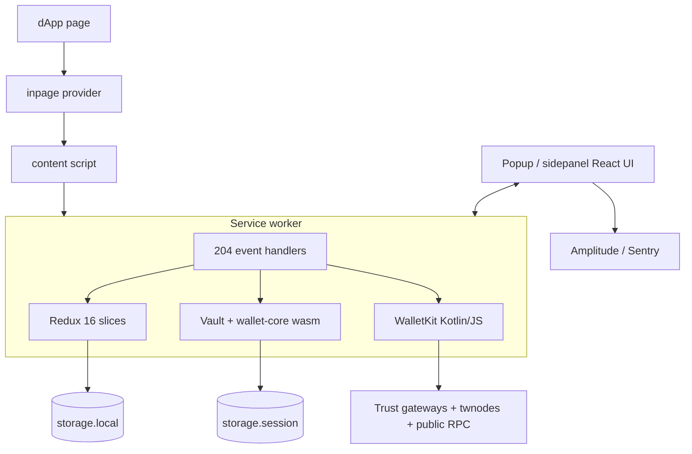

# Trust Wallet Extension 26.41.0 - Architecture Overview

Reverse-engineered from the unpacked Chrome MV3 package (static analysis; no source maps exist). Every document labels claims CONFIRMED / INFERRED / UNKNOWN.

## One-page picture

## Reading order

| Doc | Topic | Evidence strength |
|---|---|---|
| 01 | Inventory, manifest, entry points | Strong |
| 02 | Runtime topology and handshake | Strong |
| 03 | Core wallet: vault, keystore, passkeys, chain registry | Strong, passkey secret UNKNOWN |
| 04 | dApp provider and 204 handlers | Strong |
| 05 | Transaction pipelines | Medium: WalletKit internals opaque |
| 06 | Feature modules and routes | Medium: endpoints partly INFERRED |
| 07 | Network layer | Medium: hosts CONFIRMED, roles often INFERRED |
| 08 | State and storage | Strong for keys, UNKNOWN for sqlite use |
| 09 | Security model | Strong per control, end-to-end INFERRED |
| 10 | Comparison with Harbour | Depends on Harbour matrix |
| 11 | End-to-end Harbour parity plan (architecture, free providers, phases) | Plan |
| 99 | Unknowns and next steps | - |

## Five takeaways

1. Same crypto core as Harbour (wallet-core 4.8.2 wasm); the difference is the data plane (private gateway + WalletKit).
2. Everything flows through a DI-registered handler router with an internal/public event split.
3. Sensitive exports need password re-entry; external callers cannot self-assert internal flags.
4. While unlocked, PBKDF2-derived vault keys (not the raw password) live in `storage.session` (MV3).
5. Remote control exists via Amplitude flags and a CDN chain config.
