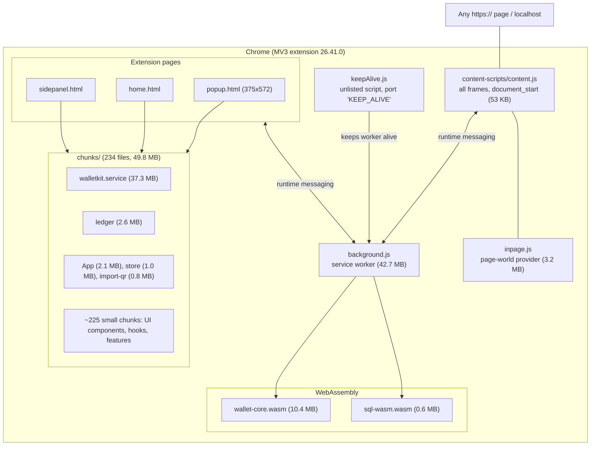

# 01 - Inventory: what ships in Trust Wallet extension 26.41.0

Scope: static inventory of the unpacked Chrome extension. Nothing was executed.
Evidence labels: **CONFIRMED** (seen in a file or tool result), **INFERRED** (reasoned from evidence), **UNKNOWN** (not found).

## Plain-language summary

Trust Wallet's extension is a Manifest V3 extension. One background service worker (`background.js`, 42.7 MB) holds the wallet logic. Three HTML pages (`popup.html`, `home.html`, `sidepanel.html`) are the user interface; the popup and home pages load the same `popup` chunk, and the side panel loads its own `sidepanel` chunk. A content script is injected into every `https://` page and into `localhost`/`127.0.0.1`, and an `inpage.js` file provides the injected wallet object that websites talk to. Cryptography for many blockchains comes from two WebAssembly files: `wallet-core.wasm` (Trust Wallet's open-source wallet-core, compiled with Emscripten) and `sql-wasm.wasm` (SQLite for the browser).

## Diagram: package layout

## Manifest facts (manifest.json)

| Field | Value | Label | Source |
|---|---|---|---|
| manifest_version | 3 | CONFIRMED | manifest.json |
| version | 26.41.0 | CONFIRMED | manifest.json |
| minimum_chrome_version | 114 | CONFIRMED | manifest.json |
| background | service_worker `background.js` | CONFIRMED | manifest.json |
| action | popup `popup.html`, title "Trust Wallet" | CONFIRMED | manifest.json |
| side_panel | `sidepanel.html` | CONFIRMED | manifest.json |
| permissions | alarms, tabs, storage, clipboardWrite, notifications, scripting, sidePanel, gcm | CONFIRMED | manifest.json |
| host_permissions | `https://*/*`, `http://localhost/*`, `http://127.0.0.1/*` | CONFIRMED | manifest.json |
| content_scripts | 1 entry: `content-scripts/content.js`, `all_frames: true`, `run_at: document_start`, matches `https://*/*`, localhost, 127.0.0.1, with 30 excluded host patterns (ad/captcha networks, Google Docs/Mail/Meet, Facebook, Instagram, LinkedIn, X/Twitter, TikTok, WhatsApp and similar) | CONFIRMED | manifest.json |
| content_security_policy | `script-src 'self' 'wasm-unsafe-eval'; object-src 'self'` for extension pages | CONFIRMED | manifest.json |
| web_accessible_resources | not declared | CONFIRMED | manifest.json has no such key |
| key (fixed extension ID) | public key present | CONFIRMED | manifest.json |
| update_url | Chrome Web Store update service | CONFIRMED | manifest.json |

Observation: `web_accessible_resources` is absent, so pages cannot load extension files directly. `inpage.js` therefore must reach the page another way (injected by the content script). **INFERRED**: this is checked in phase 2.

## Files and sizes

| File or folder | Size | What it is | Label |
|---|---|---|---|
| background.js | 42,723,770 B | Service worker bundle; ends with a Sentry debug-id preamble and sourceMappingURL comment, but no .map files ship | CONFIRMED |
| chunks/ | 234 files, 49.8 MB total | Code-split modules shared by the pages and worker | CONFIRMED |
| chunks/walletkit.service-*.js | 37,331,651 B | Largest module, starts with Vite's `__vite__mapDeps` helper that lazily loads `chunks/browser-*.js` | CONFIRMED |
| chunks/ledger-*.js | 2,573,982 B | Ledger hardware wallet support (also `import-ledger` chunk) | CONFIRMED (names), INFERRED (contents) |
| chunks/App-*.js | 2,137,186 B | Main application component | INFERRED |
| inpage.js | 3,185,335 B | Page-world provider script | CONFIRMED (file), INFERRED (role, phase 4) |
| content-scripts/content.js | 53,225 B | Content script | CONFIRMED |
| keepAlive.js | 1,512 B | Opens a `chrome.runtime.connect({name:"KEEP_ALIVE"})` port and reconnects on disconnect | CONFIRMED |
| wallet-core.wasm | 10,362,000 B | Emscripten/embind build; imports from `env` and `wasi_snapshot_preview1` | CONFIRMED |
| sql-wasm.wasm | 613,426 B | SQLite build; WABT reports `valid`, 34 imports, 52 exports | CONFIRMED |
| assets/ | 79 files (52 svg, 10 ttf, 9 gif, 4 otf, 3 png, 1 css) | Fonts (Inter, PingFang, Geeza, BinancePlex), flags, images | CONFIRMED |
| composeResources/ | 9.6 MB | Localized string resources in Android "values-xx" folders (about 100 locales) | CONFIRMED |
| _locales/ | one locale (en) | Chrome i18n | CONFIRMED |
| _metadata/ | computed_hashes.json, verified_contents.json | Chrome Web Store integrity data | CONFIRMED |

## Entry points

| Entry | Loads | Label |
|---|---|---|
| popup.html | `preload-helper`, `logger`, `popup` chunks | CONFIRMED |
| home.html | same three chunks as popup.html (full-tab view of the same app) | CONFIRMED (same scripts), INFERRED (role) |
| sidepanel.html | `sidepanel` chunk, preloads `preload-helper`, `logger`, `constants` | CONFIRMED |
| background.js | Service worker, started by Chrome | CONFIRMED |
| keepAlive.js | Page-side script that holds a port open to the worker | CONFIRMED (code); who loads it is UNKNOWN until phase 2 |

popup.html also preconnects to `https://assets-cdn.trustwallet.com` (token and chain logos), and its comments cite Sentry issue IDs, which tells us error reporting uses Sentry (`SENTRY_RELEASE = 26.41.0` is set in every bundle).

## What the chunk names reveal (INFERRED, to be confirmed in later phases)

Names come from the file list; content has not been read yet.

- Onboarding and security: `onboarding`, `create-mnemonic`, `import-mnemonic-or-private-key`, `import-qr`, `import-ledger`, `backup-seedphrase`, `set-passkeys`, `CreatePassword`, `InputPassword`, `unlock`, `authentication`, `biometrics`, `useAuthenticateWithBiometrics`, `useSetupAuthentication`, `useSeedPhraseBackupRequired`.
- Wallet data: `useWallets`, `useAccounts`, `useBalances`, `useCombinedBalances`, `useAssets`, `useBlockchains`, `blockchain(s)`, `popularChains`, `custom-asset`, `manage-crypto`, `network`, `supportedDappNetworks`.
- Transactions: `send`, `sendLikeTransactionType`, `transaction`, `txType`, `useTransactionsByDate`, `useFormattedTransaction`, `gas-station`, `erc20`, `sha3`.
- Commerce: `buy`, `buyCrypto.interfaces`, `sell`, `onramp-revamp`, `offramp-revamp`, `fiat-ramps`, `fundingProviders`, `enforceTrustedRampAddress`, `RecurringBuyModal`, `SellCryptoModal`.
- dApps and NFTs: `dapps`, `dAppBlockchain`, `approval-detail`, `nft-collection`, `nft-item`, `nft-reported-collections`, `useNFTCollection(s)`, `useNFTItem`.
- Platform: `store`, `storage`, `query`, `persistentQueryClient`, `useQuery`, `useInfiniteQuery`, `useIsFeatureEnabled`, `useAnalytics`, `logger`.

## Build and framework clues

| Observation | Conclusion | Label | Source |
|---|---|---|---|
| `defineUnlistedScript(...)` wrapper in keepAlive.js, `"object"==typeof chrome&&chrome?.runtime?.id?globalThis.browser??chrome` | Built with the WXT extension framework | INFERRED | keepAlive.js |
| `__vite__mapDeps` and hashed chunk names such as `popup-BmMPx8n6.js` | Built with Vite (or a Vite-compatible bundler) | CONFIRMED (helper present), INFERRED (tool) | walletkit.service chunk, popup.html |
| `react-dom`, `jsx-runtime`, React comments in popup.html about `removeChild` NotFoundError | React UI | CONFIRMED | popup.html, chunk names |
| `persistentQueryClient`, `useQuery`, `useInfiniteQuery`, `query` chunks | TanStack Query with persistence | INFERRED | chunk names |
| `composeResources/` with `com.trustwallet.sdk.strings.generated.resources` | Strings come from a Kotlin Multiplatform/Compose-style resource pipeline shared with the mobile apps | INFERRED | composeResources folder name seen in unzip |
| `walletkit.service` is 37 MB and lazily loads `browser-*.js` | Large shared SDK ("WalletKit") bundled as one module | INFERRED | chunk name and header |

## WebAssembly detail (parsed from section headers)

| Module | Imports | Exports | Largest sections | Label |
|---|---|---|---|---|
| wallet-core.wasm | 45 (modules `env`, `wasi_snapshot_preview1`; embind registration calls such as `_embind_register_class`, `_embind_register_enum`, `_emval_*`) | 20 (memory, malloc, free, `__wasm_call_ctors`, `__getTypeName`, stack helpers) | code 8.1 MB, data 2.2 MB, element 24.9 KB | CONFIRMED |
| sql-wasm.wasm | 34 | 52 | code 543 KB, data 66 KB | CONFIRMED (WABT validation: valid) |

Reading: wallet-core.wasm exposes its API through embind class registrations rather than plain exports, which matches wallet-core's standard WebAssembly build. Embedded strings such as `TW.Bitcoin.Proto.SigningInput.ScriptsEntry.key`, `bitcoinLegacy`, `CoinTypeExt` and `BitcoinSigHashTypeExt` confirm it is Trust Wallet's wallet-core, with protobuf signing inputs (**CONFIRMED** by string search).

REA's `inspect_wasm_artifact` rejects files over 8 MiB, so wallet-core.wasm was parsed directly with a section reader instead of WABT. sql-wasm.wasm was validated by WABT 1.0.42 through REA.

## Evidence ledger for this phase

| Claim | Label | Source |
|---|---|---|
| Manifest V3, v26.41.0, permissions and host permissions as listed | CONFIRMED | manifest.json |
| One content script on https and localhost, with 30 excluded hosts | CONFIRMED | manifest.json |
| No web_accessible_resources | CONFIRMED | manifest.json |
| 3 HTML pages, 234 chunks, 2 wasm files | CONFIRMED | file listing |
| wallet-core.wasm is Trust Wallet wallet-core | CONFIRMED | embedded `TW.*` protobuf strings |
| sql-wasm.wasm is valid and has 34 imports and 52 exports | CONFIRMED | REA inspect_wasm_artifact |
| Source maps not shipped | CONFIRMED | no .map files in the tree, while comments reference them |
| Framework is WXT + Vite + React + TanStack Query | INFERRED | code idioms and chunk names |
| How `inpage.js` reaches the page without web_accessible_resources | UNKNOWN | phase 2 |
| Who loads `keepAlive.js` and which page calls it | UNKNOWN | phase 2 |
| What `walletkit.service` contains | UNKNOWN | phases 3 and 5 |

## Tool notes

- `analyze_javascript_application` was attempted with a `source_paths` filter and the tool rejected the array argument as a string in this client, so JS graph analysis is deferred to phase 2 and will run with a different selection approach.
- No unknown from this phase blocks the next one. Unknowns are tracked in `99-unknowns-and-next-steps.md` (created at the end).
