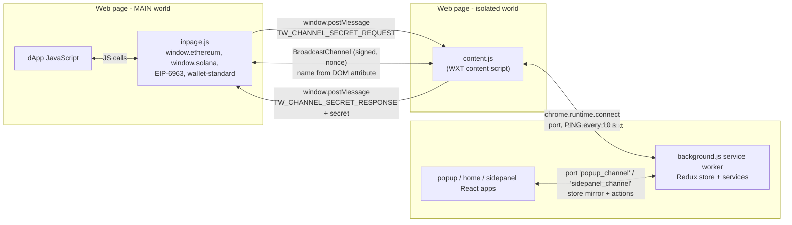
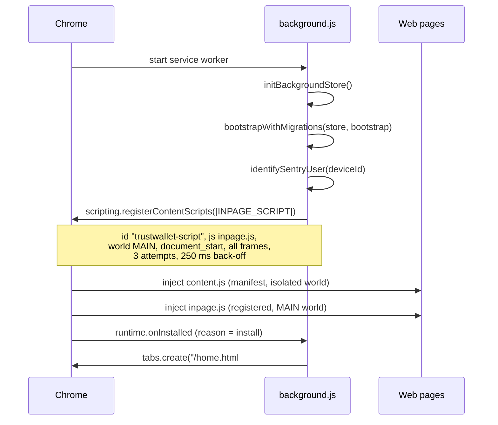
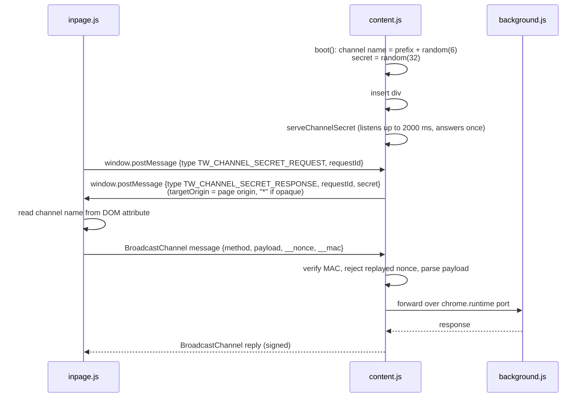

# 02 - Runtime topology: who runs where and how they talk

Evidence labels: **CONFIRMED** (seen in code), **INFERRED** (reasoned), **UNKNOWN** (not found). Code references use the shipped bundle names; identifiers such as `registerWeb3` are real names visible in `background.js` (the worker bundle keeps many readable names).

## Plain-language summary

Five pieces run in three different places. The **background service worker** owns all wallet state in a Redux store. The **popup**, **side panel** and **home tab** are React apps that hold no secrets of their own: each opens a long-lived port to the worker and mirrors its store. A **content script** (isolated world) sits in every web page, and an **inpage script** (page world) is what the website sees as the wallet. The worker registers the inpage script itself at startup with `chrome.scripting.registerContentScripts`, which is why the manifest has no `web_accessible_resources`. The page-to-content-script link is a BroadcastChannel whose messages are signed with a per-page secret, and the content script keeps a heartbeat to the worker so the worker is not asleep when a dApp calls.

## Diagram 1: processes and channels

## Diagram 2: startup and injection

## Diagram 3: the page-to-wallet secret handshake

## What each part does

### Background service worker (background.js)

| Fact | Label | Source |
|---|---|---|
| Startup order: `initBackgroundStore()` then `bootstrapWithMigrations(store, bootstrap)` then Sentry user id | CONFIRMED | background.js `init()` |
| First install opens a tab at `/home.html#/onboarding` | CONFIRMED | `registerInstallListener`, `ONBOARDING_ROUTE` |
| Registers the inpage script dynamically: id `trustwallet-script`, `world:"MAIN"`, `runAt:"document_start"`, `allFrames:true`, matches `https://*/*`, localhost and 127.0.0.1, with excludes (challenge pages, blocked domains, third-party widgets) | CONFIRMED | `INPAGE_SCRIPT`, `WEB3_INJECTION_MATCHES`, `WEB3_INJECTION_EXCLUDE_MATCHES` |
| Registration retries 3 times with 250 ms delay, falls back from `registerContentScripts` to `updateContentScripts` on duplicate id, and gives up with a log ("No web3 injection until the next wake") | CONFIRMED | `attemptRegistration`, `registerWeb3` |
| Services use decorators (`use_decorator`, `priority_decorator`) and lifecycle hooks such as `onApplicationBoot`, which is the shape of an Inversify dependency-injection container | INFERRED | `NotificationService`, `@inversifyjs/common` symbols |
| Popup and side panel connect with port names `popup_channel` and `sidepanel_channel`; any other port is treated as non-UI | CONFIRMED | `POPUP_MESSAGE_CHANNEL`, `SIDEPANEL_MESSAGE_CHANNEL`, `portIsNative` |
| On each store change the worker posts the state to every UI port as `REDUX_OBSERVER_CALLBACK_ACTION` (sanitized state) | CONFIRMED | `BrowserService.attachStore` |
| `chrome.runtime.onConnect` handler is `attachStoreAndAddToConnections` | CONFIRMED | `BrowserService.attach` |
| One-time messages go through `runtime.onMessage` / `sendOneTimeMessage`; tab broadcast through `tabs.sendMessage` | CONFIRMED | `init_extensionMessage` |
| Auto-lock uses `chrome.alarms` with name `__trustWalletAppTimer`, default 10 minutes; on fire it stops the timer, calls `appService.lock()` and dispatches `setAuthenticated(false)` | CONFIRMED | `BrowserService.runTimer`, `onTimerCompleted` |
| Push notifications use `chrome.gcm` when supported (the `gcm` permission); skipped if no sender id in the build | CONFIRMED | `NotificationService` |
| There is no `onConnectExternal`, so other extensions cannot connect | CONFIRMED | grep: 0 matches |

### Content script (content-scripts/content.js, 53 KB)

| Fact | Label | Source |
|---|---|---|
| Built as a WXT content script (`ContentScriptContext`, `wxt:locationchange`, stops older copies of itself) | CONFIRMED | content.js |
| `boot()` creates a channel name (`prefix_` + 6 random chars) and a 32-character secret, and answers the secret request once within 2000 ms | CONFIRMED | `boot`, `serveChannelSecret`, `Rn=2e3` |
| The secret is sent only to messages whose `source === window` | CONFIRMED | `serveChannelSecret` handler |
| The channel name is placed in the page DOM as `div#in-page-channel-node-id` attribute `data-channel-name` | CONFIRMED | `injectChannelNameInPage`, inpage `IN_PAGE_CHANNEL_NODE_ID`, `CHANNEL_NAME_ATTR` |
| Wire format: `{method, payload (string, max 1,000,000 chars), __nonce (16 random bytes), __mac}` | CONFIRMED | `Ut.onWireMessage`, `send` |
| MAC = HMAC over length-prefixed `"trust-wallet/broadcast-channel/v1"`, channel name, nonce, payload, keyed by the secret; compared in constant time; seen nonces are remembered to block replays | CONFIRMED | `computeMac`, `timingSafeEqual`, `isReplay` |
| Transport underneath is the `broadcast-channel` library (BroadcastChannel with localStorage and simulated fallbacks) | CONFIRMED | `pubkey.broadcastChannel-`, `type:"localstorage"`, `type:"simulate"` |
| Link to worker: `chrome.runtime.connect({name: portName})`; if connect fails the page is reloaded | CONFIRMED | class `jt` |
| Heartbeat: `PING` every 10,000 ms; first reply wait 200 ms; retry wait 400 ms; up to 5 init retries; one missed ping triggers a new port | CONFIRMED | `THRESHOLD`, `FIRST_TIME_WAIT`, `RETRY_THRESHOLD`, `MAX_MISS_RECONNECT`, `initPortStream`, `startKeepAlive` |
| Errors in the content script are forwarded to the worker as `REPORT_ERROR` with a 500-char message and 4,000-char stack, deduplicated (max 3 per message, 50 total) | CONFIRMED | `installLoggerSentryBridge`, `forwardErrorToBackground` |

Message names the content script knows (prefixes `INTERNAL_` and `PUBLIC_`): Reset, Lock, Lock_callback, Authenticate, RegisterDevice, AppDisplayed, WarningDisplayed, IconThemeChanged, OpenPopup, GetAppSettings (public), GetAppNodes (public), GetStore, GetReduxState, DispatchReduxAction, Ping (public), AnnouncementDisplayed, FetchAnnouncements, FetchUserVipTierData, FetchFundingMethods, RouteChanged, ReportError (public). **CONFIRMED** from the `ln` map in content.js. The `PUBLIC_` ones are the ones pages may call.

### Inpage script (inpage.js, 3.2 MB)

| Fact | Label | Source |
|---|---|---|
| Requests the secret with `window.postMessage({type:"TW_CHANNEL_SECRET_REQUEST", requestId: nanoid()}, "*")`, accepts only replies from `window` with a matching request id, one attempt by default, 2 s window | CONFIRMED | `requestChannelSecret`, `SECRET_HANDSHAKE_WINDOW_MS` |
| Exposes `window.ethereum`, `window.solana`, EIP-6963 announcement, and wallet-standard registration; flags such as `isTrust` and `isTrustWallet` | CONFIRMED (strings present) | inpage.js (counts: ethereum 6, announceProvider 4, solana 2, registerWallet 2, wallet-standard 13, isTrust 28) |

### UI pages

| Fact | Label | Source |
|---|---|---|
| popup.html and home.html load the same `popup` chunk; side panel loads `sidepanel` | CONFIRMED | html files |
| UI shows a spinner overlay until React mounts, then fades it | CONFIRMED | popup.html |
| UI is a mirror of the worker store, not an owner of state | INFERRED | worker pushes `REDUX_OBSERVER_CALLBACK_ACTION`; internal messages `GetReduxState` and `DispatchReduxAction` exist |

## Worked example: a dApp calls `ethereum.request({method: "eth_requestAccounts"})`

1. The page loads. Chrome injects `content.js` (isolated world) and, because the worker registered it, `inpage.js` (page world), both at `document_start`.
2. `content.js` runs `boot()`: it picks channel name and secret, writes the channel name into the DOM, and opens its port to the worker.
3. `inpage.js` posts `TW_CHANNEL_SECRET_REQUEST`; `content.js` answers with the secret (only to this window, only once).
4. The dApp calls `request`. `inpage.js` serializes the call to a JSON string, adds a nonce and HMAC, and sends it over the BroadcastChannel.
5. `content.js` checks the MAC, rejects replays, parses the payload, and forwards it over the extension port to the worker.
6. The worker's provider logic handles it (permission prompt, approval window; covered in phase 4) and answers; the reply goes back the same way, signed.

The exact worker-side handler and message type for `eth_requestAccounts` are traced in phase 4.

## Evidence summary

| Claim | Label |
|---|---|
| Worker registers inpage.js in MAIN world at runtime | CONFIRMED |
| Page-to-content link is HMAC-signed BroadcastChannel with a per-page secret and replay protection | CONFIRMED |
| Content-to-worker link is a chrome.runtime port with a 10-second PING | CONFIRMED |
| UI-to-worker link is a named port that streams Redux state | CONFIRMED |
| DI container in the worker is Inversify | INFERRED |
| `keepAlive.js` consumer | UNKNOWN: the file opens a port named `KEEP_ALIVE`, but no page (popup, sidepanel chunks) or the manifest references it and `background.js` has no `KEEP_ALIVE` string; it may be loaded by an offscreen or approval page not found yet |
| Approval/notification window creation | UNKNOWN until phase 4 |
