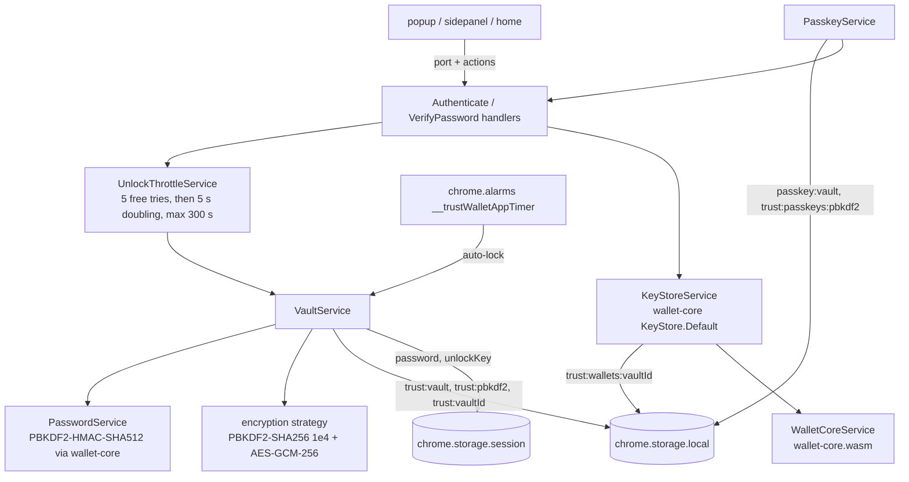
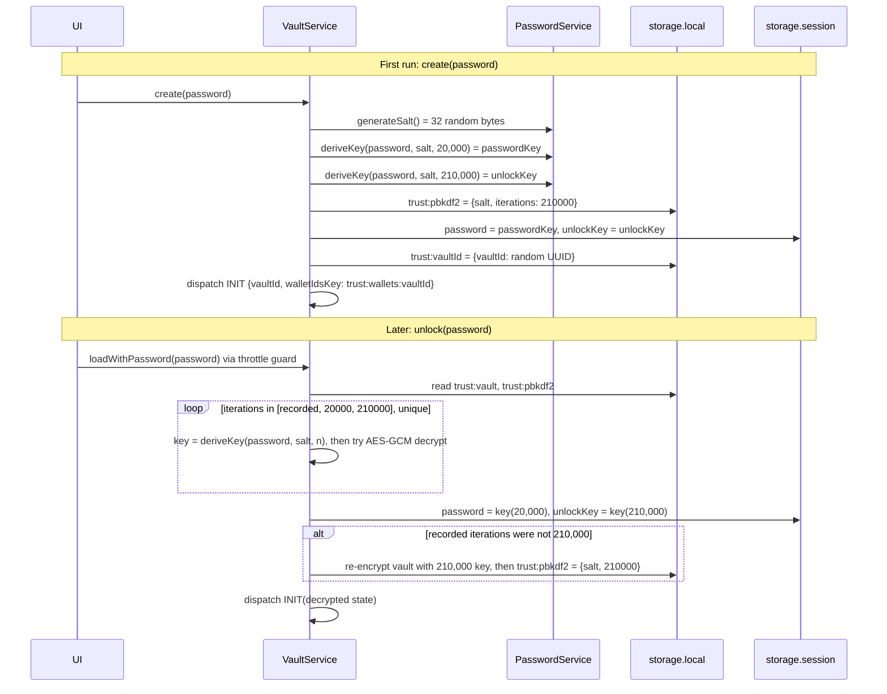
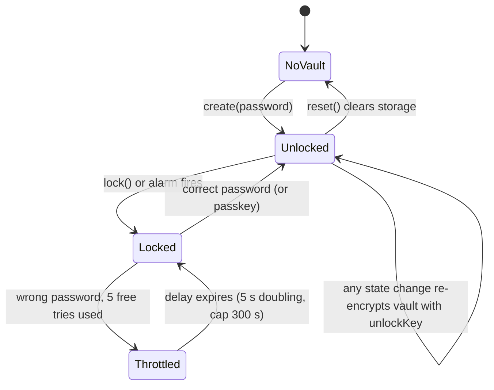
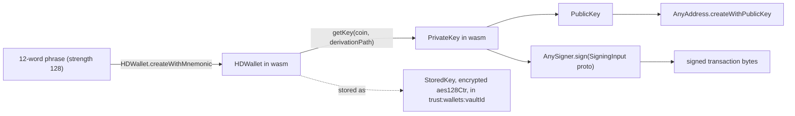

# 03 - Core wallet: vault, keystore, keys and the chain registry

Evidence labels: **CONFIRMED** (seen in code), **INFERRED** (reasoned), **UNKNOWN** (not found). All names below (`VaultService`, `KeyStoreService`, `PasswordService`, ...) are real class names in `background.js`.

## Plain-language summary

The wallet has two separate secrets stores that both live in `chrome.storage.local`:

1. **The vault** (`trust:vault`) is the app's whole Redux state (wallet list, settings, and so on) encrypted with a key derived from your password.
2. **The keystore** (`trust:wallets:<vaultId>`) is wallet-core's own encrypted record for each wallet: the recovery phrase or imported private key, plus its accounts.

Your password never touches disk. It is stretched into two keys: a cheaper "password key" (20,000 rounds) and a stronger "unlock key" (210,000 rounds). While the wallet is unlocked, both keys sit in `chrome.storage.session` (memory only, cleared when the browser closes or the wallet locks). Locking just deletes those two keys. Signing asks the keystore to decrypt the wallet with the password key, derives the needed coin key inside the wallet-core WebAssembly module, signs, and frees the key objects.

## Diagram 1: components

## Diagram 2: create password, then unlock

## Diagram 3: lock lifecycle

## Diagram 4: from phrase to signature

## Facts

### Passwords and keys

| Fact | Label | Source |
|---|---|---|
| Password hash = wallet-core `PBKDF2.hmacSha512(password, salt, iterations, 512)`; default 20,000 iterations (`DEFAULT_ITERATIONS=2e4`), unlock tier 210,000 (`UNLOCK_ITERATIONS=21e4`) | CONFIRMED | `PasswordService` |
| Salt is 32 random bytes from `crypto.getRandomValues` | CONFIRMED | `generateSalt(ae=32)` |
| The key-length argument 512 is passed as given; whether wallet-core reads it as bits or bytes is not shown here | UNKNOWN | `DEFAULT_BIT_KEY_LEN=512` |
| Vault ID is a random UUID, stored as `trust:vaultId` | CONFIRMED | `VaultService.create` |
| MV3 builds keep `password` and `unlockKey` only in `chrome.storage.session`; non-MV3 keeps them in memory | CONFIRMED | `getPassword`, `getUnlockKey`, `isMV3()` |
| `lock()` clears those keys; the encrypted vault remains | CONFIRMED | `clearPassword` |

### Vault encryption

| Fact | Label | Source |
|---|---|---|
| Whole Redux state is serialized and encrypted on every update with the unlock key, then saved under `trust:vault` | CONFIRMED | `VaultService.onUpdate` |
| Encryption strategy: random 32-byte salt, PBKDF2-SHA256 with 10,000 iterations, AES-GCM with 256-bit key and 16-byte random IV; output `{data, iv}` base64 | CONFIRMED | module `require_dist$14` (`keyFromPassword`, `encryptWithKey`) |
| A wrong key surfaces as "Incorrect password" | CONFIRMED | `decryptWithKey` catch |
| Where the strategy's own salt is stored in the output | INFERRED | `generateSalt` is called in `encrypt`; the exact output field is not visible in the excerpt |
| Vault decrypt tries the recorded iteration count, then 20,000, then 210,000; after success it migrates the vault to the 210,000 tier ("Vault KDF repair") | CONFIRMED | `decryptVault`, `loadWithPassword` |

### Brute-force protection

| Fact | Label | Source |
|---|---|---|
| State `{failedAttempts, lockedUntil}` in `trust:unlock-throttle` | CONFIRMED | `UnlockThrottleService` |
| 5 free attempts, then delay = 5 s x 2^(n-1), capped at 300,000 ms; error code `TOO_MANY_ATTEMPTS:<seconds>` | CONFIRMED | `FREE_ATTEMPTS=5`, `BASE_DELAY_MS=5e3`, `MAX_DELAY_MS=3e5` |
| Only real password failures count (empty vault and missing salt do not) | CONFIRMED | `isPasswordGuessFailure` |
| Attempts are serialized through a promise chain, so parallel guesses cannot skip the counter; success resets it | CONFIRMED | `serialize`, `guard`, `reset` |
| The throttle is client-side state in `storage.local`; someone with storage access can delete it. It limits UI guessing, not offline attacks on the stored vault | INFERRED | storage location |

### Keystore and wallet-core

| Fact | Label | Source |
|---|---|---|
| Keystore is wallet-core's `KeyStore.Default` over `KeyStore.ExtensionStorage`, key `trust:wallets:<vaultId>` | CONFIRMED | `KeyStoreService.setStorageProvider`, `StorageService.fetchKeystoreStorage`, `walletIdsKey` |
| Import uses `StoredKeyEncryption.aes128Ctr` for both phrases and private keys | CONFIRMED | `KeyStoreService.import`, `importPrivateKey` |
| Default storage area is `chrome.storage.local`; the legacy single key is `store`; migration marker `trust:migrated` | CONFIRMED | `DEFAULT_STORAGE_PROVIDER`, `LEGACY_STORAGE_KEY`, `MIGRATION_KEY` |
| New phrases are 128-bit (12 words) via `HDWallet.create(128, password)`; imports use `HDWallet.createWithMnemonic`; validation uses `Mnemonic.isValid` | CONFIRMED | `WalletCoreService` |
| Wallet types include phrase and private-key wallets (`WalletType.PRIVATE_KEY`) | CONFIRMED | `getKey` |
| Per-coin keys are derived on demand (`getKeyForCoin` finds the account for the coin, then `getKey`); key objects are deleted afterwards (`.delete()` in `finally`) | CONFIRMED | `getKeyForCoin`, `getHDWallet`, `customDerivation` |
| Custom derivation swaps the last `0` of the derivation path for another index | CONFIRMED | `customDerivation` |
| The wasm is loaded by `WalletKitService`, then `WalletCoreService.onApplicationBoot` binds `CoinType`, `PrivateKey`, `AnyAddress`, `AnySigner`, `TONWallet` and others, and calls `probeWalletCoreWasmIntegrity` | CONFIRMED | `WalletCoreService.onApplicationBoot` |
| Ledger apps recognized: Solana, Ethereum, Binance Chain, Bitcoin | CONFIRMED | `SupportedLedgerApp` enum |
| Error codes: INVALID_MNEMONIC, INVALID_PRIVATE_KEY, INVALID_WALLET_ID, WALLET_NOT_FOUND, MNEMONIC_ALREADY_EXISTS | CONFIRMED | `init_codes$1` |

### Passkeys

| Fact | Label | Source |
|---|---|---|
| `PasskeyService.create` makes a salt (`trust:passkeys:pbkdf2`), hashes a secret with it, and encrypts the wallet password under that hash into `passkey:vault` | CONFIRMED | `PasskeyService` |
| `load` decrypts the stored password with the passkey-derived key and calls `authenticateHandler.passkeyLogin(password)` | CONFIRMED | `PasskeyService.load` |
| Where the passkey secret comes from (WebAuthn PRF or another source) | UNKNOWN | there is no `webauthn` string in the worker; the `set-passkeys` UI chunk is the place to look |

### Chain registry

| Fact | Label | Source |
|---|---|---|
| `blockchains_default` is an embedded JSON array of **168** coin definitions covering **57** blockchain families | CONFIRMED | parsed from `background.js` |
| Largest families: Ethereum-compatible 61, Cosmos 32, Bitcoin-like 14; several others have 2 (Verge, Zcash, Bitcoin Cash, Stellar, EOS, Polkadot, Binance) | CONFIRMED | parsed JSON |
| Curves: secp256k1 141, ed25519 23, nist256p1 2, ed25519Blake2bNano 1 (Nano), ed25519ExtendedCardano 1 | CONFIRMED | parsed JSON |
| Most coins have one derivation path; Bitcoin has four (segwit `m/84'/0'/0'/0/0`, legacy `m/44'/0'/0'/0/0`, testnet, taproot `m/86'/0'/0'/0/0`); four other coins have two | CONFIRMED | parsed JSON |
| Fields per coin: id, name, coinId, symbol, decimals, blockchain, derivation (name, path, xpub, xprv), curve, publicKeyType, chainId, explorer, url, hrp, slip44, prefixes and hashers | CONFIRMED | parsed JSON |
| The number of chains visible to a user is smaller than 168 (some entries are testnets or deprecated, and there is a `deprecated` field and a remote chain list) | INFERRED | `deprecated` key; the 86-chain figure used earlier in the Harbour project was not re-derived here |

## Worked example: unlock, then sign an Ethereum transfer

1. You type your password. The UI sends an authenticate action; the throttle checks `trust:unlock-throttle` and refuses if `lockedUntil` is in the future.
2. `VaultService` reads `trust:pbkdf2` (salt) and tries the stored iteration count, then 20,000, then 210,000. The first key that decrypts `trust:vault` wins.
3. It writes `password` and `unlockKey` to `chrome.storage.session` and loads the decrypted state into the Redux store. The UI now shows your wallets.
4. You send ETH. The worker calls `KeyStoreService.getKeyForCoin(walletId, password, coin=60, walletType)`: the keystore (`trust:wallets:<vaultId>`) decrypts the stored key with the password key, wallet-core derives the secp256k1 key at the account's derivation path, and the key lives only inside the wasm module.
5. `AnySigner.sign(signingInput)` returns the signed bytes; the key objects are `.delete()`d; the transaction is broadcast (phase 5).
6. Ten minutes later (default) the alarm `__trustWalletAppTimer` fires, `lock()` deletes `password` and `unlockKey`, and `setAuthenticated(false)` sends you back to the lock screen.

## Evidence summary

| Claim | Label |
|---|---|
| Two-tier PBKDF2-HMAC-SHA512 key stretching (20k and 210k) | CONFIRMED |
| Vault is AES-GCM-256 encrypted with a PBKDF2-SHA256 (10k) derived key | CONFIRMED |
| Secrets in session storage while unlocked, cleared on lock | CONFIRMED |
| Client-side exponential unlock throttle | CONFIRMED |
| Keystore is wallet-core StoredKey with aes128Ctr | CONFIRMED |
| 168 coin definitions in the embedded registry | CONFIRMED |
| Passkey secret source | UNKNOWN |
| Meaning of the 512 key-length parameter | UNKNOWN |
