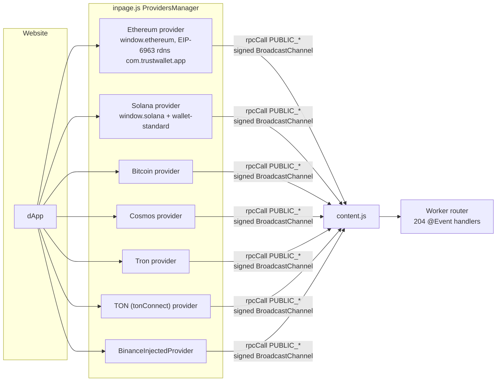
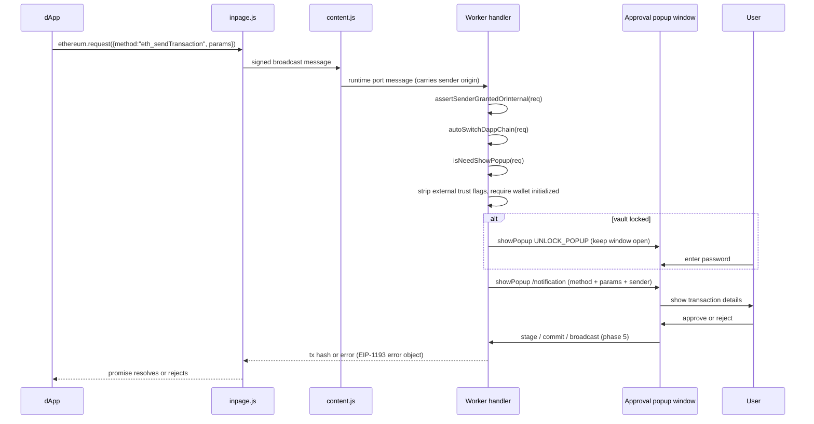
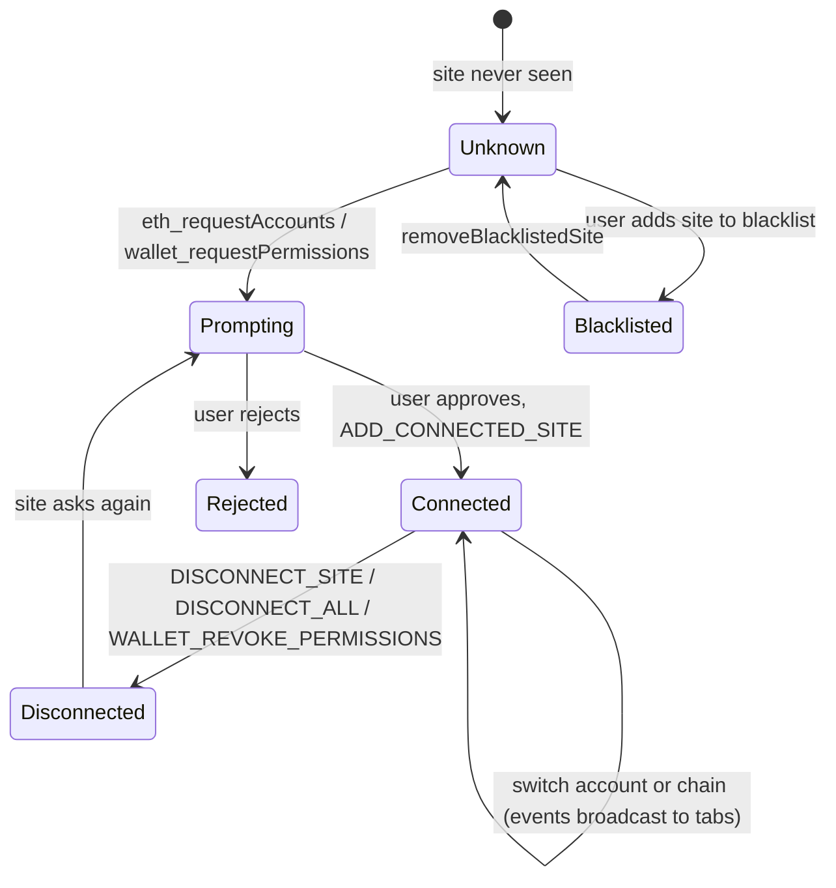

# 04 - dApp provider, permissions and approval flow

Evidence labels: **CONFIRMED** (seen in code), **INFERRED** (reasoned), **UNKNOWN** (not found). Names in `code` style are real identifiers from `inpage.js` and `background.js`.

## Plain-language summary

A website sees a wallet object injected by `inpage.js`. Each blockchain family has its own injected provider (EVM, Solana, Bitcoin, Cosmos, Tron, TON, BNB Beacon). When the page calls `request(...)`, the call is turned into a named message, signed with the page secret (phase 2), and sent to the worker. The worker has a **router of 204 named handlers** registered with a decorator (`@Event(events.X)`). Handlers that need your consent call `isNeedShowPopup(...)`, which opens a small approval window (`popup.html?notification=1#/notification`, 375 x 600). Connection permissions are stored per site in the Redux `dapps` slice and are shaped like EIP-2255 permissions (`eth_accounts` with a `restrictReturnedAccounts` caveat).

## Diagram 1: provider families

## Diagram 2: a signing request end to end (eth_sendTransaction)

## Diagram 3: connection and permission state

## Page side (inpage.js)

| Fact | Label | Source |
|---|---|---|
| `ProvidersManager` owns a map of providers, announces them, boots, starts them, and fires `window` event `trustwallet#initialized` when started | CONFIRMED | `ProvidersManager.start` |
| EIP-6963: answers `eip6963:requestProvider` and announces with `{uuid, name, icon, rdns: "com.trustwallet.app"}` | CONFIRMED | `announce`, `EIP6963Info` |
| Chains with injected providers: ethereum, solana, bitcoin, cosmos, tron, ton, binance | CONFIRMED | `DAppBlockchain` keys used in inpage.js |
| Globals assigned on `window`: `trustwallet`, plus `original`, `originalBitcoin`, `originalSolana` (backup copies of other wallets' objects) | CONFIRMED | `window.X =` assignments |
| Solana supports wallet-standard registration (`registerWallet`) | CONFIRMED | strings in inpage.js |
| The injected object carries `isTrust` / `isTrustWallet` flags (28 and 7 occurrences) | CONFIRMED | inpage.js |
| EVM provider handles `wallet_requestPermissions`, `eth_requestAccounts` (mapped to internal `requestAccounts`), `eth_sign`, `personal_sign`, `personal_ecRecover`, `eth_signTypedData` v1/v3/v4, and more | CONFIRMED | EVM provider `switch` |
| Public message names used by the page side include `requestAccounts`, `accounts`, `chainId`, `net_version`, `sendTransaction`, `signTransaction`, `signMessage`, `signPersonalMessage`, `signTypedMessage`, `signRawTransaction(Multi)`, `signPSBT`, `pushPSBT`, `addEthereumChain`, `switchEthereumChain`, `watchAsset`, `wallet_requestPermissions`, `estimateGas`, `tonConnect_reconnect/disconnect` | CONFIRMED | `Public("...")` names in inpage.js |
| Page-side state is cached with an expiry (`Cache.isExpired`) and cleared when expired | CONFIRMED | `loadCache` |

## Worker side: the handler router

| Fact | Label | Source |
|---|---|---|
| Handlers are classes decorated `@Event(events.NAME)` and expose `handle(params, request)`; 204 distinct names | CONFIRMED | `Event$2(events$20.X)` decorators |
| Handlers receive the request with `remotePort.sender`; origin comes from `getSenderOrigin(sender)`, never from the page payload | CONFIRMED | `RequestPermissions.handle` |
| `assertSenderGrantedOrInternal` guards `ETH_SEND_TRANSACTION`: the site must already be granted, or the call must come from the extension itself | CONFIRMED | `EthSendTransaction` |
| `isNeedShowPopup`: rejects if no sender; strips "trust flags" and "asset hints" from external requests; refuses if the wallet is not initialized (and opens onboarding); if locked, shows the unlock popup first, then the request popup | CONFIRMED | `isNeedShowPopup` |
| Requests from the popup itself (internal) skip the approval window | CONFIRMED | `ye && !es` branch |
| Approval window: `windows.create({url: popup.html?notification=1#<route>, type:"popup", width:375, height:600})`, placed at the right edge of the last focused window, retried without bounds on failure | CONFIRMED | `triggerPopup` |
| Route used for approvals: `/notification`, with `method`, `params`, `sender` stored in a Redux `notification` queue; the window is removed if the queue is empty after an error | CONFIRMED | `showPopup`, `safeRemoveWindow` |
| Permissions shape: `[{parentCapability:"eth_accounts", caveats:[{type:"restrictReturnedAccounts", value:[address]}], invoker: origin, id, date}]`; any permission other than `eth_accounts` is rejected with `methodNotFound` | CONFIRMED | `RequestPermissions._getPermissionResult/handle` |
| Connection data: Redux `dapps` slice with `connectedSites`, `blacklistedSites`, `dapps`, `connectedDapps` (per dapp id: chainId, networkId, accountId, address, walletId) | CONFIRMED | `dappsSlice` |
| Active account for a request: the connection that matches the active account id, else the most recently added | CONFIRMED | `resolveSiteConnectionByReq` |
| When a site connects or disconnects, the worker finds all tabs with the same origin and sends `SITE_DISCONNECTED` or `WALLET_CONNECTED_ON_ORIGIN` events | CONFIRMED | `DappsService.broadcastWalletDisconnect/Connected` |
| Chain switching for a dApp is automatic before send (`autoSwitchDappChain`) | CONFIRMED | `EthSendTransaction.handle` |
| EVM sub-handlers also exist for Cosmos broadcast (`CosmosDappsService.broadcastRaw`) | CONFIRMED | `EthSendTransaction.handle` |
| dApp discovery calls the Trust Wallet API (`searchDappDiscovery`, `fetchDappDiscovery`) with the wallet id and device id | CONFIRMED | `DappsService.fetchDiscovery` |
| Blocking list of hosts where nothing is injected: facebook, fb, messenger, instagram, threads, whatsapp, meta, workplace, twitter, x, tiktok, linkedin, snapchat, and Google Calendar, Mail, Docs, Drive, Meet, Keep, plus captcha and challenge pages | CONFIRMED | `BLOCKED_DOMAINS`, `CHALLENGE_PAGE_EXCLUDES` |
| A user-managed blacklist exists in the `dapps` slice; there is no "phishing" string in the worker, so no built-in phishing feed was found | CONFIRMED (absence by string search) | grep |
| WalletConnect is not implemented in the worker bundle directly but comes from the WalletKit SDK module (`JsWalletConnectService`, `WalletKitWalletConnectModule`, mappers for Ethereum, Cosmos, Solana) | CONFIRMED (names) |
| WalletKit looks like a Kotlin Multiplatform library compiled to JS (names such as `JsInputType_WalletConnect_getInstance`, `*_getInstance`) | INFERRED |
| Relay endpoint and project id for WalletConnect | UNKNOWN: not in the worker; probably inside the 37 MB `walletkit.service` chunk (phase 6) |

## Complete handler inventory (204)

Grouped by area. Each name is an `events.<NAME>` handler in the worker router.

**Wallet, vault and keys (29)**
ADD_ACCOUNT, AUTHENTICATE, CHANGE_LOCK_TIMER, COMPLETE_IMPORT_MNEMONIC, COMPLETE_IMPORT_PRIVATE_KEY, GENERATE_HD_WALLET, GENERATE_PASSKEY_VAULT, GET_PASSKEY_VAULT, GET_PRIVATE_KEY, GET_SEED_PHRASE, IMPORT_LEDGER_ADDRESS, IMPORT_STORED_KEYS, INITIATE_IMPORT_MNEMONIC, INITIATE_IMPORT_PRIVATE_KEY, LOCK, REMOVE_ACCOUNT, REMOVE_WALLET, RESET, RESET_TIMER, SAVE_PASSWORD, SWITCH_WALLET, UNLOCK_POPUP, VERIFY_PASSWORD, VERIFY_STORED_KEYS, VALIDATE_PRIVATE_KEY, GET_ACTIVE_WALLET, REFRESH_WALLET, BROADCAST_WALLET_CHANGED, DEVICE_SYNC

**dApp provider (EVM and generic) (33)**
ADD_CONNECTED_SITE, ADD_DAPP_BLOCKCHAIN, CLIENT_VERSION, DAPP_TRIGGERED_STAKING_TRANSACTION, DISCONNECT_ALL, DISCONNECT_SITE, ETH_ACCOUNTS, ETH_CHAIN_ID, ETH_COINBASE, ETH_DECRYPT, ETH_ESTIMATE_GAS, ETH_GET_ENCRYPTION_PUBLIC_KEY, ETH_REQUEST_ACCOUNTS, ETH_SEND_TRANSACTION, ETH_SIGN, ETH_SIGN_PERSONAL_MESSAGE, ETH_SIGN_TRANSACTION, ETH_SIGN_TYPED_DATA, ETH_SIGN_TYPED_MESSAGE, FETCH_DAPP_DISCOVERY, GENERIC_SIGN_MESSAGE, NET_VERSION, PERSONAL_EC_RECOVER, PREVIEW_DAPP_BLOCKCHAIN, TOGGLE_BEACON_CHAIN_NETWORK, VALIDATE_DAPP_URL, WALLET_ADD_ETHEREUM_CHAIN, WALLET_GET_PERMISSIONS, WALLET_REQUEST_PERMISSIONS, WALLET_REVOKE_PERMISSIONS, WALLET_SWITCH_NETWORK, WALLET_WATCH_ASSET, WEB3_SHA3

**dApp provider (other chains) (15)**
BITCOIN_PUSH_PSBT, BITCOIN_SIGN_PSBT, BROADCAST_TON_TRANSACTION, DERIVE_SOLANA_ADDRESS, SIGN_BNB_MESSAGE, SIGN_COSMOS_TRANSACTION, SIGN_TRON_TRANSACTION, SOL_BUILD_HARDWARE_MESSAGE, SOL_IS_BLOCKHASH_VALID, SOL_SIGN_RAW_TRANSACTION, SOL_SIGN_RAW_TRANSACTION_MULTI, SOL_STAGE_RAW_TRANSACTION, SOL_SWAP_TRANSACTION, TON_DISCONNECT, TON_RECONNECT

**Send, transactions and fees (35)**
BLOCKCHAINS_SUPPORT_7702, BLOCKCHAIN_SUPPORTS_7702, BROADCAST_TRANSACTION, CALCULATE_COSMOS_GAS, CALCULATE_TRON_FEE, COMMIT_TRANSACTION, ESTIMATE_GAS_TX, FETCH_ALL_CHAINS_MISSING_TRANSACTIONS, FETCH_ASSETS_TRANSACTION_HISTORY, FETCH_ASSETS_TRANSACTION_HISTORY_WALK, FETCH_ASSET_CHART, FETCH_ASSET_TRANSACTION_HISTORY, FETCH_EIP7702_FEE_QUOTES, FETCH_INSCRIPTIONS_BALANCE_FOR_ADDRESS, FETCH_MISSING_TRANSACTIONS, FETCH_UTXOS, GAS_STATION, GAS_STATUS, PREPARE_SEND, PROCESS_WIZARD_TRANSACTION, STAGE_TRANSACTION, START_POLL_GAS_FEES, STOP_POLL_GAS_FEES, SUPPORTS_CUSTOM_FEE, SUPPORTS_MEMO, SUPPORTS_NONCE, UPDATE_TRANSACTION_STATUS, UTXO_ACTION, VALIDATE_ADDRESS, VALIDATE_ASSET, VALIDATE_CONTRACT_ADDRESS, VALIDATE_CONTRACT_ADDRESS_FORMAT, VALIDATE_DESTINATION_ADDRESS, VALIDATE_MESSAGE, VALIDATE_TRANSACTION

**Swap (17)**
BROADCAST_SWAP_TRANSACTION, COMMIT_SWAP, EXECUTE_SWAP, EXECUTE_SWAP_APPROVAL, FETCH_7702_FOR_SWAPS, FETCH_SWAP_APPROVAL_PAYLOAD, FETCH_SWAP_ASSET_BALANCE, FETCH_SWAP_DOMAINS, FETCH_SWAP_PAIRS, FETCH_SWAP_QUOTE, GET_SWAP_SETTLEMENT_STATUS, RECORD_SWAP_TRANSACTION, STAGE_SWAP_APPROVAL, STAGE_SWAP_TRANSACTION, SUBMIT_SWAP_TRANSACTION, SWAP_QUOTE_SUPPORTS_7702, TRON_SWAP_TRANSACTION

**Staking and earn (6)**
EARN, FETCH_STAKING_LIST, STAKE, STAKING_DETAILS, TOGGLE_ASSET_VISIBILITY, VALIDATOR_SELECT

**Buy, sell and funding (16)**
BUY_CRYPTO, BUY_CRYPTO_QUOTE, BUY_CRYPTO_WIDGET_QUOTE, FETCH_CEX_FUNDING_ASSETS, FETCH_CEX_FUNDING_LINK, FETCH_FUNDING_METHODS, FETCH_TOKENS_AVAILABLE_TO_BUY, GET_BUY_CRYPTO_ASSETS, GET_BUY_PROVIDER_ROUTES, GET_P2P_BUY_CRYPTO_CHECKOUT, GET_P2P_BUY_CRYPTO_CONFIG, GET_P2P_BUY_CRYPTO_QUOTES, ONE_CLICK_BUY_CRYPTO_CONFIG, RECURRING_BUY_CHECKOUT, SELL_CRYPTO, SELL_CRYPTO_QUOTE

**Assets, balances, markets, NFTs (25)**
ADD_ASSET, COLLECTION_NFTS_REQUESTED, FETCH_APPROVALS, FETCH_BALANCE, FETCH_BALANCE_FOR_ADDRESS, FETCH_HOT_TOKENS, FETCH_HOT_TOKEN_CATEGORIES, FETCH_MARKET_FIGURES, FETCH_MARKET_INFO, FETCH_MARKET_SENTIMENT, FETCH_MARKET_SENTIMENT_ASSETS, FETCH_TICKER, FETCH_TOKEN_TYPES, FETCH_TRENDING_NETWORKS, FETCH_TRENDING_TOKENS, GET_AND_ADD_ASSET, GET_ASSET, GET_ASSETS, GET_COIN_STATUS, GET_COIN_STATUSES, GET_USD_EXCHANGE_RATE, POLL_APPROVALS, REGISTER_COIN, SEARCH_ASSETS, SEARCH_COINS_AND_TOKENS

**App, settings and notifications (28)**
ANNOUNCEMENT_DISPLAYED, APPLY_UPDATE, APP_DISPLAYED, CHANGE_BASE_CURRENCY, CHANGE_LANGUAGE, COMPRESS_PUBLIC_KEY, DISPATCH_REDUX_ACTION, FETCH_ANNOUNCEMENTS, FETCH_TRANSLATIONS, FETCH_USER_VIP_TIER_DATA, GENERATE_OWNERSHIP_PROOF, GET_ADDRESS, GET_NODE, GET_REDUX_STATE, ICON_THEME_CHANGED, OPEN_POPUP, PING, REMOVE_BLOCKCHAIN, REPORT_ERROR, ROUTE_CHANGED, SET_HOME_OVERRIDE, SET_RPC_OVERRIDE, SWITCH_BLOCKCHAIN, SWITCH_FILTERING_BLOCKCHAIN, TOGGLE_PUSH_NOTIFICATIONS, UPDATE_PUSH_NOTIFICATIONS_TOPICS, VERIFY_OWNERSHIP_PROOF, WARNING_DISPLAYED

**Other (0)**

Notes on the inventory:

- `GET_SEED_PHRASE` and `GET_PRIVATE_KEY` exist as router events. Their access control (password re-entry, internal-only) is covered in phase 9; the router itself does not hide them.
- Several handlers are shared by the UI and dApps; the difference is whether `isRequestInternal(req)` is true.
- Handler names beginning `SOL_`, `BITCOIN_`, `TON_`, `SIGN_COSMOS_`, `SIGN_TRON_`, `SIGN_BNB_` are the non-EVM dApp entry points.

## Worked example: a dApp asks to connect

1. The dApp calls `ethereum.request({method:"eth_requestAccounts"})`. `inpage.js` maps this to the internal `requestAccounts` call.
2. The signed message reaches the worker. The `ETH_REQUEST_ACCOUNTS` handler runs. It reads the origin from `sender`, not from the payload.
3. If the origin has no connection, `isNeedShowPopup` runs: it checks the wallet is set up, unlocks if needed (unlock popup first), then opens `popup.html?notification=1#/notification`.
4. The user picks an account and approves. `ADD_CONNECTED_SITE` writes a `connectedDapps` record `{chainId, networkId, accountId, address, walletId}` and the dApp record.
5. `DappsService.broadcastWalletConnected(origin)` tells every tab of that origin (`WALLET_CONNECTED_ON_ORIGIN`).
6. The handler returns `[address]`. Later `wallet_getPermissions` returns the EIP-2255 object with `restrictReturnedAccounts` limited to that address.

## Evidence summary

| Claim | Label |
|---|---|
| Per-chain providers injected into the page, EIP-6963 with rdns `com.trustwallet.app` | CONFIRMED |
| 204-handler router in the worker | CONFIRMED |
| Approval window is a separate 375x600 popup at `#/notification` | CONFIRMED |
| Permissions follow EIP-2255 shape, `eth_accounts` only | CONFIRMED |
| Origin comes from `sender`, external trust flags are stripped | CONFIRMED |
| No built-in phishing list in the worker | CONFIRMED (string absence) |
| WalletConnect relay config | UNKNOWN |
| Exact UI strings and warnings shown in the approval popup | UNKNOWN (UI chunks, not read in this phase) |
