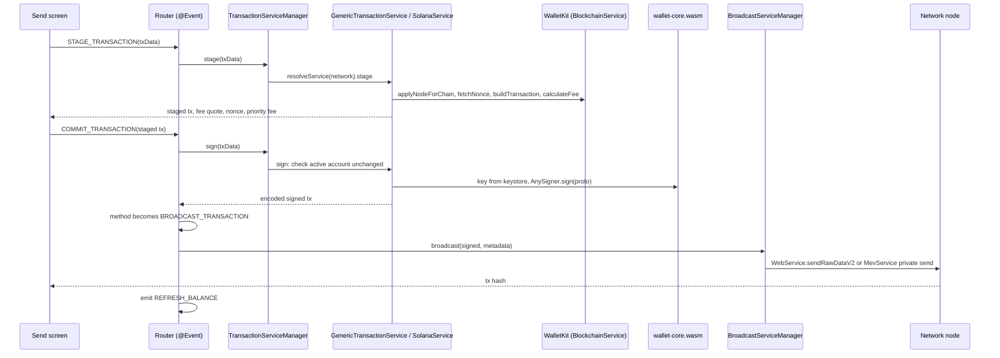
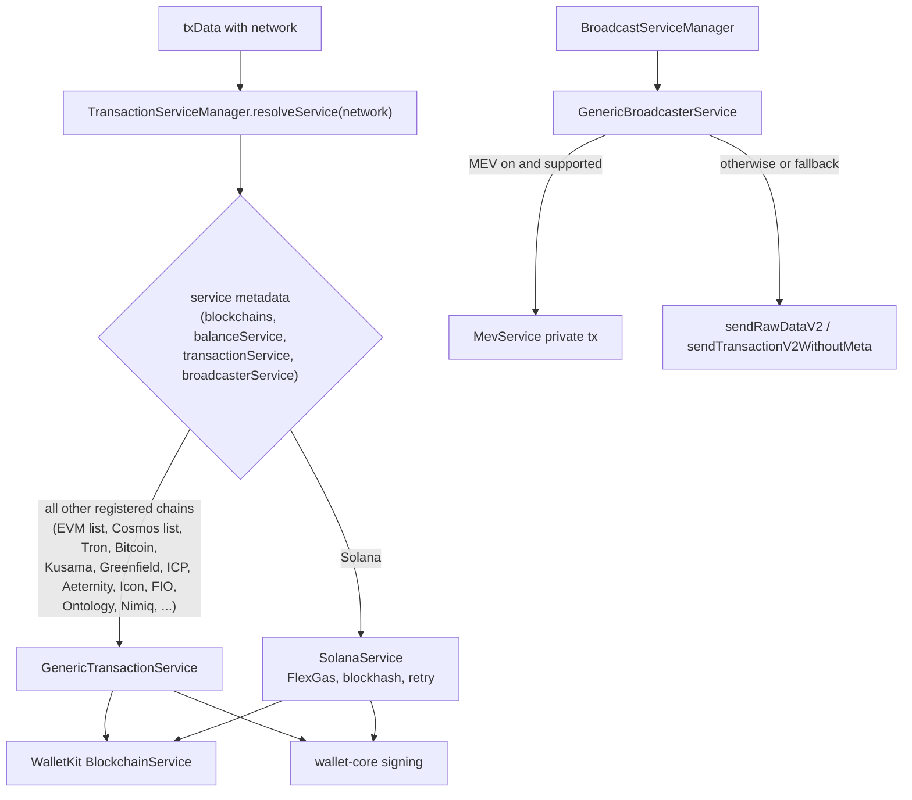

# 05 - Transaction pipelines: stage, sign, broadcast, refresh

Evidence labels: **CONFIRMED** (seen in code), **INFERRED** (reasoned), **UNKNOWN** (not found). Identifiers are real names from `background.js`.

## Plain-language summary

Every send goes through the same three worker messages: **STAGE_TRANSACTION** (build it and quote the fee), **COMMIT_TRANSACTION** (sign it, then hand it on), and **BROADCAST_TRANSACTION** (submit to the network). Which code runs for a given chain is chosen at runtime by a service manager that looks up the blockchain. In this build almost every chain uses one **Generic** service; Solana has its own. The Generic service does not contain per-chain transaction code itself: it calls the **WalletKit** SDK (`walletKitService.BlockchainService`, `WebService`, `MevService`, `SolanaFlexGasService`) and wallet-core for keys and signing. So the architecture is "one pipeline in the worker, per-chain knowledge in WalletKit and wallet-core".

## Diagram 1: the send pipeline

## Diagram 2: how a chain is dispatched

## Facts

### Stage

| Fact | Label | Source |
|---|---|---|
| `STAGE_TRANSACTION` -> `TransactionServiceManager.stage` -> `resolveService(network).stage` | CONFIRMED | `StageTransaction` |
| Stage steps: prepare params, apply node for the chain, build the transaction, build network fee, fetch nonce (if not given), for EIP-1559 networks fetch priority fees, then return the staged object; it records timings for prepare, node, build, fee, nonce, feePriority | CONFIRMED | `GenericTransactionService.stage` |
| Fee models handled: normal, custom fee config, sponsored gas (`isSponsoredGasFee`), user-operation fee (account abstraction), EIP-7702 fee, Solana FlexGas token fee | CONFIRMED | `stage`, `networkFeeIsUserOpFee`, `feeIs7702`, `selectedFlexGasFee` |
| Max sends and Solana FlexGas quote fetching run in parallel with the build | CONFIRMED | `stage` (`fetchSolanaFlexGasFeeQuotes`) |
| Gas estimate for the "balance too small" case: uses half the balance, returns "0" if that is 546 units or less | CONFIRMED | `estimateGas` |
| Capability probes exist per chain: `SUPPORTS_MEMO`, `SUPPORTS_NONCE`, `SUPPORTS_CUSTOM_FEE`, `BLOCKCHAIN_SUPPORTS_7702` | CONFIRMED | handlers in the router |
| Address and contract validation: wallet-core `CoinTypeExt.validate`; custom EVM chains validate as Ethereum; contract addresses first via the Trust Wallet asset API, then on-chain `name/symbol/decimals` calls | CONFIRMED | `validateAddress`, `validateContractAddress`, `fetchTokenOnChain` |
| Contract-address format check is skipped (always valid) for Cosmos chains, Greenfield, Stellar, Cardano, Bitcoin and Waves | CONFIRMED | `validateContractAddressFormat` |

### Sign

| Fact | Label | Source |
|---|---|---|
| `COMMIT_TRANSACTION` calls `transactionServiceManager.sign(txData)`, then rewrites the request to `BROADCAST_TRANSACTION` with `{signed, blockNumber, metadata, blockchainId}` | CONFIRMED | `CommitTransaction` |
| Safety check: signing is refused if the active wallet or account changed since the user confirmed ("Active account changed since this transaction was confirmed; refusing to sign") | CONFIRMED | `GenericTransactionService.sign` |
| Signing runs through `genericSigningService.sign`, which uses wallet-core (phase 3) | CONFIRMED (call), INFERRED (wallet-core is used inside) | `sign` |
| EIP-7702: if a send used a 7702 authorization and broadcast says it went stale, the worker re-signs once and retries | CONFIRMED | `CommitTransaction` (`isStale7702AuthorizationError`) |
| Solana FlexGas: user can pay fees in a token; the transaction is rebuilt with the FlexGas token fee and signed with the fee quote from `SolanaFlexGasService.requestFee` | CONFIRMED | `sign` |

### Broadcast

| Fact | Label | Source |
|---|---|---|
| `BroadcastServiceManager.broadcast` resolves a broadcaster from the blockchain id; error "Service not found for commit <id>" if none | CONFIRMED | `BroadcastServiceManager` |
| Generic path: `WebService.sendRawDataV2(chain, signed)` for raw-data chains, otherwise `BlockchainService.sendTransactionV2WithoutMeta` | CONFIRMED | `GenericBroadcasterService.sendBroadcast` |
| MEV protection: when enabled the worker tries `MevService.sendPrivateRawTransactionWithoutMeta` / `sendPrivateTransactionWithoutMeta`; if the chain does not support it, it falls back to public broadcast with a warning | CONFIRMED | `sendBroadcast`, `isMevUnsupportedError` |
| Solana FlexGas broadcast goes through `SolanaFlexGasService.submitTransaction` instead of a normal node | CONFIRMED | `GenericBroadcasterService.broadcast` |
| Retry helper classifies errors: transient (timeout, network, 502/503/504 and similar), already-known, nonce-too-low, may-have-reached-node; "already landed" is treated as success | CONFIRMED | `isTransientBroadcastError`, `ALREADY_KNOWN_MARKERS`, `NONCE_TOO_LOW_MARKERS`, `isTxAlreadyLandedError`, `retryAsync` |
| After success: `emit(QueueEvent.REFRESH_BALANCE)` | CONFIRMED | `CommitTransaction` |
| Solana has a dedicated retry broadcaster (`SolanaRetryBroadcast`) | CONFIRMED (name) | class list |
| TON broadcasts through its own event (`BROADCAST_TON_TRANSACTION`) | CONFIRMED | router |

### Per-chain structure

| Fact | Label | Source |
|---|---|---|
| Only two concrete transaction services extend the base: `GenericTransactionService` and `SolanaService` | CONFIRMED | `class X extends BaseTransactionService` |
| `GenericBlockchainProvider` registers: balance `GenericBalanceService`, transaction `GenericTransactionService`, broadcaster `GenericBroadcasterService`, for a list including Kusama, Greenfield, Binance testnet, Internet Computer, Aeternity, Icon, FIO, Ontology, Nimiq, all supported Cosmos chains and all supported EVM chains | CONFIRMED | decorator metadata |
| Bitcoin-family balances use the same generic service via WalletKit, including BRC-20 inscription balances | CONFIRMED | `fetchCoinInscriptionsBalanceForAddress` |
| Tron has its own encoding helpers (TRC-20 transfer/approve selectors, base58 address handling, contract types transfer, delegate, undelegate, claim rewards) in the transaction layer | CONFIRMED | `decodeTrc20Transfer`, `TRON_TYPE_CALL` |
| UTXO handling: `FETCH_UTXOS`, `UTXO_ACTION`, `UtxoBackgroundService`, PSBT sign/push events | CONFIRMED | router, class list |
| Gas and fee polling: `START_POLL_GAS_FEES` / `STOP_POLL_GAS_FEES`, gas station and gas status features | CONFIRMED | router |
| Transaction history: `FETCH_ASSET_TRANSACTION_HISTORY`, `..._HISTORY_WALK`, `FETCH_MISSING_TRANSACTIONS`, status updates `UPDATE_TRANSACTION_STATUS`, `TransactionHistoryService` | CONFIRMED | router, class list |
| Transaction simulation / pre-sign security scanning with an external scanner | CONFIRMED ABSENT in worker and WalletKit: the only `/v1/transactions/simulate` is Aptos fee simulation (see phase 6); no scanner client was found |

## Worked example: send 10 USDT on Ethereum

1. On the Send screen the user picks asset, address and amount. The UI calls `VALIDATE_ADDRESS` (wallet-core address check) and `SUPPORTS_MEMO/NONCE/CUSTOM_FEE` to decide which fields to show.
2. On review, the UI sends `STAGE_TRANSACTION`. The worker applies the node for Ethereum, fetches the nonce, builds the ERC-20 `transfer` call through WalletKit, asks `calculateFee`, and for EIP-1559 networks also asks `calculateFeePriority`. The UI shows fee tiers.
3. The user confirms and the UI sends `COMMIT_TRANSACTION`. The worker checks that the active wallet and account are the same ones that were confirmed, signs with the key from the keystore, and forwards `BROADCAST_TRANSACTION` with the signed bytes.
4. `BroadcastServiceManager` resolves `GenericBroadcasterService`. If MEV protection is on and supported it sends privately; otherwise `sendRawDataV2` to the configured node. A "known transaction" error is treated as success, transient network errors are retried.
5. On success the worker emits `REFRESH_BALANCE`; history is updated through `UPDATE_TRANSACTION_STATUS` and the history services.

## Evidence summary

| Claim | Label |
|---|---|
| Three-message pipeline (stage, commit, broadcast) | CONFIRMED |
| One generic service plus Solana for chain-specific differences; the real per-chain logic is in WalletKit and wallet-core | CONFIRMED (structure), INFERRED (that WalletKit holds the per-chain logic, because the generic service only calls it) |
| MEV protection with public fallback | CONFIRMED |
| Active-account guard before signing | CONFIRMED |
| Solana FlexGas, EIP-7702, sponsored gas, account-abstraction fees | CONFIRMED |
| Security simulation before signing | CONFIRMED ABSENT (no scanner client found; only Aptos fee simulation) |
| WalletKit internals (per-chain builders, node lists) | UNKNOWN until phase 6 reads `walletkit.service` |
