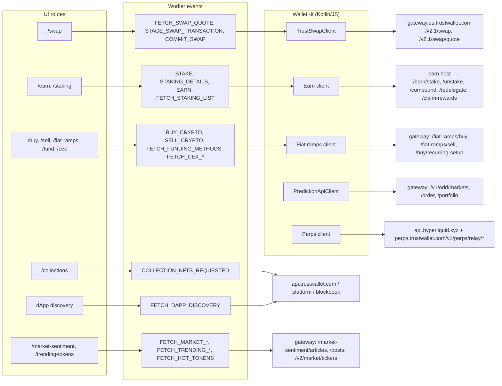
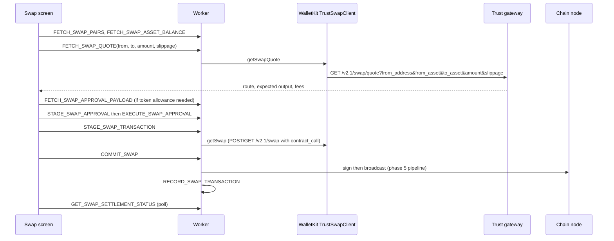

# 06 - Feature modules: swap, earn, buy/sell, NFTs, discover, markets, perps, predictions

Evidence labels: **CONFIRMED** (seen in code), **INFERRED** (reasoned), **UNKNOWN** (not found). Endpoint paths and host names are copied from `background.js` and `chunks/walletkit.service-*.js`. Only hosts and paths are listed; no request was made to any of them.

## Plain-language summary

Features are split into three layers. The **UI** (React, 66 routes) calls the worker with named events. The **worker** has one handler per action (phase 4). The **WalletKit SDK** (a 37 MB chunk that looks like Kotlin Multiplatform code compiled to JavaScript) makes the actual network calls: swap quotes, staking operations, balances, fees, prediction markets, perps, and so on. Trust Wallet's own gateways sit in front of almost everything, which is why one set of hosts covers so many features.

## Diagram 1: feature to backend map

## Diagram 2: swap flow

## UI routes (66 route patterns found in the App, popup and sidepanel chunks)

Account and wallets: `/onboarding`, `/unlock`, `/wallets`, `/wallet/:id`, `/wallet/accounts/:id`, `/wallet/account/:walletId/:accountId`.
Money movement: `/send/*`, `/receive/*`, `/swap/*`, `/bridge`, `/buy/*`, `/sell/*`, `/fund/*`, `/fiat-ramps/*`, `/cex`, `/cex/:providerId`, `/cex/qr`, `/gas-station/:assetId`, `/utxo`, `/history`, `/transaction/:id`, `/confirm`, `/approval`.
Earn: `/earn/*`, `/staking`, `/staking/:assetId`, `/unstake/:assetId`, `/redelegate/:assetId`, `/compound/:assetId`, `/claim-delegation/:assetId`.
Assets and NFTs: `/asset/:assetId`, `/manage-crypto`, `/custom-asset/*`, `/:assetId/inscriptions`, `/:assetId/inscribe`, `/collections/:collectionId`, `/collections/:collectionId/nfts/:nftId`, `/collections/reported`.
Markets: `/market-sentiment/*`, `/trending-tokens/*`.
dApps: `/connections`, `/connection/:id`, `/connections-blacklist`, `/notification`, `/notifications`.
Settings: `/settings/*`, `/preferences`, `/security`, `/auto-lock`, `/currency`, `/language`, `/color-mode`, `/network/*`, `/chain/:blockchainId`, `/address-book`, `/help`, `/developer`, `/developer/faucets`, and `/security/select-source-wallet` and `/security/select-destination-wallet` (a wallet-to-wallet security/migration flow whose purpose is not shown by the names alone). **CONFIRMED** (route strings).

## Facts by feature

### Gateways and hosts used by WalletKit

| Fact | Label | Source |
|---|---|---|
| WalletKit constants: `gateway.us.trustwallet.com`, `api.trustwallet.com`, `platform.trustwallet.com`, `assets-cdn.trustwallet.com`, `amber-api-stg.twinternal.net`, `earn.twstg.net`, `perps.trustwallet.com` | CONFIRMED | `Companion` in walletkit chunk |
| Other WalletKit hosts: `naming.trustwallet.com` (name resolution), `wallet-kit.trustwallet.com` (remote-fallback node config), `api.hyperliquid.xyz` (perps), `discover-cdn.trustwallet.com/public/config/chain-config.json` (remote chain config), `query.thegraph.kiln.fi/subgraphs/name/vsuite` (Kiln staking subgraph) | CONFIRMED | walletkit chunk |
| Two hosts look like staging environments (`amber-api-stg.twinternal.net`, `earn.twstg.net`) yet are compiled into the production bundle; the earn endpoints therefore go to a staging-named host in this build | CONFIRMED (strings), INFERRED (meaning) | walletkit chunk |
| WalletKit is a Kotlin Multiplatform library compiled to JavaScript: Kotlin-style names (`Companion`, `$...COROUTINE$`, `*_getInstance`), Ktor (`ktor.io` string), Apollo GraphQL clients (`BlockchainApolloClients`) | INFERRED (strong) | walletkit chunk |

### Swap

| Fact | Label | Source |
|---|---|---|
| Swap is Trust Wallet's own: `TrustSwapClient` calls `GET /v2.1/swap/quote` (params `from_address, from_asset, to_asset, amount, amount_for, recipient_address, slippage, contract_call`) and `/v2.1/swap` (adds `from_amount, to_amount`) | CONFIRMED | `TrustSwapClient$getSwapQuote`, `$getSwap` |
| Providers/routes: `/v1/providers`, `/v1/providers/bridge/`, `/v1/providers/dex/`, `/v1/route`, `/v1/route/step`, `/swap/hot-tokens` | CONFIRMED | path strings |
| Worker steps: pairs, balance, quote, approval payload, stage approval, execute approval, stage swap, commit swap, submit swap, record swap, settlement status; Solana and Tron have dedicated swap events (`SOL_SWAP_TRANSACTION`, `TRON_SWAP_TRANSACTION`); EIP-7702 swap quotes are supported (`SWAP_QUOTE_SUPPORTS_7702`) | CONFIRMED | router events |
| Bridge route `/bridge` exists in the UI | CONFIRMED | route list |

### Earn and staking

| Fact | Label | Source |
|---|---|---|
| Earn operations: `/earn/stake/`, `/earn/unstake/`, `/earn/compound/`, `/earn/redelegate/`, `/earn/claim-rewards/`, `/earn/claim-delegation/`, `/earn/staking`, `/staking-info` | CONFIRMED | path strings |
| Chain-specific staking: Cardano validator APRs (`/v1/staking/chains/cardano/validator_aprs`), Tezos bakers (`/v3/bakers`), Tron (`/wallet/getBrokerage`, `getReward`, `listwitnesses`, freeze/unfreeze contract types), Ethereum via Kiln (`ethKilnStakingService`, subgraph above, `/v1/pools/exit-queue/ticket/`), Cosmos validator lists, Polkadot/Kusama (`/v1/validator/all`) | CONFIRMED | path strings, class names |
| DeFi-style yield: stablecoin vault `/v1/invests/stablecoin/*` (config, positions, quotes, deposit, withdraw, approve), Angle (`/v1/defi/angle/*`), Morpho extra rewards (`/v1/defi/extra-rewards/morpho`), launchpool rewards | CONFIRMED | path strings |

### Buy, sell, funding

| Fact | Label | Source |
|---|---|---|
| Fiat ramps: `/fiat-ramps/buy`, `/fiat-ramps/sell`, `/buy`, `/sell`, `/buy/recurring-setup`; P2P buy handlers (`GET_P2P_BUY_CRYPTO_CONFIG`, `_QUOTES`, `_CHECKOUT`); one-click buy config; recurring buy checkout | CONFIRMED | paths, router events |
| Ramp address is checked against a trusted list (`enforceTrustedRampAddress` chunk) | CONFIRMED (name) | chunk list |
| CEX funding: `/cex`, `/cex/:providerId/assets`, `/cex/:providerId/platform`, `/cex/qr`; events `FETCH_CEX_FUNDING_ASSETS`, `FETCH_CEX_FUNDING_LINK` | CONFIRMED | routes, router |

### NFTs, inscriptions, tokens

| Fact | Label | Source |
|---|---|---|
| NFT UI: collections, item detail, reported collections; chunks `nft-collection`, `nft-item`, `nft-reported-collections`; event `COLLECTION_NFTS_REQUESTED` | CONFIRMED | routes, chunk names |
| Bitcoin inscriptions (BRC-20) balances and an inscribe route | CONFIRMED | `/:assetId/inscriptions`, `/:assetId/inscribe`, `FETCH_INSCRIPTIONS_BALANCE_FOR_ADDRESS` |
| Token metadata via `/v1/assets`, `/v1/assets/popular`, `/v1/assets/listings`, `/v1/search/assets`, `/assets/balance/`, plus on-chain ERC-20 probing | CONFIRMED | paths, phase 5 |
| Logos from `assets-cdn.trustwallet.com/assets/<address>/logo.png` | CONFIRMED | path string |

### Discover, markets, announcements

| Fact | Label | Source |
|---|---|---|
| dApp discovery: search and sections via the Trust API using wallet id and device id (phase 4) | CONFIRMED | `DappsService.fetchDiscovery` |
| Market data: `/v2/market/rates`, `/v2/market/tickers`, `/v1/market/info/`, `/market-sentiment/articles`, `/market-sentiment/posts`; trending tokens and networks; hot tokens | CONFIRMED | paths, router events |
| Announcements and VIP tier: `FETCH_ANNOUNCEMENTS`, `FETCH_USER_VIP_TIER_DATA` | CONFIRMED | router |
| Push notifications via GCM with topic updates | CONFIRMED | phase 2, router |

### Newer product lines found in WalletKit

| Fact | Label | Source |
|---|---|---|
| Prediction markets: `PredictionApiClientImpl` with `/v1/odd/auth`, `/categories`, `/networks`, `/markets`, `/markets/batch_outcomes`, `/order`, `/portfolio`, `/positions`, `/trades`, `/trades/create` | CONFIRMED | walletkit chunk |
| Perpetuals: `api.hyperliquid.xyz` plus a Trust relay (`/v1/perps/relay/authorize`, `/v1/perps/relay/quote`) | CONFIRMED | walletkit chunk |
| Whether these two features are reachable in the extension UI (no matching route in the 66 routes) | UNKNOWN; the code is present but no route string for them was found |
| Naming: `naming.trustwallet.com` with `/v1/domains`, `/v1/lookup` | CONFIRMED | paths |

### Fix to phase 5

| Fact | Label | Source |
|---|---|---|
| `/v1/transactions/simulate` is Aptos RPC fee simulation (`AptosRpcClient.simulate` with `estimate_gas_unit_price`, `estimate_max_gas_amount`), not a security scanner. No pre-sign security-scanner client was found anywhere in the worker or WalletKit | CONFIRMED | walletkit chunk |

## Worked example: staking from the Earn screen

1. The user opens `/earn/*`. The UI asks `FETCH_STAKING_LIST`; the worker asks WalletKit, which calls the earn host `/earn/staking` and chain-specific sources (for Ethereum, the Kiln subgraph).
2. The user picks an asset and amount. `STAKING_DETAILS` returns APR, lock-up, and fee info. `VALIDATOR_SELECT` is used on chains that need a validator.
3. On confirm the UI calls `STAKE`. WalletKit asks `/earn/stake/<id>` for the unsigned transaction payload, the worker stages it with the normal pipeline (phase 5), the user signs, and it is broadcast.
4. Later `/compound/:assetId`, `/unstake/:assetId`, `/redelegate/:assetId`, and `/claim-delegation/:assetId` follow the same pattern with `/earn/compound/`, `/earn/unstake/`, `/earn/redelegate/` and `/earn/claim-delegation/`.

## Evidence summary

| Claim | Label |
|---|---|
| Swap uses Trust Wallet's own `/v2.1/swap` gateway API | CONFIRMED |
| Earn operations call a gateway host named like a staging environment | CONFIRMED (host), INFERRED (staging intent) |
| WalletKit is Kotlin/JS | INFERRED (strong) |
| Prediction markets and perps clients are present | CONFIRMED |
| Those two are exposed in the extension UI | UNKNOWN |
| Request and response schemas of the gateway APIs | UNKNOWN (only paths and parameter names were read) |
