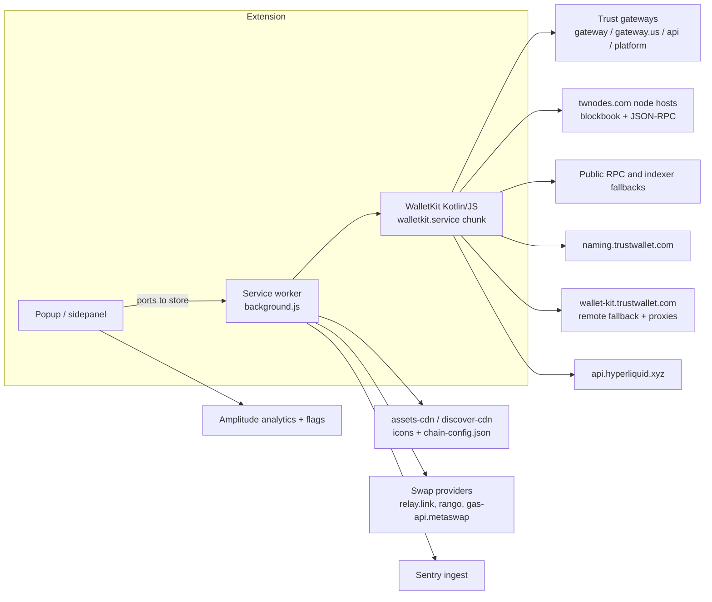
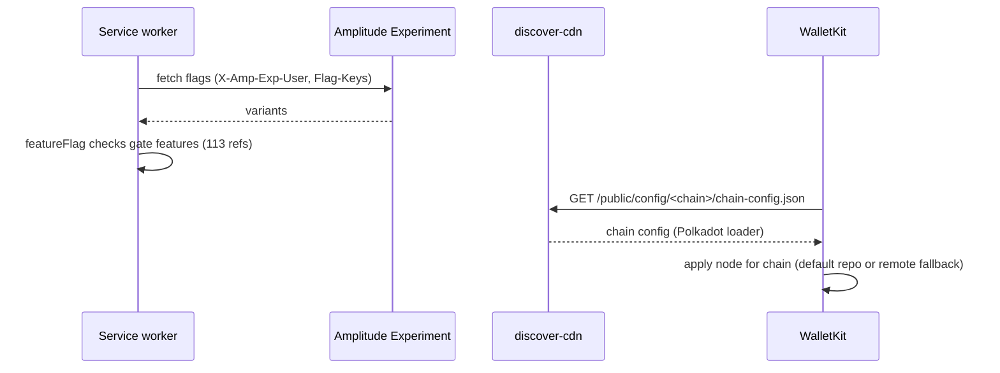

# 07 - Network Layer

Scope: every external endpoint Trust Wallet 26.41.0 can talk to, grouped by purpose, with how requests are authenticated, retried, configured and observed.

Evidence labels: **CONFIRMED** = literal string/code read in the bundle. **INFERRED** = deduced from naming or surrounding code. **UNKNOWN** = not resolved statically.

## 1. Topology

## 2. Endpoint groups

| Group | Hosts (representative) | Used by | Label |
|---|---|---|---|
| Primary gateway | `gateway.trustwallet.com` (prod), `gateway.twstg.net` (staging), `gateway.us.trustwallet.com` | WalletKit `getBaseUrl`: chooses prod vs staging by an environment flag | CONFIRMED |
| Legacy/API | `api.trustwallet.com`, `platform.trustwallet.com` | WalletKit service constants block (api, platform) | CONFIRMED |
| Asset CDN | `assets-cdn.trustwallet.com/blockchains/<chain>/assets/<id>/logo.png` | token icons, gas-token metadata | CONFIRMED |
| Remote chain config | `discover-cdn.trustwallet.com/public/config/<path>/chain-config.json` | Polkadot chain config loader | CONFIRMED (Polkadot only) |
| Naming | `naming.trustwallet.com` | name-service resolution client | CONFIRMED |
| WalletKit remote | `wallet-kit.trustwallet.com` (default remote fallback, configurable custom), e.g. `/v1/apr/proxy/stakewiz` | node fallback, staking APR proxy | CONFIRMED |
| Perps | `api.hyperliquid.xyz` | Hyperliquid client in WalletKit | CONFIRMED |
| Staging/internal | `amber-api-stg.twinternal.net`, `earn.twstg.net`, `gateway.twstg.net` | selected when environment is not prod | CONFIRMED present, INFERRED never used in production build |
| Node fleet | ~140 `*.twnodes.com` hosts | per-chain JSON-RPC/blockbook | CONFIRMED hostnames, INFERRED as default node repository |
| Public RPC / indexers | `api.trongrid.io`, `toncenter.com`, `mempool.space`, `thornode.ninerealms.com`, `api.mainnet-beta.solana.com`, `cloudflare-eth.com`, `mainnet.infura.io` | chain-specific fallbacks or metadata | INFERRED (some may be only explorer/doc links in chain metadata) |
| Swap/bridge providers | `api.relay.link`, `rango.exchange`, `gas-api.metaswap.codefi.network` | swap quote/gas helpers in background | CONFIRMED strings, INFERRED roles |
| Analytics | `api2.amplitude.com` (US), `api.eu.amplitude.com` (EU), `/batch` and `/2/httpapi` | Amplitude browser SDK in the useAnalytics chunk | CONFIRMED |
| Feature flags | `flag.lab.amplitude.com`, `api.lab.amplitude.com` (+ `.eu`) | Amplitude Experiment SDK; headers `X-Amp-Exp-*` | CONFIRMED SDK, INFERRED that it drives `isFeatureEnabled` |
| Error reporting | `o4507686279512064.ingest.us.sentry.io` (project 4509275482226688), release `26.41.0`, environment `production` | `initializeSentry` in background | CONFIRMED |

Note: 727 unique hostnames appear across bundles. Most are chain metadata (explorer, docs, social links), so host presence alone does not prove a runtime call.

## 3. Request conventions

| Aspect | Finding | Label |
|---|---|---|
| Device id header | `X-TW-DEVICE-ID` constant next to the gateway URLs | CONFIRMED |
| Signed-request headers | `X-TW-CREDENTIAL`, `X-TW-DATE`, `X-TW-NONCE`, `X-TW-TX-META` appear in bundles; signing scheme not decoded | CONFIRMED names, UNKNOWN algorithm |
| Account-abstraction headers | `X-TW-NAAS-AAG-PROVIDER`, `X-TW-NAAS-AAG-CHAIN`, `X-TW-NAAS-EOA-SPONSORSHIP-UID` (NaaS node/AA gateway, gas sponsorship) | CONFIRMED names |
| GraphQL | Apollo headers `X-APOLLO-OPERATION-NAME/ID`, `X-APOLLO-CAN-BE-BATCHED` indicate an Apollo Kotlin client | CONFIRMED headers, INFERRED GraphQL endpoint(s) |
| Correlation | `X-Request-ID`, `X-Correlation-ID`, `X-Platform` | CONFIRMED |
| Retry | "retry" appears 128x in background and 51x in WalletKit; analytics config `flushMaxRetries:12`, `flushQueueSize:200`, `flushIntervalMillis:10000`, `useBatch:false` | CONFIRMED counts and Amplitude defaults; per-call policies UNKNOWN |
| Timeouts | `AbortSignal.timeout` present (1x each); `timeout:` 14x in background | CONFIRMED presence |
| HTTP cache layer | No react-query style `staleTime` found; domain caches exist (e.g. address validation cache in WalletKit DI) | CONFIRMED absence of `staleTime`, INFERRED custom caching |

## 4. Remote configuration and flags

Feature-flag references: `featureFlag`/`FeatureFlag` appear 113x in background and 107x in WalletKit; `isFeatureEnabled` 18x in background (CONFIRMED). The flag provider mapping to Amplitude Experiment is INFERRED from the co-located SDK headers.

## 5. Worked example: loading a token balance on Ethereum

1. UI asks the store for balances; the worker calls WalletKit (INFERRED from the architecture in docs 02/06).
2. WalletKit's node repository picks a node for the chain: default `twnodes.com` host, or `wallet-kit.trustwallet.com` fallback (CONFIRMED mechanism, INFERRED exact order).
3. Request goes out with `X-TW-DEVICE-ID`; failures retry per client policy (UNKNOWN numbers).
4. Token icon is rendered from `assets-cdn.trustwallet.com/blockchains/ethereum/assets/<contract>/logo.png`.
5. Usage events are batched to `api2.amplitude.com` (or the EU host for EU zone).

## 6. Privacy and risk notes

- A Sentry DSN and project ids are embedded (public by design). Whether Sentry scrubs addresses is UNKNOWN.
- Analytics zone defaults to US; opt-out flag exists in config (`optOut:false` default) but the user-facing toggle location is UNKNOWN.
- Staging hosts shipping in the production bundle widen the string surface but are gated by an environment check (INFERRED).

## 7. UNKNOWNs carried forward

- Algorithm and key source behind `X-TW-CREDENTIAL`/`X-TW-NONCE` signing.
- Exact GraphQL endpoint URL(s) and operations.
- Node selection order and per-chain retry/timeout policies.
- Which of the ~140 `twnodes.com` hosts are default versus fallback.
- Amplitude API key location (not matched by regex; may be built at runtime).
