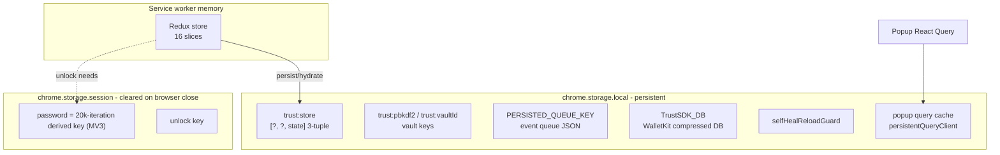
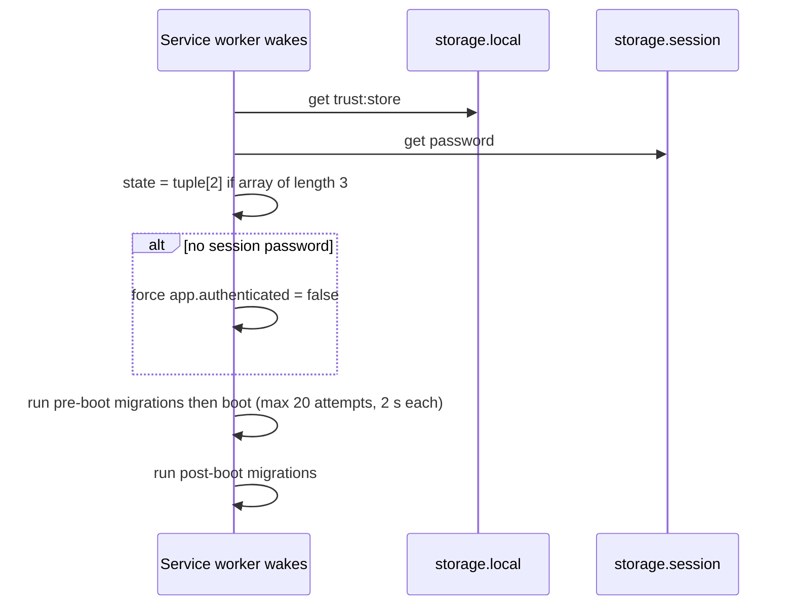

# 08 - State and Storage

Evidence labels: **CONFIRMED** (literal code/string), **INFERRED**, **UNKNOWN**.

## 1. Storage map

| Store | Key | Content | Encrypted? | Label |
|---|---|---|---|---|
| `storage.local` | `trust:store` | Persisted Redux state, saved as a 3-element array; hydration reads index 2 | Not shown to be encrypted here | CONFIRMED key and shape, UNKNOWN whether sensitive slices are stripped |
| `storage.local` | `trust:pbkdf2`, `trust:vaultId` | Vault KDF parameters / vault id (VaultService constants) | KDF params public by nature | CONFIRMED names; see doc 03 |
| `storage.local` | `PERSISTED_QUEUE_KEY` (value string not resolved) | JSON-serialised work queue, restored in `onApplicationBoot`, saved in `onApplicationShutdown` | No | CONFIRMED mechanism, UNKNOWN literal key |
| `storage.local` | `TrustSDK_DB` | WalletKit SDK DB, written through `setStorageKey` with a compress step | Compressed; encryption UNKNOWN | CONFIRMED |
| `storage.local` | `selfHealReloadGuard` | Guard record limiting self-heal reloads (1 h window) after WASM desync errors | No | CONFIRMED |
| `storage.local` | popup query cache key | React Query persisted queries (offlineFirst persister) | No | CONFIRMED mechanism |
| `storage.local` | `one-tap:*` prefix | Removed by migration `migrateOneTapRemoval` | n/a | CONFIRMED |
| `storage.session` | `password` | Despite the name, the PBKDF2 (20,000 iterations) derived key, not the raw password: `setPassword(deriveKey(pw, salt, 20000))` in create/unlock; read by `VaultService.getPassword()` and `isVaultUnlocked()` in MV3 | Derived key, memory-backed session storage | CONFIRMED |
| `storage.session` | unlock key | Derived unlock key: PBKDF2 210,000 iterations (`setUnlockKey`) | Derived key | CONFIRMED |
| `localStorage` / cookie | `loglevel` | Third-party logger level only | No | CONFIRMED |
| IndexedDB | none found | | | CONFIRMED absence (0 matches) |
| `storage.sync` | none found | | | CONFIRMED absence |

## 2. Redux slices (CONFIRMED via `createSlice` names)

`app`, `approvals`, `asset`, `blockchains`, `dapps`, `fiat`, `migration`, `migrations`, `nft`, `notification`, `sdkFeatureSlice`, `settings`, `staking`, `swap`, `tx`, `wallet`.

| Slice | Likely purpose (INFERRED from name) |
|---|---|
| app | lock/authenticated flag, boot state (`app.authenticated` is forced false when no session password) |
| wallet | accounts, selected account/wallet metadata |
| approvals / dapps | pending dapp requests, connected sites |
| asset / blockchains / nft | token lists, enabled chains, collectibles |
| tx / swap / staking | in-flight and historical transactions, swap and earn state |
| fiat / settings / notification | currency, user prefs, notices |
| migration(s) / sdkFeatureSlice | migration versions, SDK feature switches |

## 3. Boot and hydrate

Constants: `BOOT_MAX_ATTEMPTS=20`, `BOOT_ATTEMPT_TIMEOUT_MS=2000` (CONFIRMED).

## 4. Migrations

Versioned arrays with two tracks, `migrations.version` (pre-boot) and `migrations.postBootVersion` (post-boot). The runner slices the migration list from the current version and reduces over it, bumping the version after each (CONFIRMED). Named examples: `migrateOneTapRemoval`, `migrateTokenScannerRemoval`, `migrateWrongSelectedAccount`. Full list size UNKNOWN.

## 5. SQLite (sql-wasm)

`sql.js` is bundled (`initSqlJs`, `sql-wasm.wasm`) but no `new Database(` construction was found in the background bundle. Who loads it and what it stores is UNKNOWN; likely used by the WalletKit/Kotlin SQL layer (INFERRED), and the persisted DB would be the `TrustSDK_DB` blob (INFERRED, unverified).

## 6. Worked example: browser restart

1. Browser closes: `storage.session` is wiped, so the derived keys vanish; `trust:store` survives.
2. Browser reopens, worker boots, hydrates `trust:store`, finds no session password, forces `authenticated=false`.
3. UI shows unlock. Entering the password re-derives keys (doc 03) and rewrites them into session storage.

## 7. Findings worth flagging

- While unlocked, two derived keys (20k and 210k PBKDF2) sit in `storage.session` (MV3); the raw password is not stored. A key that decrypts the vault is still equivalent to the password for this wallet, so it is a sensitive in-memory secret until browser close (see doc 09).
- Whether `trust:store` includes the encrypted vault or only UI state is UNKNOWN; vault ciphertext location was documented in doc 03 via VaultService.

## 8. UNKNOWNs

- Literal value of `PERSISTED_QUEUE_KEY`, first two tuple items of `trust:store`.
- Which slices are excluded from persistence.
- SQLite consumer and schema; `TrustSDK_DB` encryption.
- Count and content of migrations.
