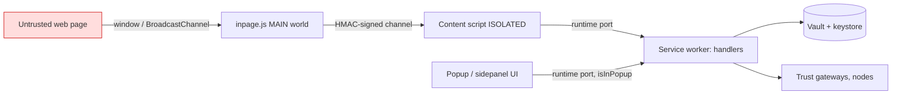

# 09 - Security Model

Evidence labels: **CONFIRMED** (code/manifest read), **INFERRED**, **UNKNOWN**. This is a static review of a public store build; it is not a vulnerability assessment.

## 1. Trust boundaries

Boundary 1 (page to inpage) is untrusted by design. Boundary 2 (inpage to content script) is protected by the secret handshake in doc 02. Boundary 3 (content script/popup to worker) is where sender attribution and the internal/public event split are enforced.

## 2. Manifest surface (CONFIRMED)

| Item | Value | Note |
|---|---|---|
| Permissions | alarms, tabs, storage, clipboardWrite, notifications, scripting, sidePanel, gcm | `tabs` and `scripting` are broad; `gcm` used for push |
| Host permissions | `https://*/*`, `http://localhost/*`, `http://127.0.0.1/*` | Required to inject the provider everywhere; also lets the worker script any https tab |
| CSP (extension pages) | `script-src 'self' 'wasm-unsafe-eval'; object-src 'self'` | No remote script; WASM allowed for wallet-core and sql.js |
| externally_connectable | not declared | Web pages cannot message the worker directly; only via content script |
| web_accessible_resources | not declared | Smaller fingerprinting and resource-abuse surface |

## 3. Internal vs public events (key control)

Handlers are registered under two namespaces built by `Internal("X")` -> `INTERNAL_X` and `Public("X")` -> `PUBLIC_X` (CONFIRMED). Sensitive operations such as `GET_SEED_PHRASE`, `GET_PRIVATE_KEY`, `REMOVE_WALLET`, `REGISTER_COIN`, `RESET` are `Internal`.

The dapp-request gate `isNeedShowPopup`:

1. Rejects the request if no `remotePort.sender` exists ("Unattributable request: missing sender").
2. Computes `isInPopup(request)`.
3. Calls `stripExternalTrustFlags(request, isInPopup)`: if the caller is not the popup, it forces `params.isInternal = false` and removes `params.source`.
4. `stripExternalAssetHint` does the same for asset hints on `eth_sendTransaction`/`eth_signTransaction`.
5. If the call is from the popup and not internal, it returns early; if the app is not initialized it opens the extension tab.

Result: a web page cannot self-assert `isInternal` (CONFIRMED stripping). Exact `isInPopup` implementation (sender URL vs id check) was not decoded: UNKNOWN.

## 4. Secret export access control

`GetSeedPhrase.handle({password, walletId, passkeyPassword})`: if `passkeyPassword` is given it first calls `passkeyService.retrievePassword`, then `walletService.getSeedPhrase(password, walletId[, true])`. So exporting the phrase requires the user's password (or passkey-derived password) as an explicit argument; an already-unlocked session alone is not enough (CONFIRMED signature). `GET_PRIVATE_KEY` follows the same pattern with `PasskeyService` injected (CONFIRMED injection, INFERRED identical flow).

## 5. Secrets at rest and in memory

| Asset | Where | Protection | Label |
|---|---|---|---|
| Mnemonic / keys | Vault + wallet-core keystore | PBKDF2 + AES-GCM; keystore AES-128-CTR (doc 03) | CONFIRMED |
| Wallet password (unlocked) | `storage.session["password"]` | Plain string, memory-backed, cleared on browser close | CONFIRMED |
| Unlock key | `storage.session` | Form unknown | UNKNOWN |
| App state | `storage.local["trust:store"]` | Not shown encrypted | CONFIRMED storage, UNKNOWN contents |

Risk note: any extension context able to read `storage.session` can read the password while unlocked. By default session storage is not exposed to content scripts, so the practical risk is a compromised extension page, not a web page (INFERRED).

## 6. Phishing and site controls

- `dapps` slice keeps `blacklistedSites` (user-managed list with id and date) and `connectedSites` (CONFIRMED). Actions `addBlacklistedSite`/`removeBlacklistedSite` exist.
- No built-in scam-domain feed or transaction security simulation was found (doc 05: CONFIRMED ABSENT for simulation). The only block list located is user-managed.
- Token scanner was removed by migration `migrateTokenScannerRemoval` (CONFIRMED name).

## 7. Telemetry exposure

Sentry (`production`, release `26.41.0`) with `attachStacktrace:true` and Amplitude analytics (doc 07). Whether addresses or balances are scrubbed before send is UNKNOWN.

## 8. Self-healing reload

On WASM desync errors the worker schedules a guarded reload, limited by `selfHealReloadGuard` (1 hour window, max count constant not decoded). This prevents reload loops (CONFIRMED mechanism).

## 9. Worked example: malicious page calls `INTERNAL_GET_SEED_PHRASE`

1. Page posts a crafted message with `isInternal:true`.
2. Inpage/content script forward it; the handshake HMAC check must pass (doc 02) or it is dropped.
3. In the worker, caller is not popup, so `isInternal` is forced false and `source` removed.
4. Even if it reached the internal handler, `getSeedPhrase` needs the user password argument.
5. Outcome: blocked at two independent layers (INFERRED end-to-end; each layer CONFIRMED individually).

## 10. Threat surface summary (ranked)

1. Plaintext password in session storage while unlocked.
2. Broad host permissions plus `scripting`/`tabs`.
3. Telemetry data minimization unknown.
4. No automated phishing or simulation protection (feature gap rather than vulnerability).

## 11. UNKNOWNs

- `isInPopup` exact logic; max reload count; unlock key format.
- Passkey secret source (carried from doc 03).
- WalletConnect relay/project configuration (carried).
- Sentry/Amplitude scrubbing.
