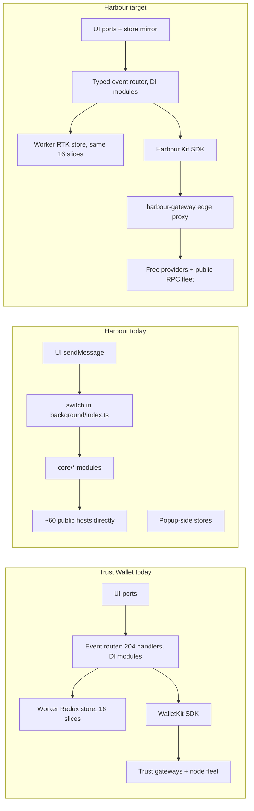
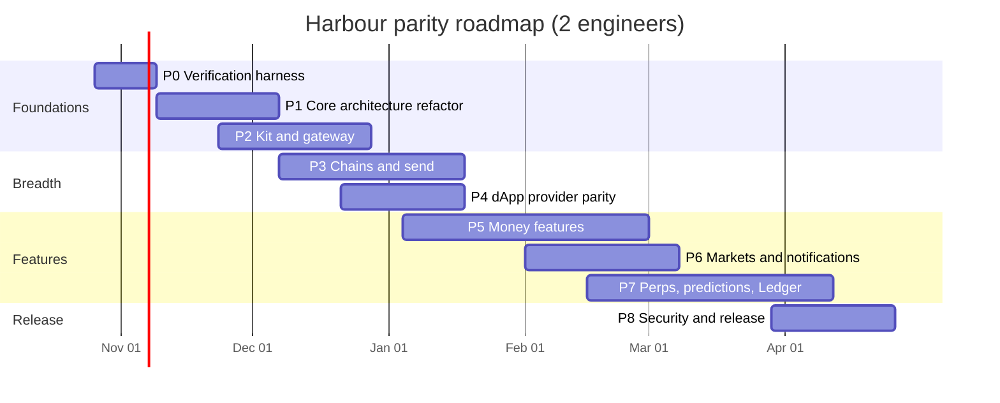
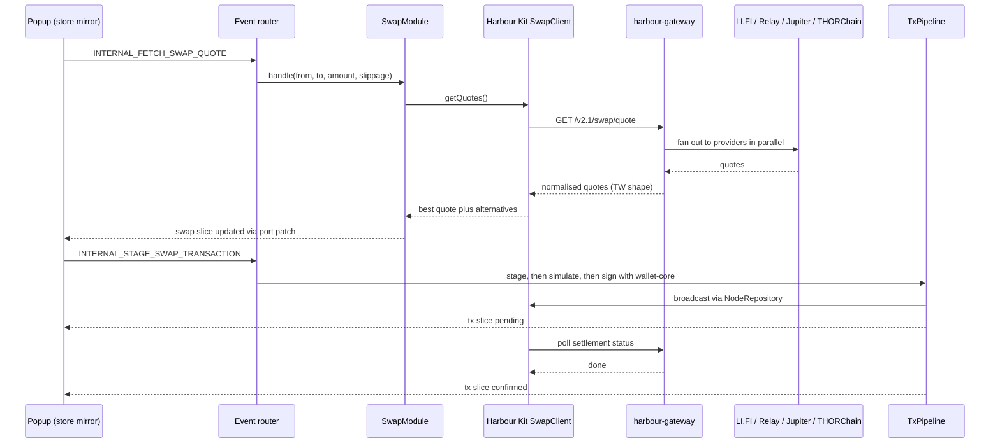

# 11 - End-to-End Plan: Making Harbour a Close Trust Wallet Clone

Inputs: Trust Wallet 26.41.0 reverse engineering (docs 01-10) and the current `harbour-wallet-v2` tree (about 19.6k lines of TS/TSX, `docs/project/FEATURE-MATRIX.md` dated 2026-10-19).
Goal: match Trust Wallet's **architecture, structure and features** as closely as practical. Where Trust Wallet relies on its private gateway or paid vendors, use **free third-party services** (or free tiers) instead.

Free-tier facts below were checked on 2026-10-21 where a source is cited. Others are marked "verify", because free tiers change often.

---

## 1. Principles

1. **Same shape, different data plane.** Copy Trust Wallet's layering (router, DI modules, worker store, WalletKit-style SDK, gateway). Swap only the backends.
2. **Own a thin gateway.** Trust Wallet hides vendors behind `gateway.trustwallet.com`. Harbour gets a free edge proxy (`harbour-gateway`) for the same job: it holds API keys, normalises responses and caches. API keys never ship inside the extension.
3. **Evidence-gated.** Every feature closes only when a parity test passes: route screenshot, event contract, signing vector or HAR contract.
4. **Free by default, paid as an option.** Each provider slot has a free primary and a free fallback. Paid upgrades are noted but never required.
5. **Keep Harbour's wins.** Per-origin chain selection, strict content-script validation, the public phishing lists and modular adapters are better or equal. Keep them unless parity requires otherwise.

---

## 2. Gap scorecard

| Area | Trust Wallet 26.41.0 | Harbour today | Gap |
|---|---|---|---|
| Background router | 204 `@Event` handlers in DI modules, `INTERNAL_*` / `PUBLIC_*` namespaces | One 670-line `switch` in `background/index.ts` plus `handlers/*` | **High** (structural) |
| State | Redux store **in the worker** (16 slices), persisted to `trust:store`, UI mirrors it over ports | Popup-side stores (`useSyncExternalStore`); `@reduxjs/toolkit` installed but unused | **High** (structural) |
| UI to worker transport | Long-lived ports, state push | `runtime.sendMessage` request/response (`popup/api.ts`) | Medium |
| Migrations | Versioned pre-boot and post-boot runners | None | **High** (needed before any release) |
| Boot robustness | 20 boot attempts at 2 s each, self-heal reload guard, persisted work queue | None | Medium |
| Data plane | WalletKit SDK: node repository, remote fallback, typed clients | Scattered `core/*` modules calling public APIs directly | **High** (structural) |
| Gateway | Private gateways plus about 140 `twnodes.com` nodes | Direct calls to about 60 public hosts; keys would be exposed | **High** |
| Remote config and flags | Amplitude Experiment flags, CDN `chain-config.json` | None | Medium |
| Telemetry | Sentry and Amplitude | None | Low (optional, opt-in) |
| Chains | 168-entry registry | 86 chains | Medium |
| dApp provider | EVM plus many chain families, HMAC-signed handshake | EVM (EIP-1193/6963), Solana, Wallet Standard; MessageChannel hello; never QA'd in Chrome | **High** until QA passes |
| Swap | Own `/v2.1/swap` aggregator (EVM, Solana, Tron, BTC, 7702) | LI.FI (EVM) and Jupiter (Solana) | Medium |
| Earn | Gateway `/earn/*`, Kiln (ETH), Tron, Cardano, Tezos, Polkadot | 12 Cosmos chains, SOL, ETH (Lido), BNB | Medium |
| Perps and predictions | Hyperliquid plus a Trust relay; `/v1/odd/*` prediction API | Absent | New scope |
| Push | `gcm` permission, topic updates | None | Medium |
| Hardware | Ledger | Stub | Medium |
| Security extras | User blacklist; no simulation found | Public lists and a local blacklist | Harbour is ahead; add simulation as a bonus |

---

## 3. Architectural and structural differences, and how to close them



| # | Difference | Trust Wallet evidence | Harbour evidence | Closing action |
|---|---|---|---|---|
| A1 | Handler model | `Event$2(events.X)` classes, `Module({services})`, `Use()` injection (doc 04) | `switch (msg.type)` in `background/index.ts`, `runExtraHandler` | Build `background/kernel/`: an `@Event` decorator (or a registry call), a small DI container (`Injectable`, `Use`, `Module`) and one class per handler. Port handlers module by module behind a compatibility shim. |
| A2 | Internal/public split | `Internal("X")` gives `INTERNAL_X`; `stripExternalTrustFlags` (doc 09) | `accessPolicy.ts` checks the popup URL | Namespace every event. Public events are reachable only from the provider port. Strip `isInternal`/`source` from non-UI senders. Keep the URL check and add the side-panel path. |
| A3 | Store location | Worker Redux, hydrated from `trust:store` (doc 08) | Popup modules hold state | Move to a worker RTK store with TW's slice names: `app, approvals, asset, blockchains, dapps, fiat, migration, migrations, nft, notification, sdkFeatureSlice, settings, staking, swap, tx, wallet`. The UI subscribes over a port that sends a snapshot plus patches. |
| A4 | Persistence and migrations | `trust:store` 3-tuple, pre-boot and post-boot versions | `wallet:*` keys, no versions | Add `wallet:store` as `[schemaVersion, postBootVersion, state]`. Port TW's runner semantics (slice the array from the current version, reduce, bump the version after each step). Migration 0 imports the current `wallet:*` keys. |
| A5 | Transport | Ports | `sendMessage` | Use one `harbour-ui` port per popup or side panel, with request ids and server push. Keep `sendMessage` only for wake-ups. |
| A6 | Boot and resilience | `BOOT_MAX_ATTEMPTS=20`, `selfHealReloadGuard`, persisted queue | None | Add a boot loop, a WASM-desync self-heal with a one-hour guard, and a persisted queue service (`onApplicationBoot` / `onApplicationShutdown`). |
| A7 | Data-plane SDK | WalletKit: `DefaultNodeRepository`, `DefaultRemoteFallback`, typed clients (doc 07) | Direct fetches | Build `src/kit/` (Harbour Kit): `HttpClient` with retry, timeout, cache, rate limit and circuit breaker; `NodeRepository` (default, then gateway fallback, then user custom); clients `SwapClient, EarnClient, NftClient, PriceClient, NamingClient, RampClient, PerpsClient, PredictionClient, HistoryClient`. |
| A8 | Gateway | `gateway.trustwallet.com`, `X-TW-DEVICE-ID` | None | Deploy `harbour-gateway` on a free edge runtime (Cloudflare Workers free plan, verify the quota). Routes mirror TW paths (`/v1/balances`, `/v2/market/tickers`, `/v2.1/swap/quote`, `/earn/*`, `/fiat-ramps/*`). Send an `X-HB-DEVICE-ID` header. |
| A9 | Remote config | Amplitude flags, CDN `chain-config.json` | None | Publish a signed `config.json` (flags, chain toggles, announcements, provider kill switches) on GitHub Pages or the gateway. Verify an Ed25519 signature in the worker. Optionally run GrowthBook (open source) later. |
| A10 | Telemetry | Sentry production, Amplitude | None | Opt-in only. Use Sentry's free developer plan or self-hosted GlitchTip for errors, and PostHog's free tier or none for analytics. Scrub addresses and amounts in `beforeSend`. |
| A11 | Chain registry | 168 entries (doc 03) | 86 in `core/chains/registry.json` | Generate the registry from wallet-core `registry.json`/`coins.json` plus TW asset metadata, and gate visibility with remote config. |
| A12 | Provider handshake | HMAC-signed BroadcastChannel secret (doc 02) | MessageChannel `HARBOUR_INPAGE_HELLO` | Keep the MessageChannel design, since it is already private. Add a per-load nonce, and an HMAC only if a test shows spoofing. Note this as a deliberate difference. |
| A13 | Tx pipeline | Stage, commit, broadcast, record, settlement poll (doc 05) | `sendService`, `swapService` | Build one `TxPipeline` (stage, then simulate, then sign, then broadcast, then track) feeding the `tx` slice. Swap, earn, NFT and dApp transactions all use it. |
| A14 | Session secrets | Derived 20k and 210k keys in `storage.session` | Same model (`wallet:password`, `wallet:unlock`) | Parity reached. Add a clear-on-idle alarm, which already exists. |

Target source layout:

```
src/
  background/
    kernel/        event decorator, DI container, port server, boot loop, queue, self-heal
    modules/       app, wallet, vault, provider, tx, swap, earn, nft, ramps, market, perps, prediction, notifications, ledger
    store/         RTK store, 16 slices, persistence, migrations/{pre,post}
  kit/             HttpClient, NodeRepository, clients/*, providers/* (vendor adapters)
  core/            wallet-core wrappers, chain adapters, signing (kept)
  inpage/ content/ provider families (evm, solana, cosmos, aptos, sui, ton, tron, btc)
  popup/           UI only: port client + store mirror, no business logic
gateway/           Cloudflare Worker (or Node) mirroring TW gateway routes
config/            signed remote config + chain toggles
```

---

## 4. Provider replacement map

The table maps each paid or private Trust Wallet backend to a free replacement. "Key" means a free API key is needed; keys live in `harbour-gateway`, never in the extension.

| Capability | Trust Wallet uses | Free primary | Free fallback | Notes and limits |
|---|---|---|---|---|
| EVM swap and bridge | Own `/v2.1/swap` aggregator | **LI.FI** (already integrated) | **Relay** (`api.relay.link`, already referenced by TW) | LI.FI without a key allows 75 quotes per 2 h; a free Partner Portal key gives about 100 req/min ([LI.FI rate limits](https://docs.li.fi/api-reference/rate-limits)). Relay requires a key for every `quote/v2` call from 2026-10-02 ([Relay API keys](https://docs.relay.link/references/api/api-keys)). |
| Solana swap | Own aggregator | **Jupiter** `api.jup.ag` | LI.FI (Solana routes) | Move off `lite-api.jup.ag`, which is being phased out. Keyless use is 0.5 RPS and the free key 1 RPS ([Jupiter migration](https://developers.jup.ag/docs/portal/migration)). |
| BTC and native cross-chain | Own aggregator plus THORChain | **THORChain** (THORNode quote endpoints) | **Chainflip** or **Maya** | No key needed. Affiliate fee basis points can fund the project. Verify the endpoints. |
| EVM to Solana | Own aggregator | **Relay** | **deBridge DLN** API, **Mayan** | Verify deBridge's free access. |
| Tron swap | `TRON_SWAP_TRANSACTION` | LI.FI or Rango (if Tron is supported) | SunSwap router via TronGrid | Rango needs a key (verify the free tier). |
| Gasless / 7702 swaps | `SWAP_QUOTE_SUPPORTS_7702`, NaaS sponsorship headers | **EIP-7702 + Pimlico/ZeroDev** free tiers (testnets, small mainnet quota) | Disable | 0x Gasless is paid (Standard plan, no free tier listed: [0x pricing FAQ](https://help.0x.org/articles/3042324687-0x-api-pricing-faq)). |
| Perps | `api.hyperliquid.xyz` plus a Trust relay | **Hyperliquid public API**, signed by the wallet directly | Dwellir or QuickNode Hyperliquid endpoints (free tiers, verify) | Register a **builder code**. Users approve `approveBuilderFee` once. The cap is 10 bps on perps and 100 bps on spot ([builder codes](https://www.dwellir.com/guides/builder-codes)). No Trust relay is needed. |
| Prediction markets | Gateway `/v1/odd/*` | **Polymarket** builder program (CLOB plus relayer) | Read-only display only | Builders get gasless relayer operations and attribution ([Polymarket builders](https://docs.polymarket.com/builders/overview)). Region restrictions apply, so gate by geo and legal review. |
| Balances (EVM) | Gateway, node fleet | **Public RPC fleet** (PublicNode, dRPC, Ankr, LlamaRPC via chainlist) with multicall | Alchemy or Infura free tiers | `NodeRepository` rotates nodes and records health. |
| Token balances (multi-EVM) | Gateway | **Blockscout** v2 APIs | **Etherscan API V2** (one free key, 5 calls/s) ([2026 comparison](https://eco.com/support/en/articles/14895612-block-explorer-apis-compared-2026-etherscan-blockscout-routescan-helius)), Alchemy free | Verify which chains Etherscan's free tier covers. |
| Solana tokens, history, NFTs | Gateway | **Helius** free developer plan (DAS) | Public RPC `getTokenAccountsByOwner` | Credit-based limits. |
| BTC, LTC, DOGE (UTXO) | Blockbook on twnodes | **mempool.space / Blockstream Esplora** (BTC) | Public Blockbook instances, Blockchair free (verify) | |
| Tron | twnodes, TronGrid | **TronGrid** (free key) | Tronscan API | |
| TON | twnodes | **Toncenter** (free key) | TonAPI free tier (verify) | |
| Cosmos family | Gateway, nodes | **cosmos/chain-registry** REST/RPC lists | Polkachu and other community endpoints | |
| Polkadot, Kusama | twnodes, CDN chain-config | **Subscan** (free key) plus official RPC | Polkadot.js public endpoints | |
| Cardano | `/v1/staking/.../cardano` | **Koios** (free) | Blockfrost free tier | |
| Tezos | `/v3/bakers` | **TzKT** (already integrated) | Tezos public RPC | |
| Tx history (EVM) | Gateway | Blockscout, Etherscan V2 | Routescan (no published free tier, so skip) | |
| Prices, tickers, charts | `/v2/market/*` | **CoinGecko** free Demo key (verify the monthly cap) | **DefiLlama** `coins.llama.fi` (free, no key), GeckoTerminal for DEX tokens | Cache prices in the gateway (60 s). |
| Fiat FX | Gateway `/v2/market/rates` | **open.er-api.com** (already integrated) | Frankfurter (ECB) | |
| Gas estimation | `gas-api.metaswap.codefi.network` | **`eth_feeHistory`** computed locally | Etherscan gas oracle | Avoid MetaMask's API (terms of service). |
| Token lists and logos | `assets-cdn.trustwallet.com` | **trustwallet/assets** GitHub (MIT), mirrored to the gateway or CDN | Uniswap token lists, Jupiter token API | |
| NFTs (EVM) | Gateway | **Alchemy NFT API** free tier | **Moralis** free tier, Blockscout v2 | SimpleHash has shut down ([Alchemy migration guide](https://alchemy.com/blog/migrating-from-simplehash-to-alchemy)). Avoid Reservoir: the company pivoted to bridging (Relay) ([Fortune](https://fortune.com/crypto/2025/02/05/union-square-ventures-leads-14-million-round-in-reservoir-an-nft-company-pivoting-to-bridge-technology)). |
| NFTs (Solana) | Gateway | **Helius DAS** | Magic Eden public API | |
| Inscriptions / ordinals | `/:assetId/inscriptions` | Ordinals indexer free tier (Unisat or Ordiscan, verify) | Hide the feature | |
| Staking: ETH | Kiln subgraph | **Lido** API (already integrated) | Rocket Pool contracts | |
| Staking: SOL | StakeWiz via the wallet-kit proxy | **StakeWiz** API (free; TW uses it) | validators.app (free key) | |
| Staking: Cosmos, Tron, Polkadot, Cardano, Tezos | Gateway `/earn/*` | Chain-native RPC/REST, Subscan, Koios, TzKT | | Build unsigned transactions locally with wallet-core. |
| Fiat on/off-ramp | Gateway `/fiat-ramps/*` | **Onramper** aggregator widget (partner key, free for integrators, verify) | Transak, MoonPay, Ramp, Mercuryo partner widgets | Ramps pay the integrator; no cost to Harbour. Mirror `enforceTrustedRampAddress`. |
| Name resolution | `naming.trustwallet.com` | **ENS** via RPC, **SNS** via the Bonfida proxy (already integrated) | Unstoppable Domains resolution (free key), Space ID | |
| WalletConnect | Reown (inferred) | **Reown** project id | | Reown's free Starter plan exists ([Reown pricing](https://reown.com/pricing)); confirm that WalletKit relay use stays within it. |
| dApp discovery | Gateway search | Curated `discover.json` in remote config | **DefiLlama** protocols API | |
| News and sentiment | `/market-sentiment/*` | RSS (CoinDesk, The Block, Decrypt) via the gateway | CryptoPanic free tier (verify) | |
| Phishing / token risk | User blacklist | **MetaMask eth-phishing-detect** list, **ScamSniffer** open DB, **GoPlus** Security API (free) ([GoPlus docs](https://docs.gopluslabs.io/)) | Local blacklist | Harbour goes beyond TW here. |
| Tx simulation | Not found in TW | **`eth_simulateV1`** on supporting RPCs | Tenderly or Alchemy free simulation (verify) | Optional bonus. |
| Push notifications | `gcm`, topics | **FCM** via `chrome.instanceID` / `chrome.gcm` plus a gateway worker that watches addresses | Polling alarms | |
| Remote flags | Amplitude Experiment | **Signed static JSON** | GrowthBook (open source) | |
| Error reporting | Sentry | **Sentry** free developer plan | GlitchTip self-hosted | Opt-in. |
| Analytics | Amplitude | None by default | PostHog free tier | Opt-in. |
| Gateway hosting | Trust infrastructure | **Cloudflare Workers** free plan | Deno Deploy or Vercel free | Verify the daily request quota. |

---

## 5. Phased plan

Each phase lists its work, its deliverable and its exit criteria. Durations assume two engineers working in parallel streams.

### Phase 0 - Verification harness (weeks 1-2)
- Load the built extension in Playwright Chromium (`tools/` scripts), with smoke tests for onboarding, unlock, injection and approval window.
- Signing vectors: wallet-core test vectors for each supported family, plus TW-compatible derivation checks (HD paths per CoinType).
- HAR contract replay: a mock gateway that serves `E2E-network-log-trust-wallet.har` responses, so UI parity can be tested offline.
- A parity checklist generated from doc 06 (66 routes) and doc 04 (204 events), stored as `parity/*.json`.
**Exit:** CI runs build, unit, vector and extension smoke tests on every commit. The parity dashboard shows the baseline percentage.

### Phase 1 - Core architecture refactor (weeks 3-6), closes A1-A6 and A14
- Kernel: DI container, `@Event` registry with `INTERNAL_`/`PUBLIC_` names, port server, boot loop (20 attempts at 2 s), queue service, self-heal reload guard.
- Worker RTK store with the 16 TW slice names. Persist `wallet:store` as `[version, postBootVersion, state]` and exclude secrets.
- Migration runner (pre and post). Migration 0 imports the existing `wallet:*` keys.
- Popup becomes a thin client: port, store mirror, selectors. Remove business logic from `popup/*`.
- Port the existing handlers one module at a time behind the shim, starting with app, vault, wallet, settings and provider.
**Exit:** `background/index.ts` is under 100 lines. Every message is a named event. Upgrading an old profile in a migration test keeps wallets and settings. No popup file imports `core/` services directly.

### Phase 2 - Harbour Kit and gateway (weeks 5-9), closes A7-A10
- `kit/HttpClient`: retry with backoff and jitter, timeout via `AbortSignal.timeout`, ETag and TTL cache, per-host token bucket, circuit breaker.
- `kit/NodeRepository`: default list, then gateway fallback, then custom node. Health scoring is persisted.
- Typed clients with provider adapters for every row in section 4, each with a primary and a fallback.
- `gateway/` (Cloudflare Worker): key vault, response normalisation to TW-shaped JSON, KV cache, per-device rate limiting.
- Signed remote config: flags, chain toggles, announcements, provider kill switches.
- Optional telemetry wiring, off by default.
**Exit:** no API key exists in the extension bundle (grep test). Killing any single provider in config fails over automatically, as shown by a test.

### Phase 3 - Chain breadth and send coverage (weeks 7-12), closes A11
- Generate the registry from wallet-core for 168 entries, with visibility from config. Start by exposing TW's user-visible set.
- Send: ICP, FIO, Nimiq, Aion and Ontology; tokens on Tron (TRC20 exists), Solana SPL (exists), TON jettons, Sui coins, Aptos coins, Stellar assets, Cosmos IBC/CW20, Algorand ASA, Polkadot Asset Hub.
- FlexGas and fee tiers (`FAST`/`TURBO`/`ULTRA` strings seen in WalletKit), UTXO management (coin control), BTC inscriptions view.
- History adapters per family through the Kit.
**Exit:** each enabled chain passes receive, send and history tests on testnet or a mainnet dust amount, and its signing vectors match.

### Phase 4 - dApp provider parity (weeks 9-12), closes A12
- Map each of TW's 204 events to Harbour's coverage. Implement the missing public methods.
- Add provider families: Cosmos (Keplr-compatible), Aptos and Sui (Wallet Standard), TON Connect, Tron (TronLink-compatible), Bitcoin (PSBT signing, Wallet Standard style).
- Approval window parity (screens from the UI parity work), SIWE and SIWS, biometric approval.
- Strip internal flags from external senders (TW `stripExternalTrustFlags` equivalent). Add a per-load nonce to the handshake.
**Exit:** the provider test-dApp suite (Uniswap, Jupiter, Keplr demo, TON Connect demo, Sui demo) passes in Chrome. The approval screen matches TW screenshots.

### Phase 5 - Money features (weeks 11-18)
- Swap: quote racing across LI.FI, Relay, Jupiter and THORChain, showing the best price with TW's provider list UI. Includes allowance staging, `TxPipeline` execution, settlement polling (Relay or LI.FI status, THORChain tx status) and swap history.
- Bridge, EVM to Solana, BTC swaps, and a dust cleaner (batch small balances into a swap).
- Gasless: EIP-7702 delegation plus a paymaster free tier, behind a flag.
- Earn: Tron (freeze/vote), Polkadot (nomination pools), Cardano (delegation certificate), Tezos (baker delegation), and ETH via Lido plus a Rocket Pool fallback. Multi-validator for Cosmos. Compound, redelegate and claim flows mirror TW routes.
- NFTs: Alchemy/Moralis for EVM, Helius DAS for Solana, floor prices from the same APIs, report and hide, spam filter.
- Ramps: Onramper aggregator plus direct partners, recurring buy, sell, P2P and CEX funding with the trusted ramp-address check.
**Exit:** each flow completes end to end on mainnet with small amounts, and the screen sequence matches TW captures.

### Phase 6 - Markets, discover, notifications (weeks 15-19)
- Market tickers, rates, info and charts through the gateway (CoinGecko, then DefiLlama, then GeckoTerminal).
- Trending tokens and networks, and hot tokens (CoinGecko trending, GeckoTerminal pools).
- Sentiment articles and posts from RSS through the gateway, with announcements from config.
- Push: FCM registration, plus a gateway worker that watches registered addresses (Blockscout/Helius webhooks or polling) and pushes incoming-transaction notices. Notification preferences already exist.
**Exit:** the home, market and discover screens render live data with the right fallbacks, and a test transfer triggers a push.

### Phase 7 - Advanced features (weeks 17-24)
- Perps: Hyperliquid client in `kit/clients/perps` (info and exchange endpoints), an agent wallet for session signing, deposit from Arbitrum USDC, builder code approval, positions, orders and PnL screens.
- Prediction markets: Polymarket client (markets, order, portfolio, positions and trades mapped to TW's `/v1/odd/*` shapes) using builder code attribution. Flag-gated and geo-gated.
- Ledger: WebHID transport (`@ledgerhq/hw-transport-webhid`), with EVM, BTC and SOL apps first.
- Mobile sync: keep the existing QR sync and align it with TW's flow.
**Exit:** perps trade on mainnet behind a flag, predictions run read-only plus one test order in an allowed region, and Ledger signs EVM and BTC.

### Phase 8 - Security, hardening, release (weeks 22-26)
- Security: phishing lists (MetaMask, ScamSniffer), GoPlus token, address and approval checks, `eth_simulateV1` previews, and an approval scan using GoPlus approval security plus on-chain allowance reads.
- Minimise permissions (drop `tabs` if `activeTab` plus scripting suffice). Review the CSP. Run a dependency audit and test that secrets never leave the worker.
- External review of the vault and provider, reproducible builds, and the store listing.
**Exit:** no critical findings, all parity checks at 95% or above, and the release candidate is signed.



The estimate is roughly six months for two engineers. Phases 3-7 can run in parallel once phases 1 and 2 land.

---

## 6. Worked example: swap in the target architecture



---

## 7. Verification strategy

| Layer | Method | Pass bar |
|---|---|---|
| Crypto | wallet-core vectors per CoinType, address derivation against TW for the same mnemonic | 100% match |
| Events | Contract tests per event name and payload schema derived from doc 04 | All implemented events green |
| UI | Route-by-route screenshot diff against TW captures (66 routes) | Under 2% pixel diff, or design sign-off |
| Network | HAR replay for the gateway's TW-shaped responses | Schemas match |
| Providers | Chaos test: disable each provider in config | Automatic failover, no UI error |
| dApps | Playwright suite on real dApps | Connect, sign and transact pass |
| Security | Secret-leak tests, sender spoofing tests, phishing list tests | Zero failures |

---

## 8. Risks and decisions

| Risk | Impact | Mitigation |
|---|---|---|
| Free tiers change or vanish (Jupiter's lite API retirement and Relay's mandatory keys both happened in 2026) | Features break | Two providers per slot, kill switches in config, gateway caching |
| API keys exposed in the extension | Quota theft | All keys in the gateway, device-id rate limiting |
| Perps and prediction regulation | Legal exposure | Geo-gating, flags off by default, legal review before enabling |
| Gateway becomes a single point of failure | Outage | Extension falls back to direct public endpoints for reads |
| Refactor regressions (phase 1) | Wallet loss risk | Migration tests on real profiles, staged rollout, vault code untouched |
| Trademark | Store rejection | Keep the neutral "Harbour" name and logo, as already decided |

Decisions for you:
1. Gateway host: Cloudflare Workers (recommended) or self-hosted on the Mac with Docker for development.
2. Monetisation (optional): swap and perps builder or affiliate fees can fund paid tiers later.
3. Scope of perps and predictions for the first release (recommended: behind a flag).

---

## 9. Mapping to unknowns (doc 99)

Several unknowns affect parity: the gateway schemas (#8) shape the gateway's response format, node selection order (#10) shapes `NodeRepository` defaults, and registry versus UI chain count (#12) shapes phase 3 visibility. Run a dynamic capture of TW (REA browser scenario) during phase 0 to resolve them before phases 2 and 3 lock their contracts.
