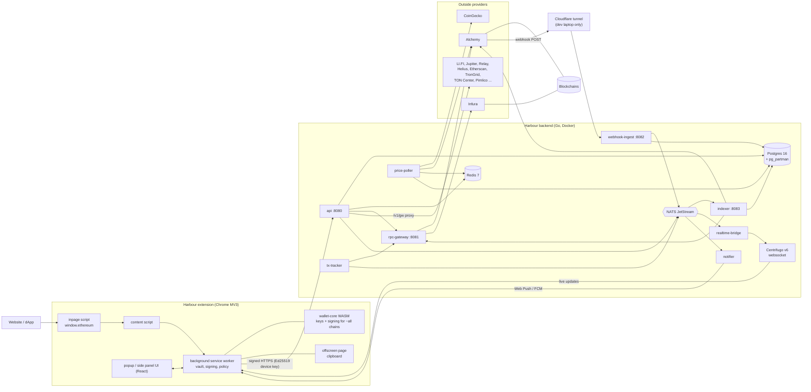

# Harbour Wallet v3: Technology Stack, Providers and How Everything Connects

Written 2026-10-30 from the code on branch `harbour-v3` (`harbour-wallet-v3/`). Every item below was found in `package.json`, `backend/go.mod`, `backend/deploy/docker-compose.yml`, `backend/config/*.yaml`, `manifest.config.ts`, `vite.config.ts`, the `src/` tree, or the existing docs next to this file. Where something is only planned (not built yet) it is marked **[planned]**. Where something is old v2 code that still sits in the repo it is marked **[legacy]**.

Related docs: `HOW-IT-WORKS.md` (backend flows with diagrams), `Harbour v3 — New Developer Guide.md` (how to run it), `CHAINS.md`, `SECURITY-AUDIT-V3.md`.

---

## 1. The whole thing in plain words

Harbour is a **Chrome extension wallet** plus a **small backend that we run ourselves**.

- The **extension** is the wallet. It holds the user's seed phrase and keys (encrypted), signs every transaction on the user's computer, and shows the screens. Keys never leave the extension. The backend never sees a seed, a private key or a password.
- The **backend** is the "data desk". It watches the blockchain for the addresses users track, stores balances, history, NFTs and prices in our own database, and serves the extension from that database. This makes the wallet fast, keeps provider API keys off the user's machine, and avoids paying a provider on every popup open.
- **Providers** (Alchemy, Infura, CoinGecko, LI.FI, and so on) are outside companies we rent data and features from. The backend talks to most of them; the extension talks directly only to a few public ones (non-EVM chains, some market data).
- A **tunnel** (Cloudflare) exists only on a developer laptop, so Alchemy can reach our laptop to say "a transfer just happened".

Four parts, three connections:

1. **A website** talks to the **content script and in-page script** (two small scripts Harbour injects into web pages).
2. The **popup UI** talks to the **background service worker** over a private port.
3. Only the **background service worker** talks to the **backend** (and to a few public chain endpoints).

---

## 2. Big picture diagram

---

## 3. The extension (front end)

### 3.1 Platform and build

| Technology | What it is | Why Harbour uses it |
| --- | --- | --- |
| **Chrome Extension Manifest V3** (`manifest.config.ts`) | Chrome's current extension format. The wallet runs as a service worker plus a popup and side panel. Minimum Chrome 137. | Required by the Chrome Web Store (MV2 is being retired). Chrome 137 is the first version with WebCrypto **Ed25519** unflagged, which the device key needs (audit finding V3-33). The strict CSP (`script-src 'self' 'wasm-unsafe-eval'`) blocks remote code; WASM is allowed only for wallet-core. |
| **TypeScript 5.5** | Typed JavaScript | A wallet moves money; types catch whole classes of bugs (wrong chain id, wrong amount type) before they ship. |
| **Vite 5.4** + **@crxjs/vite-plugin** (2.0 beta) | Bundler and extension packager | Fast builds, and crxjs turns `manifest.config.ts` and the entry files into a loadable extension. Source maps are never shipped. |
| **React 18** + **react-dom** | UI library | The popup and onboarding are built in React, to clone the Trust Wallet extension's UI one-to-one. |
| **Redux Toolkit** | State container | Holds wallet state in the background worker and the swap screen state (`background/store`, `swapStore.ts`). |
| **lucide-react**, **@fontsource/inter**, **lottie-web** | Icons, the Inter font, small animations | Visual match to the reference wallet; the font is bundled so no font host is called (privacy). |
| **ESLint 9** (+ typescript-eslint, react-hooks, unused-imports) | Linter, zero warnings allowed | Keeps the code clean and catches unsafe patterns. |
| **Node test runner** (`node --test test/*.test.js`) | Built-in tests, about 478 results | No extra test framework to trust or update. |
| **Node 22 / npm** | Toolchain | Build and test. `npm ci` installs the exact locked versions. |

### 3.2 The extension's internal pieces

| Piece | Folder | Job in plain words |
| --- | --- | --- |
| **Background service worker** | `src/background/` | The brain. Owns the vault, checks policy, signs, talks to the backend. Everything that matters happens here, never in a web page. |
| **Popup / side panel UI** | `src/popup/` | What the user sees. It shows data and asks the worker to do things through `popup/api.ts`. It is deliberately "dumb": it never receives a seed phrase or private key. |
| **Content script** | `src/content/content.ts` | Sits next to the web page, checks that each dApp request has a valid shape and an allowed method name, then forwards it to the worker. Chrome (not the page) reports the origin, so a site cannot pretend to be another site. |
| **In-page script** | `src/inpage/` | Defines `window.ethereum` (and the Solana and other providers) so dApps can find Harbour. It also announces Harbour to wallet pickers (EIP-6963). |
| **Offscreen page** | `src/offscreen/clipboard.*` | A hidden page Chrome allows so the worker can use the clipboard (for example to clear a copied address). Needs the `offscreen` and `clipboardWrite` permissions. |
| **Core logic** | `src/core/` | Code with no UI: chains, vault and passwords, tokens, swaps, staking, NFTs, activity history, ramps, signing policy (`core/harbour/policy.ts`). |
| **Network kit** | `src/kit/` | RPC failover, HTTP client, signed remote config, market-data clients. |
| **Harbour backend client** | `src/core/harbour/` | `client.ts` and `device.ts` sign each request with the device key; `fetchHook.ts` makes the Harbour API look like a normal RPC endpoint so older code keeps working. |

### 3.3 Libraries in `package.json` and why

**Wallet, keys and crypto**

| Library | Why it is here |
| --- | --- |
| `@trustwallet/wallet-core` 4.8.2 (WASM) | The same crypto engine the Trust Wallet uses: derives addresses and signs transactions for more than 100 chains from one seed. Harbour is a Trust Wallet clone, so using the same engine gives identical addresses. Loaded as WebAssembly (`scripts/prepare-wasm.mjs` copies and verifies it). |
| `viem` 2.21 | Typed EVM toolkit: encodes and decodes transactions, ABI calls, signatures and addresses. Also decodes signed transactions for the activity history. |
| `@noble/hashes` 1.5 | Audited pure-JS hashing. Provides **Argon2id**, HKDF and SHA-256 for turning the password into vault keys (`core/keySchedule.ts`). |
| WebCrypto (built into Chrome, no package) | AES-256-GCM vault encryption, HKDF, and **Ed25519** device signatures. Native and fast, nothing to audit in a bundle. |
| `buffer` 5.7 | Node's Buffer for places the browser or service worker lacks it (some chain SDKs need it). |
| `webextension-polyfill` | Promise-style `browser.*` API so extension code is not callback-based. |

**Chain SDKs for non-EVM families**

| Library | Chain family | Why |
| --- | --- | --- |
| `@mysten/sui` | Sui | Official SDK; builds and signs Sui transactions. |
| `@aptos-labs/ts-sdk` | Aptos | Official SDK. |
| `@ton/core`, `@ton/crypto`, `@ton/ton` | TON | Official SDK for wallet contracts and message signing. |
| `@polkadot/api` | Polkadot / Substrate (staking) | Official SDK for staking calls (`core/staking/polkadot.ts`). |
| wallet-core + hand-written senders in `core/chains/send/` | Bitcoin family, Solana, TRON, Cosmos family, XRP, Stellar, NEAR, Algorand, Tezos, Cardano, Filecoin and about 20 more | One engine for signing, thin per-chain code to fetch fees, build and broadcast. |

**Hardware wallet and QR**

| Library | Why |
| --- | --- |
| `@ledgerhq/hw-transport-webhid`, `hw-app-eth`, `hw-app-btc`, `hw-app-solana` | Talk to Ledger devices over USB (WebHID) so users can import and sign with a hardware wallet. |
| `qrcode` | Draws QR codes (receive address, sync). |
| `jsqr` | Reads QR codes from the camera (scan an address, import, mobile sync). |
| `@ngraveio/bc-ur` | Encodes data into multi-frame QR codes (UR format) for the QR wallet-sync feature (`core/qrSync.ts`). |

**dApp connections**

| Library | Why |
| --- | --- |
| `@reown/walletkit`, `@walletconnect/core`, `@walletconnect/utils` | **WalletConnect v2** (Reown). Lets mobile-first dApps connect to the extension through a relay. Harbour's policy file validates pairing links and which chains and methods are approved; requests then go through the same approval screen as injected dApps. Needs a project id (`VITE_WC_PROJECT_ID`). |

**Trading features**

| Library | Why |
| --- | --- |
| `@msgpack/msgpack` | Hyperliquid's API needs MessagePack when it signs orders (`core/perps/hyperliquid.ts`). |

### 3.4 Security design in the extension

| Item | What it does | Why |
| --- | --- | --- |
| **Argon2id + HKDF** key schedule (46 MiB, 2 passes, about 1.3 s) | Turns the password into two independent keys: the vault unlock key and the keystore passphrase. Old PBKDF2 vaults can still be read and are upgraded. | Memory-hard hashing makes a stolen browser profile expensive to brute-force (audit V3-01). |
| **AES-256-GCM vault** (`core/passworder.ts`) | Encrypts the vault; random salt and IV each time. | Authenticated encryption; tampering is detected. |
| **Passkey / WebAuthn biometrics** (`core/passkey.ts`) | Touch ID, Windows Hello or device PIN unlock. A random secret stored in the authenticator wraps the unlock material. | Same design as Trust Wallet 26.41.0 (recovered by reverse engineering). A password is always required too, so the user can unlock either way. |
| **Re-authentication gate** | Password or biometric needed to add a wallet, import, back up or reveal a seed. | Stops someone at an unlocked laptop from taking the seed. |
| **Signing policy** (`core/harbour/policy.ts`) | Every value-moving action is checked before signing (connected site, mainnet rules, quotas). | One central place to enforce rules. |
| **Device key (Ed25519)** | Each install makes a key pair; every backend request is signed. | The backend has no accounts or passwords; the device key *is* the identity. |
| **Signed remote config** (`kit/remoteConfig.ts`) | Feature flags, provider kill switches and announcements, verified with an Ed25519 public key baked into the build. | Lets us switch off a broken provider or feature without a store release, and nobody but us can change it. |
| **Signed releases** (`scripts/release.mjs`, `release-signer.pub`) | Release zip, SHA-256, signature and a reproducible build check. | Anyone can rebuild from the commit and compare hashes. |

---

## 4. The backend (Go)

All code is in `harbour-wallet-v3/backend/`. One Docker image builds every program; the container command chooses which one runs.

### 4.1 Language and Go libraries

| Technology | Why |
| --- | --- |
| **Go 1.26** | Small, fast, single static binaries, strong concurrency for the indexer, easy to run in tiny containers. Chosen over Node for predictable memory and speed on many parallel chain reads. |
| `go-chi/chi` v5 | Lightweight HTTP router for the API, gateway and webhook receiver. |
| `jackc/pgx` v5 | Fast PostgreSQL driver. Queries are hand-written for now (sqlc is planned once the indexer needs bulk queries). |
| `redis/go-redis` v9 | Redis client (nonces, quotas, price cache, locks). |
| `nats-io/nats.go` | NATS JetStream client (the event bus). |
| `nats-io/nats-server` | Used in tests to start a real NATS in-process. |
| `decred/dcrd/dcrec/secp256k1` | Recovers the sender address from a signed Ethereum transaction (broadcast checks that the sender is tracked by this device) and signs for the dev tool. |
| `golang.org/x/crypto` (sha3) | Keccak-256 for Ethereum hashing and addresses. |
| `golang.org/x/image` | Decodes and resizes NFT images (PNG, JPEG, GIF, WebP) in the media proxy. |
| `goccy/go-yaml` | Reads `providers.yaml`, `chains.yaml`, `api.yaml`. |
| `coder/websocket` | WebSocket client used by the `hbdevice` dev tool to watch realtime updates. |
| Go standard library | Ed25519 verification, AES-GCM, HMAC, HTTP, `crypto/tls`. |

### 4.2 Every backend service, one by one

| Service (`cmd/`) | Port | Plain-words job |
| --- | --- | --- |
| **api** | 8080 | The only service the extension talks to. Registers devices, verifies every signed request, enforces quotas, records which addresses a device tracks, serves portfolio / history / NFTs / prices / tx estimate-simulate-broadcast, issues realtime tokens, and proxies safe third-party calls under `/v1/gw`. |
| **rpc-gateway** | 8081 (private) | The *only* program that speaks JSON-RPC to Alchemy, Infura, QuickNode, Chainstack or public nodes. Spreads load over several keys, scores providers, fails over, opens a circuit breaker when one is sick, caches finalized results, hedges slow calls, sends transactions to two providers at once. Replaces what eRPC would do, in-process. |
| **indexer** | 8083 (health) | The worker. When an address is added it back-fills history (up to 90 days / 5,000 transfers), reads balances from the chain with **Multicall3** at one block, syncs NFTs, scores spam, creates and prunes Alchemy webhooks, handles live deliveries, runs gap-fill every 3 minutes, and repairs reorgs. |
| **webhook-ingest** | 8082 | A tiny receiver for Alchemy webhooks. Verifies the HMAC-SHA256 signature, stores the raw body for 7 days, puts it on NATS, answers 200 immediately. Records its own downtime so the indexer can gap-fill after an outage. |
| **price-poller** | none | Fetches USD prices only for tokens somebody holds (top 2,000 every 60 s, the rest every 5 min), caches them in Redis, writes price history and hourly balance snapshots. The extension never triggers a price call. |
| **tx-tracker** | none | Follows every transaction sent through Harbour until confirmed, failed or dropped, and announces each state change. |
| **realtime-bridge** | none | Copies `balance.changed` and `tx.status` events from NATS to Centrifugo channels. The only thing that pushes to clients. |
| **notifier** | none | Sends Web Push (and FCM when configured) such as "Received 0.5 ETH" or "Transaction confirmed", even when the popup is closed. Payloads are encrypted for the browser. |
| **migrate** | none | Runs the SQL files in `migrations/` once then exits. Creates tables, the runtime roles and monthly partitions (run daily with `-maintain`). |
| **hbdevice**, **hbkeys**, **hbverify** | none | Developer tools only: act as an extension from a terminal, generate VAPID keys, and check that stored balances equal a fresh chain read. |

### 4.3 Data and messaging stores

| Technology | What it stores or carries | Why this one |
| --- | --- | --- |
| **PostgreSQL 16** (+ **pg_partman**) | The source of truth: tracked addresses (device link encrypted with AES-256-GCM plus an HMAC blind index), transactions, transfers, address activity, balances, NFT holdings, price ticks, webhook deliveries. Big tables are partitioned by month (and hash-partitioned for activity). Amounts are `NUMERIC(78,0)`. | Reliable, supports huge numbers exactly (token amounts do not fit normal integers), strong constraints for de-duplication, and the same engine and `pg_partman` extension exist on AWS RDS. Each service logs in as its own role with data access only (no DDL). |
| **Redis 7.4** | Request nonces (stop replays), per-device rate limits and quotas, idempotency keys, registration challenges, cached prices, cached responses (10 s), push de-duplication, Centrifugo's engine. | Very fast and short-lived data does not belong in Postgres. Password-protected. |
| **NATS JetStream** | The event bus: `address.added`, `chain.<chain>.activity.raw`, `balance.changed.*`, `activity.new.*`, `tx.status.*`, `price.tick`, `chain.gapfill`. Messages stay on disk until a consumer acknowledges them. | Lets services work without waiting for each other, and nothing is lost if one restarts. Each service has its own login and may publish only to its own subjects (`deploy/nats/nats.conf`). Chosen over Kafka for being far lighter to run while the system is small. |
| **Centrifugo v6** | WebSocket server that pushes live balances and transaction status to the popup. Channels `balances:*` and `tx:*` cannot be joined by clients themselves; the api signs a subscription token per address. | A proven realtime server so we do not hand-write WebSocket fan-out. Uses Redis as its engine. |

### 4.4 Backend deployment and tooling

| Technology | Role |
| --- | --- |
| **Docker + Docker Compose** (`deploy/docker-compose.yml`, `run.sh`) | One command starts Postgres, Redis, NATS, Centrifugo, migrate and all Go services in the right order. Ports are bound to `127.0.0.1` only. |
| **Multi-stage Dockerfile** | Builds with `golang:1.26-alpine`, runs on `gcr.io/distroless/static` as a non-root user. Reproducible (`-mod=readonly`, `-trimpath`), tiny, no shell for an attacker. |
| **Cloudflare quick tunnel (`cloudflared`)** | Development only. Gives `webhook-ingest` a temporary public HTTPS address so Alchemy can POST to a laptop. Needs no router changes (it makes an outbound connection). The URL changes on restart, so it is kept in `WEBHOOK_PUBLIC_URL` and the indexer moves the webhook automatically. |
| **Makefile, `scripts/setup.sh`** | `make up/test/lint`; `setup.sh` generates every password and secret into a git-ignored `.env`. |
| **GitHub Actions** (`ci/backend.yml`) | `go vet`, `golangci-lint` (with `depguard`), provider-name check, `go test -race`, **govulncheck**, **gosec**; `go mod tidy` must leave no diff. |
| **Prometheus metrics** (`/metrics` on the gateway) | Per-provider health, latency and error counts. |
| **AWS [planned]** (RDS Postgres, ElastiCache Redis, ECS Fargate, later EKS) | Production hosting (backend plan phase 7). Chosen because Alchemy and Infura run mostly on AWS (low latency), it has the most managed options, and RDS supports `pg_partman`. In production `webhook-ingest` sits behind a load balancer with a fixed domain, so no tunnel. |

---

## 5. Providers and services, every one, and why

### 5.1 Blockchain data and RPC

| Provider | Used by | What for | Why |
| --- | --- | --- | --- |
| **Alchemy** | rpc-gateway, indexer, price-poller, api (`/v1/gw`) | JSON-RPC; **Transfers API** (history); **Address Activity webhooks** (live pushes); NFT API; token metadata; risk simulation on mainnets; price fallback | One provider covers history, webhooks, NFTs and RPC for most EVM chains. Chosen as the main indexer source and first RPC. |
| **Infura** | rpc-gateway | Second RPC provider | Failover: if Alchemy has a bad day, reads keep working. |
| **QuickNode, Chainstack** | rpc-gateway (optional keys) | Third and fourth RPC pools for Ethereum and Base | More independence for production. Skipped at startup if their env var is empty. |
| **Public RPC endpoints** | rpc-gateway | Chains Alchemy/Infura do not serve (RPC-only chains) | Free fallback; each endpoint gets its own rate budget. |
| **Etherscan v2** | api `/v1/gw` | Explorer history for chains without our indexer | One key covers many EVM chains. |
| **Blockscout** (many `*.blockscout.com`) | extension | Explorer history and NFTs for EVM chains with no keyed explorer | Free and open; works on testnets and smaller chains. |
| **Helius** | api `/v1/gw` | Solana RPC and DAS (NFT) calls | Best-in-class Solana access; key stays on the server. |
| **TronGrid** | api `/v1/gw` | TRON account, resources and broadcast | The standard TRON gateway. |
| **TON Center** | api `/v1/gw` | TON API | Public TON gateway. |
| **mempool.space / Esplora** | extension | Bitcoin history and fees | Public, no key. |
| **Magic Eden** | extension | Solana NFT data | Solana NFT market data. |
| **Public chain endpoints** (Cosmos LCDs, Sui, Aptos, XRP, Stellar and others) | extension, direct | The 41 non-EVM chains the backend does not serve | Reuses v2 adapters; MVP scope. Trade-off: these calls come straight from the user's browser, so a third party sees the user's IP. |

### 5.2 Prices and market data

| Provider | Used by | Why |
| --- | --- | --- |
| **CoinGecko** (demo or pro plan) | price-poller, api `/v1/gw` (market charts, tickers, trending) | Broad coverage; first price source. Decision: public data rather than Trust Wallet's private gateway. Commercial-licence check still to confirm. |
| **Alchemy Prices** | price-poller | Fallback when CoinGecko lacks a token. |
| **DefiLlama** (`coins.llama.fi`) | extension | Extra token prices. |
| **GeckoTerminal** | extension, gateway `/gt/` | DEX pool data and liquidity for new tokens. |
| **GoPlus** | extension | Token and address security checks (honeypots, scam flags) before the user signs. |
| **RSS feeds** (CoinDesk, Cointelegraph, Decrypt, The Block) | gateway `/rss/` | News in the Discover tab. |

### 5.3 Swaps, bridges and gas

| Provider | What for | Why |
| --- | --- | --- |
| **LI.FI** | Cross-chain and same-chain EVM swap routing | One API aggregates many DEXes and bridges; swap fees can be earned. |
| **Jupiter** | Solana swaps | The standard Solana aggregator. |
| **Relay** | Fast cross-chain bridging | Quick bridge quotes. |
| **THORChain** (via THORNode) | Native-asset swaps (BTC and others) | Trust-minimised cross-chain swaps. |
| **Pimlico** | ERC-4337 account-abstraction and gasless / paymaster calls | Optional gasless transactions (feature flag `gasless7702`, off by default). |

### 5.4 Buy / sell (ramps)

Transak, Ramp Network, MoonPay, Mercuryo, Banxa and Onramper (each in `core/ramps/`), plus a Binance P2P link. Harbour builds the checkout link and enforces that the wallet address placed in it is the user's own (`ramps/guard.ts`); the provider does KYC and payment. Reason: a self-custodial wallet should never touch fiat or custody funds. Keys for these are entered by the operator, not shipped in the build.

### 5.5 Trading features (UI-first in the MVP)

| Provider | Feature | Note |
| --- | --- | --- |
| **Hyperliquid** (`api.hyperliquid.xyz`) | Perpetuals | A builder code and fee can be set in the build (`VITE_HB_HL_BUILDER*`). Flag `perps` is off by default. |
| **Polymarket** (`gamma-api.polymarket.com`) | Prediction markets | Optional builder code. Flag `predictions` is off by default. |
| **Staking** (`core/staking/`) | EVM, Solana, TRON, Cosmos family, Cardano, Tezos, Polkadot | Validator list snapshot bundled in the extension. |

### 5.6 Notifications

| Technology | Why |
| --- | --- |
| **Web Push with VAPID** (notifier) | Standard browser push; payloads are encrypted so only the user's browser can read them. Endpoints must belong to a real browser push service. |
| **Firebase Cloud Messaging** (`gcm` permission, `VITE_HB_FCM_SENDER_ID`, `FCM_CREDENTIALS_FILE`) | Chrome extension push channel; set up as an optional adapter. |

### 5.7 Other external services

| Service | Role |
| --- | --- |
| **WalletConnect / Reown relay** | Message relay for WalletConnect v2 sessions (project id required). |
| **IPFS and Arweave gateways** | Fetch NFT metadata that lives on those networks (the backend media proxy fetches images, refuses private addresses, and re-encodes them). |
| **GitHub** | Source hosting and CI. |
| **Chrome Web Store** | Distribution of the signed release zip. |

---

## 6. Chains

Per `CHAINS.md`: **16 EVM mainnets and 2 testnets are fully indexed** by the backend (Ethereum, Base, Polygon, Arbitrum, Optimism, BNB, Avalanche, Linea, Scroll, zkSync, Blast, Mantle, Celo, Gnosis, opBNB, Sonic; plus Sepolia and Base Sepolia). **38 more EVM mainnets are RPC-only** (balance and fees through the backend RPC proxy). **41 non-EVM chains** (Bitcoin, Solana, TRON, Cosmos family, TON, Sui, Aptos, XRP, Stellar and more) are served straight from the extension. Product rules: only the native coin shows by default; tokens and NFTs appear after the user adds them; networks are grouped Default, Custom and Testnets. Chain lists are generated from one source (`backend/scripts/gen_chains.py`) so extension, backend and faucets stay in step.

---

## 7. How the pieces connect: five stories

### Story 1: opening the wallet (home screen)

1. `price-poller` has already filled Redis with prices for held tokens (from CoinGecko, Alchemy as fallback).
2. The popup asks the worker; the worker sends `GET /v1/me/portfolio` to **api**, signed with the device key.
3. **api** checks the signature and the nonce in **Redis**, reads balances from **Postgres**, reads prices from **Redis**, and answers.
4. Nothing in this path touches a blockchain or a price provider. That is why it is fast and costs no provider credits.

### Story 2: adding an address (first time we see it)

1. The extension sends `PUT /v1/me/addresses`. **api** records it as `pending` in **Postgres** and publishes `address.added` on **NATS**.
2. **indexer** wakes up, pulls history from **Alchemy**'s Transfers API (newest first, capped), and writes it to Postgres. Every fact is first inserted into `event_keys`; a duplicate key means "already stored", so replays do nothing.
3. It reads balances with **Multicall3** through **rpc-gateway** at a single block (never by adding up transfers, because gas and rebasing tokens change balances without a transfer).
4. Within about 15 seconds it adds the address to an Alchemy **webhook**.

### Story 3: a transfer arrives (live path)

1. A block with the transfer lands on the chain. **Alchemy** POSTs a webhook to our public URL (in dev: the **Cloudflare tunnel**, which forwards to `localhost:8082`).
2. **webhook-ingest** verifies the HMAC signature, stores the raw body, publishes it on **NATS**, and answers 200.
3. **indexer** converts it into a standard event, writes it to Postgres (deduped), waits 2 s for more events, refreshes balances, and publishes `balance.changed` and `activity.new`.
4. **realtime-bridge** forwards `balance.changed` to **Centrifugo**, which pushes it to the open popup. **notifier** sends a Web Push "Received ..." if the popup is closed.
5. If the webhook is missed (laptop asleep, tunnel down), **gap-fill** every 3 minutes (and after a detected outage) re-reads from `last_seen_block`. Webhooks make it fast; gap-fill makes it correct.

### Story 4: sending a transaction

1. The user confirms in the popup. The worker checks the **signing policy**, signs locally with the vault key (wallet-core / viem), then calls **api** `estimate`, `simulate` and `broadcast`.
2. **api** forwards to **rpc-gateway**, which picks the healthiest of **Alchemy / Infura / others** and sends the raw transaction to two providers at once.
3. **api** stores it as pending and returns a channel token. **tx-tracker** polls receipts through the gateway and publishes `tx.status` on **NATS**; **realtime-bridge** and **Centrifugo** push the status; **notifier** pings "Transaction confirmed".
4. The backend never sees the key; it only relays bytes that are already signed.

### Story 5: a website asks to connect or sign

1. The dApp calls `window.ethereum.request(...)` (the **in-page script**).
2. A private channel hands it to the **content script**, which validates it and forwards it to the **background worker**.
3. The worker queues it and opens the **approval window**; the user sees a prepared summary (never keys) and approves.
4. The worker signs and, for a transaction, broadcasts it through the backend (Story 4). WalletConnect requests take the same approval path.

---

## 8. Why this particular stack: the short answers

| Choice | Reason |
| --- | --- |
| Chrome MV3 extension | Required by Chrome; best reach for a Trust Wallet extension clone. |
| React + Vite + TypeScript | Fast to build, matches the reference UI, and types protect money-moving code. |
| Trust Wallet's wallet-core (WASM) | Same addresses and signing as the wallet being cloned, covering 100+ chains without writing each signer from scratch. |
| viem | Small, typed, audited-style EVM tooling. |
| Argon2id, AES-GCM, WebAuthn, Ed25519 | Modern, standard, memory-hard and hardware-backed protection for a vault in a browser profile. |
| Own Go backend instead of the v2 Cloudflare worker | Heavy reads (history, balances, NFTs, portfolio) are served from our database, provider keys stay on our servers, and the extension never queries providers directly. The v2 worker (`gateway/`) is **[legacy]** and unused in v3. |
| Postgres | Exact big numbers, partitioning, strict de-duplication. |
| Redis | Fast nonces, quotas, caches. |
| NATS JetStream | Durable, light event bus; per-service permissions. |
| Centrifugo | Ready-made realtime push. |
| Alchemy + Infura (+ QuickNode / Chainstack) | Provider redundancy behind our own gateway so one outage or 429 does not break the wallet; adding a provider is a config change, not code. |
| CoinGecko with Alchemy fallback | Public price data, no dependency on Trust Wallet's private APIs. |
| Docker Compose now, AWS later | One-command local stack identical to production; AWS chosen for managed Postgres/Redis and provider proximity. |
| Cloudflare tunnel in dev only | Lets Alchemy reach a laptop without opening router ports. |
| Provider adapters + YAML config | New providers, RPCs, indexers and chains are added by config or one adapter package passing the shared contract tests. CI blocks provider names from leaking into service code. |
| govulncheck, gosec, golangci-lint, npm audit, reproducible builds, signed releases | Supply-chain and code-safety checks for a wallet people trust with funds. |

---

## 9. Things that are not there yet, or need care

- **AWS deployment** and more production hardening are **[planned]**.
- **FCM** is wired as an optional channel; it is not required for the Web Push path.
- **Perps and prediction markets** are UI-first and gated by remote-config flags (`perps`, `predictions`, `gasless7702` default to `false`).
- **Non-EVM and RPC-only reads** reach third parties (browser direct, or via the Harbour RPC proxy), unlike indexed chains: a privacy trade-off listed in `CHAINS.md`.
- **Open audit items** (Infura key rotation, privacy opt-in, Go toolchain bump for stdlib advisories, two flaky tests) are tracked in `SECURITY-AUDIT-V3.md` and `AUTH-AND-ACTIVITY-FIXES.md`.
- **Secrets** (provider keys, Firebase service account, release key) live only in git-ignored files and the backend `.env`; none are in the extension bundle. The build refuses a non-https backend URL except localhost.
