# How the Harbour backend runs (and why each command exists)

This explains what actually happens when you run `./run.sh`, what Docker, the Cloudflare tunnel and the webhook URL are for, and how a single transfer travels from the blockchain into the wallet's database. Read it top to bottom once; after that, the diagrams are the quick reference.

---

## 1. The one-paragraph version

The extension should never ask a blockchain node for balances or history directly: it would be slow, cost provider credits on every popup open, and expose provider keys. Instead, Harbour runs its own small set of services. They **watch the chain for the addresses users track, write everything into Postgres, and serve the extension from Postgres**. Alchemy tells us about new transfers by calling a URL of ours (a *webhook*). On a laptop that URL doesn't exist on the internet, so a **Cloudflare tunnel** gives your laptop a temporary public HTTPS address. **Docker** runs all the services and databases with one command so you don't install Postgres, Redis or NATS by hand.

---

## 2. The big picture

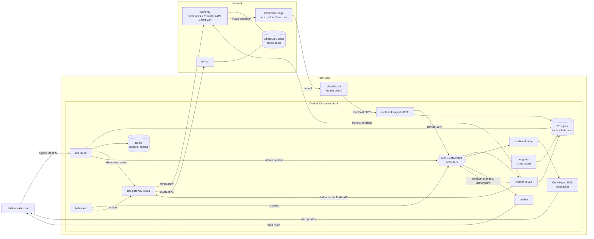

Two directions of traffic matter:

- **Outbound** (your Mac calls the internet): `rpc-gateway` and `indexer` call Alchemy and Infura. This works from any laptop, no setup needed.
- **Inbound** (the internet calls your Mac): Alchemy pushes webhooks. Your laptop sits behind a home/office router with no public address, so this is the only part that needs the tunnel.

---

## 3. Each piece, in plain words

| Piece | What it is | Why Harbour needs it |
| --- | --- | --- |
| **Docker / Docker Compose** | Runs each program in its own isolated container from a recipe (`Dockerfile`), and `deploy/docker-compose.yml` lists all of them, their ports and start order. | One command starts all of them in the right order on any machine, identical to production. Nothing is installed globally on your Mac. |
| **Postgres** | The database. | The source of truth: tracked addresses, every transfer (facts), current balances and NFTs (projections). The extension's screens read from here, not from the chain. |
| **Redis** | Fast in-memory store. | Per-device rate limits and quotas, request nonces (so a signed request can't be replayed), idempotency keys, registration challenges. |
| **NATS JetStream** | A message queue that keeps messages on disk until processed. | Services hand work to each other without waiting: "this address was added", "this webhook arrived", "this balance changed". If the indexer is restarting, messages wait. |
| **migrate** | Runs `migrations/*.sql` once, then exits. | Creates and upgrades tables before any service starts. Runs on every `./run.sh` / `restart`; already-applied migrations are skipped. |
| **api** | The only service the extension talks to. | Registers devices, checks every request's Ed25519 signature, enforces quotas, records which addresses a device tracks, proxies a few safe RPC reads. |
| **rpc-gateway** | The only thing that talks JSON-RPC to Alchemy/Infura. | Spreads load over several keys, fails over when one provider is down, caches finalized results, never lets a provider return 429. |
| **indexer** | The worker. | Backfills history when an address is added, reads balances from chain, syncs NFTs, manages Alchemy webhooks, processes deliveries, gap-fills, repairs reorgs. |
| **price-poller** | A scheduled worker. | Fetches USD prices for tokens someone holds (CoinGecko, then Alchemy), every minute for popular tokens; caches them in Redis; records price history and daily balance snapshots for the chart. The extension never triggers a price call. |
| **webhook-ingest** | A tiny receiver on port 8082. | Accepts Alchemy's webhook POSTs, verifies the signature, saves the raw body, puts it on NATS, answers 200 immediately. |
| **Centrifugo** | Websocket server. | Pushes live balance and transaction updates to the open popup. Clients can only join channels the api signed a token for. |
| **tx-tracker** | A worker. | Watches every transaction sent through Harbour until it is confirmed, failed or dropped, and announces each change. |
| **realtime-bridge** | A relay. | Copies `balance.changed` and `tx.status` events from NATS into Centrifugo channels. The only thing that pushes to clients. |
| **notifier** | A worker. | Sends Web Push notifications ("Received 0.5 ETH", "Transaction confirmed") even when the popup is closed. Payloads are end-to-end encrypted to the browser. |
| **cloudflared** | Runs on your Mac, outside Docker. | Gives port 8082 a public HTTPS address so Alchemy can reach webhook-ingest. Development only. |
| **Alchemy** | Hosted blockchain data provider. | RPC (through the gateway), transfer history (Transfers API), NFT lists, and webhooks that push new activity. |
| **Infura** | Second RPC provider. | Failover: if Alchemy has a bad day, reads keep working. |

### Ports at a glance

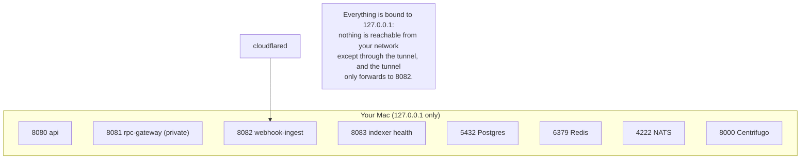

---

## 4. Why the tunnel, and how it works

Alchemy needs an `https://` URL to POST to. `localhost:8082` only means something on your Mac. Your router does not let the internet in. The tunnel solves this without opening any port:

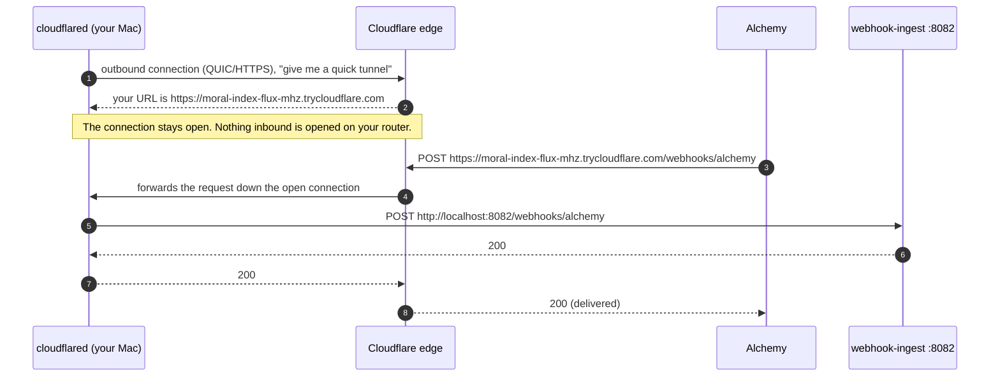

Things that follow from this:

- **The terminal running `cloudflared tunnel --url http://localhost:8082` must stay open.** Close it and Alchemy's deliveries fail.
- **The quick-tunnel URL is random and changes every time cloudflared restarts.** That is why `WEBHOOK_PUBLIC_URL` lives in `.env` and you update it after a restart. The indexer notices the new URL and moves the webhook automatically (see section 7).
- **Nothing breaks if the tunnel is down for a while.** Missed deliveries are recovered by gap-fill (section 8). The tunnel only makes updates *fast*.
- **Production doesn't use a tunnel.** On AWS (phase 7) webhook-ingest sits behind a load balancer with a fixed domain, e.g. `https://hooks.harbour.example/webhooks/alchemy`.

---

## 5. What `./run.sh` actually does

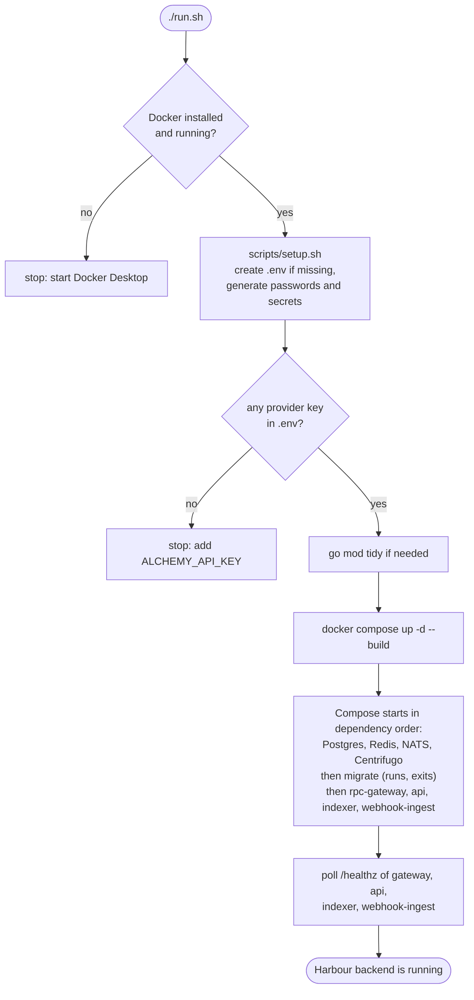

| Command | When you use it | What happens underneath |
| --- | --- | --- |
| `./run.sh` | First start, or after `down` | The flowchart above. |
| `./run.sh restart` | After pulling or changing code/config | Rebuilds the Go images, runs `migrate`, recreates the four Go services. Databases keep their data. |
| `./run.sh status` | "Is everything up?" | Container list, each `/healthz`, per-provider gateway table, and whether your **public tunnel URL reaches webhook-ingest**. |
| `./run.sh logs` | Watching what happens | Follows the logs of api, rpc-gateway, indexer, webhook-ingest. |
| `./run.sh smoke` | Quick sanity check | Registers a test device (like the extension would) and reads a block on Base and a balance on Ethereum through the API and gateway. |
| `./run.sh verify CHAIN ADDR` | "Are stored balances right?" | Tracks the address, waits for its backfill, then compares every stored balance with a fresh single read from chain at the same block. |
| `./run.sh inspect CHAIN ADDR` | "What does Harbour know about this address?" | Prints its tracking state, webhook, last 10 transfers, balances and recent deliveries straight from Postgres. |
| `./run.sh test` | Before committing | Unit tests, then integration tests against the running Postgres/Redis. |
| `./run.sh down` | Done for the day | Stops containers; data is kept in Docker volumes. |
| `./run.sh reset` | Start from zero | Stops and **deletes** local database, Redis and NATS data. |

### Why `.env` and `scripts/setup.sh`

`.env` holds everything secret or machine-specific: provider keys, generated passwords, `ADDRESS_LINK_ENCRYPTION_KEY`, `ALCHEMY_NOTIFY_TOKEN`, `WEBHOOK_PUBLIC_URL`. It is git-ignored. `setup.sh` fills in only the *empty generated* values and never overwrites what you set. Compose passes `.env` into the containers; the Go programs also read it when you run them on the host (`go run ./cmd/...`).

---

## 6. Flow: the extension adds an address

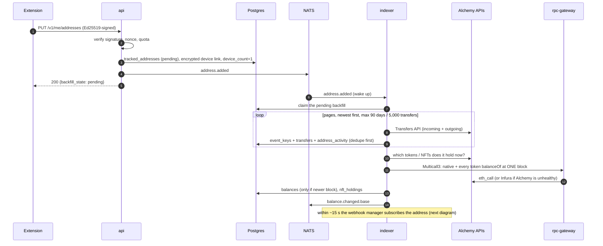

Why balances come from the chain and not from adding up transfers: gas fees, L2 fees and rebasing tokens (stETH) change balances without a transfer event. Summing transfers would drift; reading from chain at one block is exact. `./run.sh verify` proves this against the live chain.

---

## 7. Flow: keeping Alchemy webhooks in sync

The indexer owns the webhooks; you never create them by hand. Every 15 seconds (and right after an address is added) it reconciles:

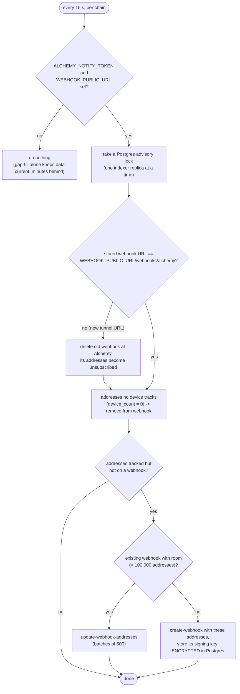

The **signing key** Alchemy returns on create is what webhook-ingest uses to prove a delivery really came from Alchemy. It is stored encrypted with a key derived from `ADDRESS_LINK_ENCRYPTION_KEY`, never in `.env` or git.

---

## 8. Flow: a live transfer arrives

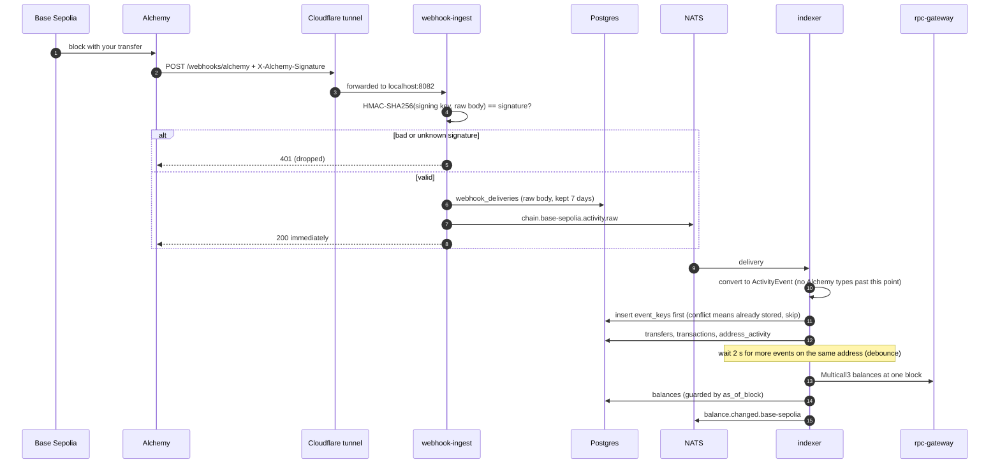

**Why replays are harmless:** Alchemy delivers *at least once*, so the same webhook can arrive twice. Each transfer has a key `(chain, tx_hash, event_ref)` such as `log:110`. The key is inserted into `event_keys` first, in the same database transaction as the transfer; if it already exists, nothing else is written. That is exit test #1: replaying every webhook twice changes nothing.

---

## 9. Flow: what if a webhook is missed? (gap-fill)

Alchemy only retries a failed delivery for about 10 minutes. If your laptop slept, the tunnel died or webhook-ingest was stopped longer than that, those deliveries are gone. Gap-fill is the guarantee; webhooks are just the fast path.

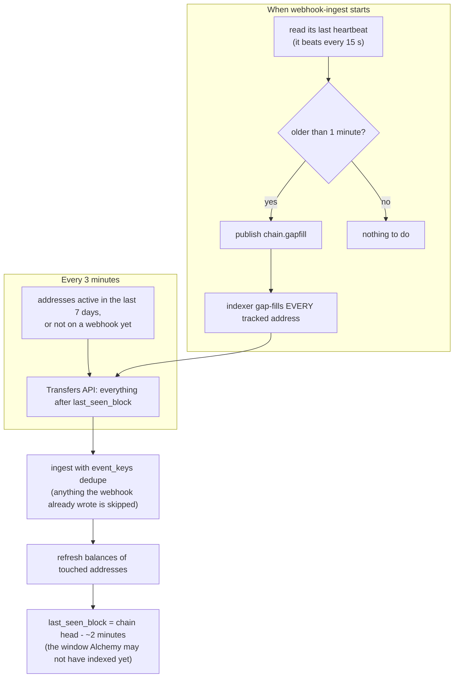

`last_seen_block` means "everything up to here is definitely stored". Only gap-fill moves it, never webhooks, because webhooks don't prove completeness. That is exit test #2: stopping ingest for 30 minutes loses nothing.

---

## 10. Flow: reorgs and finality

A chain can briefly disagree with itself: a block you saw gets replaced (a *reorg*), and its transactions may vanish or move to another block. Until a block is **finalized** (about 15 minutes on Ethereum; on Base, when its batch is final on Ethereum), stored rows are `confirmed`, not `finalized`.

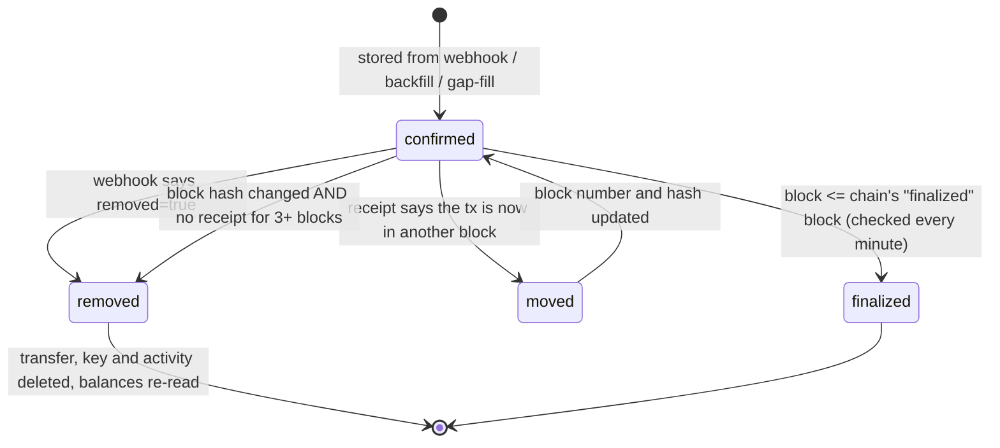

The repair job is cheap: it compares one block hash per distinct recent block and only fetches a transaction receipt when something doesn't match (or when a backfilled row has no hash yet).

---

## 10b. Flow: the extension opens the home screen (phase 5)

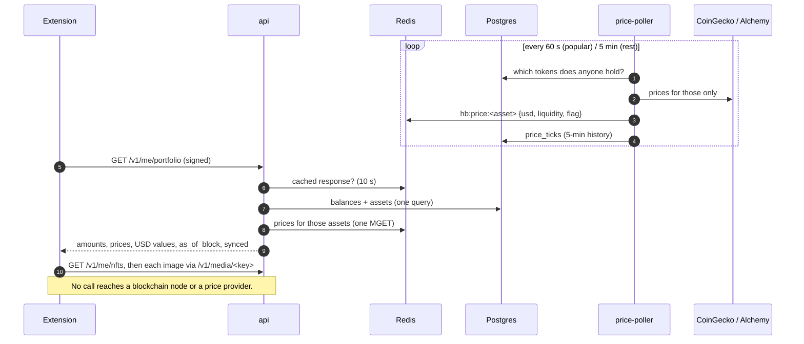

## 10c. Flow: sending a transaction (phase 6)

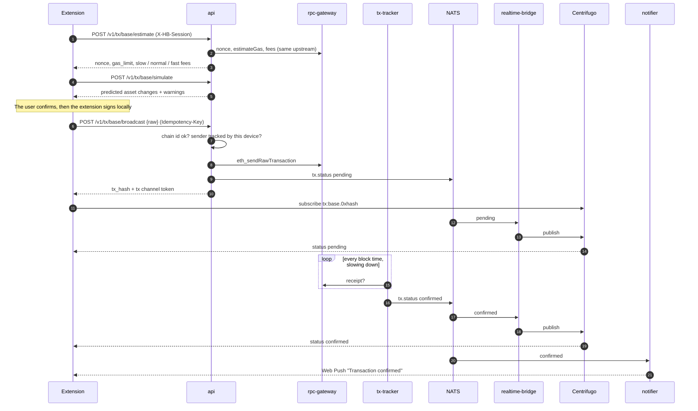

Balances follow the same road: the indexer's `balance.changed` goes through `realtime-bridge` to `balances:<chain>.<address>`, and incoming transfers (`activity.new`) become a push from `notifier`.

## 10d. The extension and the backend (harbour-wallet-v3)

The v3 extension (copied from v2, which stays untouched) offers only **Sepolia and Base Sepolia**, and gets everything for them from the Harbour API. The backend serves the same two (`ENABLED_CHAINS=sepolia,base-sepolia` in `backend/.env`).

| In the extension | Comes from |
| --- | --- |
| Home balances and tokens | `GET /v1/me/portfolio` (tokens the indexer found appear automatically; spam is hidden) |
| Activity | `GET /v1/me/history`, merged with your own just-sent transactions |
| NFTs | `GET /v1/me/nfts`, images through Harbour's media proxy |
| Any RPC call (gas, nonce, dApp reads) | `POST /v1/rpc/<chain>` (allow-listed, signed) |
| Sending | signed in the extension, then `POST /v1/tx/<chain>/broadcast` |
| Live updates while the popup is open | Centrifugo websocket, tokens from `POST /v1/realtime/token` |
| Notifications when it's closed | Web Push (`PUT /v1/me/push`) from the notifier |

On first start the service worker creates a device key (non-extractable WebCrypto Ed25519, kept in IndexedDB), solves the proof-of-work and registers. Every wallet address is tracked automatically after you create, import or unlock a wallet. Seeds and private keys never leave the extension.

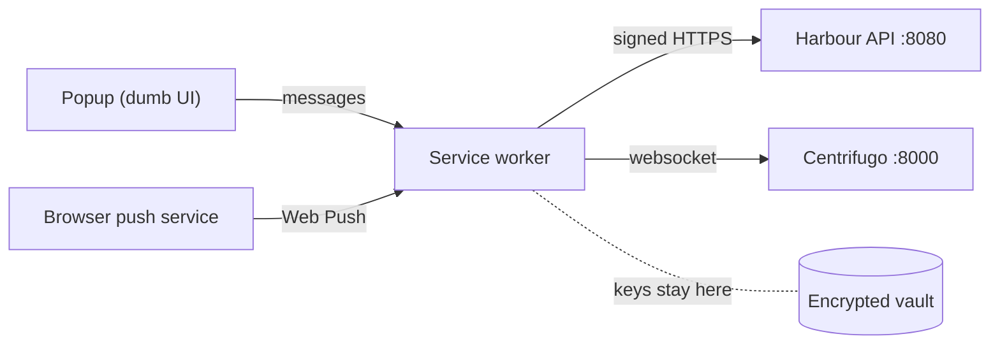

Run it: start the backend (`cd backend && ./run.sh`), then in `harbour-wallet-v3` run `npm install && npm run build` and load `dist/` in `chrome://extensions` (Developer mode → Load unpacked). Point a non-local build at another API with `VITE_HB_API_URL` in `.env.production`.

## 11. Development vs production

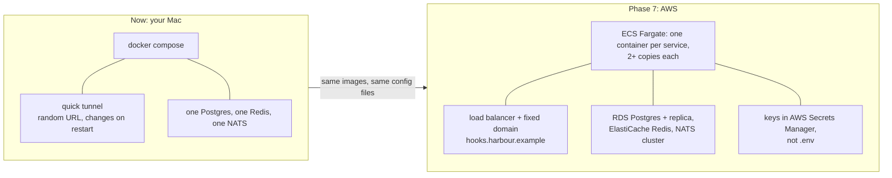

The code doesn't change between the two: only `.env` values (URLs, secrets) and where the containers run.

---

## 12. Troubleshooting map

| Symptom | Likely cause | Fix |
| --- | --- | --- |
| `./run.sh` stops at "Docker is not running" | Docker Desktop closed | Open Docker Desktop, rerun. |
| `status` says public URL **NOT reachable** | cloudflared closed, or URL changed | Restart `cloudflared tunnel --url http://localhost:8082`, put the new URL in `.env`, `./run.sh restart`. |
| `logs` shows `create webhook` errors | `ALCHEMY_NOTIFY_TOKEN` wrong/empty | Copy the Auth token from Alchemy → Webhooks, update `.env`, restart. |
| `logs` shows `rejected delivery ... bad signature` | Delivery from a webhook Harbour doesn't know (e.g. one you created by hand) | Let the indexer manage webhooks, or add `id:key` to `ALCHEMY_WEBHOOK_SIGNING_KEYS`. |
| New transfer shows up only after a few minutes | Webhook path down; gap-fill caught it | Check `status` (tunnel) and `logs` (webhook-ingest). Data is still correct. |
| `verify` says MISMATCH | A balance differs from chain | Rerun once (the chain may have moved between reads); if it persists, send the output. |
| `watch` prints nothing after a send | realtime-bridge or Centrifugo down | `./run.sh status`, then `./run.sh logs` (realtime-bridge errors name the cause). The tx still settles: `GET /v1/tx/<chain>/<hash>`. |
| `send` says `not_tracked` | Sender isn't tracked by this test device | `./run.sh send` tracks it first; with `hbdevice send` add it via `hbdevice addresses`. |
| Containers fail with "permission denied" on config | Host file permissions | Already handled in the Dockerfile; `./run.sh restart`. |

---

## 13. Where things live

```
harbour-wallet-v3/
  HOW-IT-WORKS.md          <- this file
  backend/
    run.sh                 <- the commands above
    .env                   <- your secrets (git-ignored)
    config/                <- chains.yaml, providers.yaml, api.yaml (no secrets)
    deploy/docker-compose.yml
    cmd/                   <- one folder per program: api, rpc-gateway, indexer, webhook-ingest, price-poller,
                              tx-tracker, realtime-bridge, notifier, migrate, hbdevice, hbverify, hbkeys
    internal/              <- service code (never imports a provider SDK)
    adapters/              <- the only place that knows Alchemy/Infura exist
    migrations/            <- SQL applied by migrate
    clients/ts/            <- the extension's device-signing client
```
